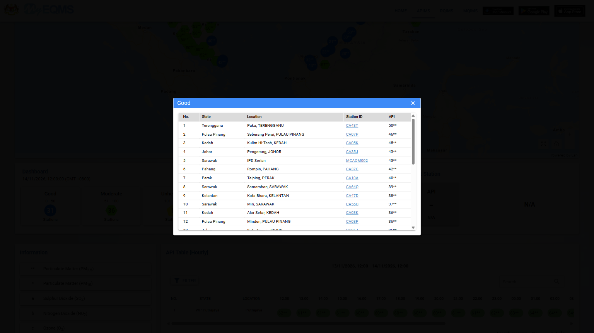
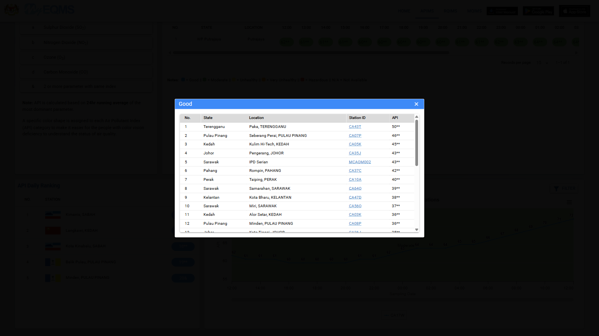
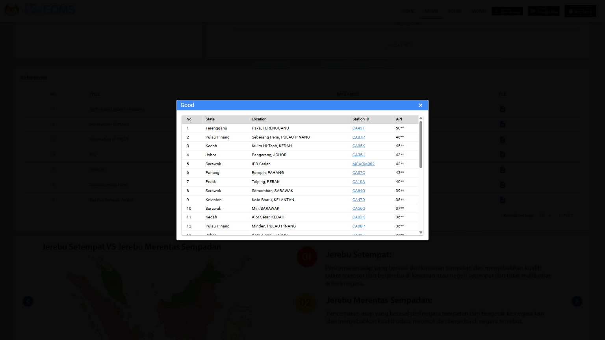
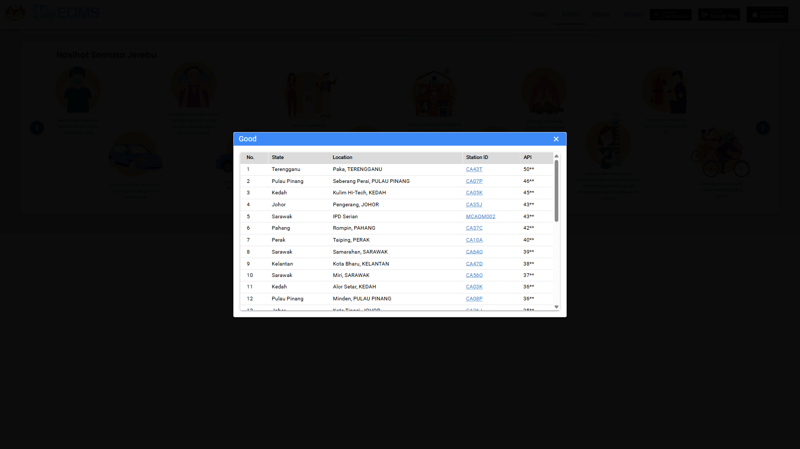
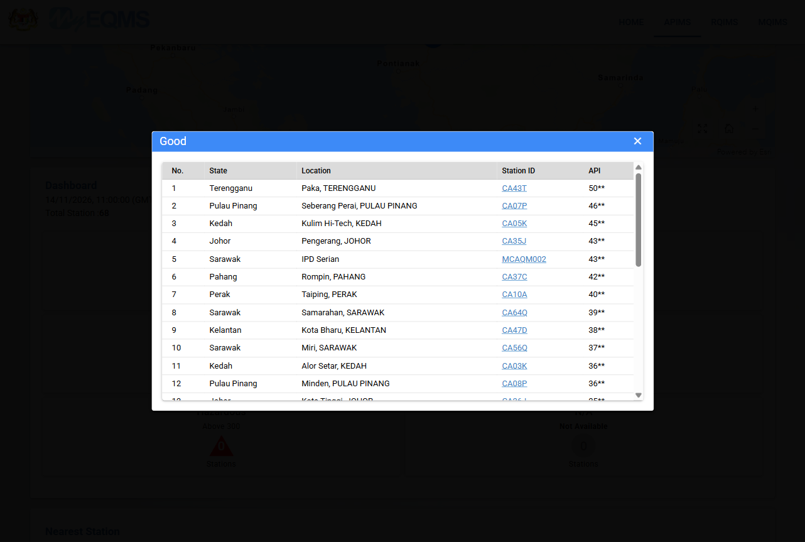
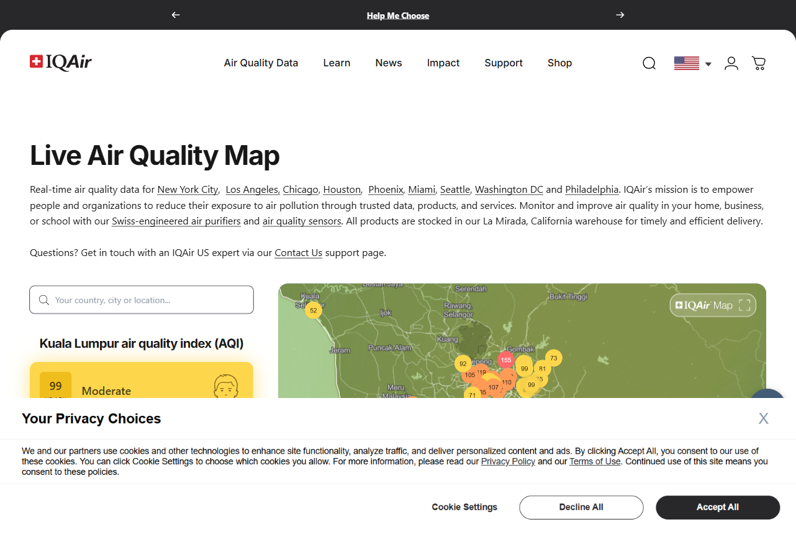
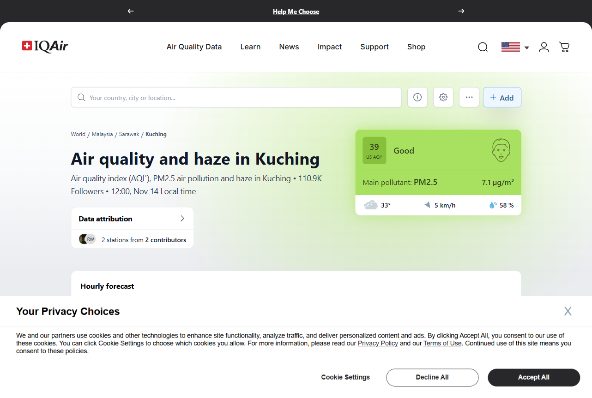
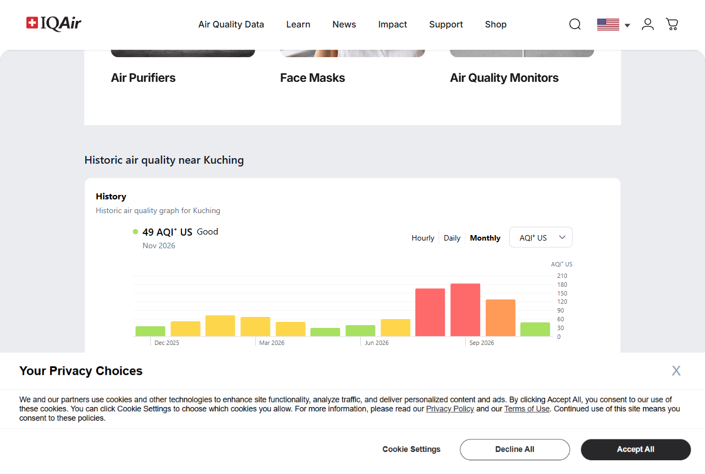
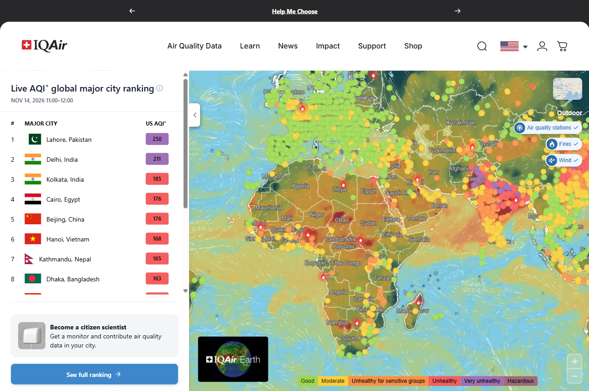

# APIMS / IQAir

URL: https://apims.doe.gov.my/ (redirects to https://eqms.doe.gov.my/APIMS/main) · https://www.iqair.com/ · Audited: 2026-11-14 · Tier: 2

Focus: how haze impact is communicated to the public — color scales and AQI/API tiers. No account needed for either site. APIMS has **no fire data** and IQAir's public pages have **no fire data** (a "Fires" layer toggle exists on the IQAir map, observed but not exercised), so all three fire walkthrough tasks below are "not supported" and were replaced by their haze analogues, per the Tier-3-style substitution rule.

## Summary

APIMS is Malaysia DOE's Air Pollutant Index system, now a module ("APIMS" tab) of the MyEQMS portal at eqms.doe.gov.my; it answers "how bad is the air right now, statewide" with six tier cards (name + value range + station count), a tier-tabbed station list, an hourly colour-chip table and a 24-hour trend chart — plus an explicit colour-blind shape encoding. IQAir is a global commercial AQI platform whose city page (tested on Kuching) is the reference for public-facing haze communication: one number + colour + tier word, dominant pollutant, a WHO-guideline comparison, tier-specific health actions, 7-day forecast, 12-month history, station/city rankings, and named data contributors (DOE Malaysia + a community sensor). For IGNIS, APIMS supplies the tier-card and legend patterns (inherit the ranges-on-cards and shape+colour encoding); IQAir supplies the plain-language impact framing and multi-source attribution; APIMS's fixed-viewport layout that clips its own content is the anti-pattern to avoid.

## Task walkthrough

| Task | Steps / clicks | Result | Notes |
|---|---|---|---|
| Hotspots in West Kalimantan last September | — | not supported | No fire data in either app. Haze analogue "is it hazy in Kuching now?": **IQAir 2 clicks** (click search box → type "Kuching" → click suggestion; the suggestion click was intercepted in my automation by an invisible overlay guard, so I completed via the same suggestion's URL — user path is 2 clicks). Answer on landing: US AQI⁺ 39 "Good", main pollutant PM2.5 7.1 µg/m³, "1.4× the WHO annual guideline". **APIMS 1 click** (APIMS tab after the apims.doe.gov.my → MyEQMS redirect; the click did not register in automation, so I loaded /APIMS/main directly — same destination): dashboard shows all 68 stations by tier; the "Good" tier tab lists Kuching (CA65Q) API 34 with PM2.5 superscript. All 11 Sarawak stations were "Good" (20–43) on 14/11/2026 11:00 GMT+8. |
| Which months burn most, year over year | — | not supported | No fire data. Haze analogue "which months are haziest": IQAir **+1 click** ("Monthly" tab in the History section, 3 clicks total from home) → 12-month line chart Dec 2025–Nov 2026, y-axis 0–210, latest point 49 "Good" — seasonality readable at a glance with no further interaction. APIMS: not supported — the page exposes only a rolling 24 h table and a 25-point hourly trend chart; no monthly or seasonal view. |
| 2023 vs 2019 | — | not supported | Neither app offers year-vs-year comparison. IQAir history is a rolling 12-month window with Hourly/Daily/Monthly tabs and a metric selector (AQI⁺ US / PM2.5 / O₃) but no year picker or overlay. APIMS has no historical UI at all beyond 24 h. |

## Checklist

Scores 0–2 per user: R = first responder, S = scientist, L = land manager. N/A where the item cannot apply (no fire data) or was not tested.

| # | Item | Observation | R | S | L | Verdict |
|---|---|---|---|---|---|---|
| 1 | First screen | APIMS: one dashboard — 6 tier cards with counts ("Good 0–50: 30 Stations" … live-updating), Esri map, tier-tabbed station list; answers "how bad overall" with zero clicks. IQAir home: geolocated city AQI card (Kuala Lumpur) + embedded world map. | 2 | 1 | 1 | adapt |
| 2 | Time controls | APIMS: fixed rolling 24 h window (25 hourly columns "13/11 11:00 – 14/11 11:00" + 25-point chart); no date picker, presets or playback. IQAir: Hourly/Daily/Monthly history tabs; 3-day hourly and 7-day daily forecast; no date picker or playback on public pages. Gaps show as missing cells/values, not marked explicitly. | 1 | 1 | 1 | adapt |
| 3 | Space controls | APIMS: map pan/zoom, tier tabs list stations (State/Location/Station ID/API), but the hourly table is locked to its default station (W.P. Putrajaya) — I found no operable state dropdown (the filter widgets are invisible to the accessibility layer and the visible Search input cannot receive focus). IQAir: search box with autocomplete (country → state → city), breadcrumbs World/Malaysia/Sarawak/Kuching, map zoom. | 1 | 1 | 1 | adapt |
| 4 | Hotspot display | N/A — neither app shows fire detections. Notable adjacency: IQAir's map control panel has a "Fires" toggle next to "Air quality stations" and "Wind" (control observed; layer not exercised). | N/A | N/A | N/A | adapt (concept: co-locating fire location with impact measure) |
| 5 | Sensor handling | APIMS: one network (DOE stations, IDs like CA65Q/MCAQM002); each value carries a dominant-pollutant superscript (** PM2.5, * PM10, a SO₂, b NO₂, c O₃, d CO); API = 24 h running average of the dominant parameter. IQAir: "2 stations from 2 contributors" — Department of Environment of Malaysia + KOTA PADAWAN MALL community sensor, each with a profile link; metric selector switches the whole chart between AQI⁺ US / PM2.5 / O₃. No confidence levels anywhere. | 1 | 2 | 1 | adapt |
| 6 | Color and legend | APIMS: 5 tiers with ranges printed everywhere — Good 0–50 blue rgb(33,150,243), Moderate 51–100 green rgb(76,175,80), Unhealthy 101–200 yellow rgb(255,235,59), Very Unhealthy 201–300 orange rgb(255,152,0), Hazardous >300 red rgb(244,67,54); table cells use tinted chips (e.g. Moderate rgb(124,222,107)); a stated shape-per-tier encoding "for people with color vision deficiency". IQAir: US-style 6 tiers — Good green rgb(156,216,78), Moderate yellow rgb(250,207,57), USG orange rgb(249,144,73), Unhealthy red rgb(246,94,95), Very Unhealthy (label present; hex not captured), Hazardous brown rgb(160,106,123); legend shows colour + label but no numeric ranges. Both on light basemaps. | 2 | 1 | 1 | inherit (APIMS ranges-on-cards + shape encoding; avoid IQAir's range-less legend) |
| 7 | Linked views | APIMS: dashboard tier → station list linked; hourly table and trend chart share one title/selection ("Data Trend for W.P. Putrajaya Stations", per-station series toggles like "Show CA17W"); no map↔chart linking observed. IQAir: map/rankings → city page; history chart hover reports value + tier + time window; city page → station pages. | 1 | 2 | 1 | adapt |
| 8 | Comparison | No year-vs-year anywhere. Rankings only: IQAir "Real-time Malaysia AQI⁺ city ranking" (KL 89 … Kota Samarahan 39) and station ranking (Kuching 34, KOTA PADAWAN MALL 28); APIMS "API Daily Ranking" top-5 (Kimanis 16 … Minden 20 — ascending, i.e. cleanest-first, which reads as a mislabel). | 1 | 1 | 1 | adapt |
| 9 | Explaining the data | APIMS: inline methodology ("API is calculated based on 24hr running average of the most dominant parameter", colour-blind note, pollutant key) + 7 dated reference PDFs including "Transboundary Haze" and a Malay advisory ("Nasihat Semasa Jerebu"). IQAir: WHO-guideline multiple ("1.4× the WHO annual PM2.5 guideline"), plain-language FAQ ("The current air quality in Kuching is considered good…"), data-attribution dialog, ranking-methodology link. | 1 | 2 | 1 | inherit (inline method note directly under the data) |
| 10 | Mobile | Not tested — I browsed at desktop size only and did not resize the user's window or emulate a phone. IQAir pages are responsive-styled; APIMS layout is fixed-size (see #13). | N/A | N/A | N/A | not tested |
| 11 | Export/share | APIMS: reference PDFs only; no CSV/PNG export, no shareable state (URL is static). IQAir: shareable city URLs, "Add to favorites" and alerts behind login, app/Earth promo links; no public CSV. Neither offers data download on the audited pages. | 0 | 1 | 1 | adapt |
| 12 | Language and locale | APIMS: English UI; only the advisory PDF is in Bahasa Malaysia; dates DD/MM/YYYY, times GMT+8. IQAir: first-visit locale dialog (offered "Malaysia" vs other), region/country chooser in header; page copy in English with US-style "Nov 14" local-time labels. Full language lists not enumerated. | 1 | 0 | 1 | adapt |
| 13 | Performance | Measured via `performance.getEntriesByType` in the page: APIMS DOMContentLoaded 3.8 s, load 6.6 s, 185 requests, 441 KB. IQAir city page: DCL 1.9 s, load 2.9 s, 377 requests, 1.3 MB; IQAir map: DCL 1.0 s, load 1.3 s, 194 KB (tiles stream separately). Critical APIMS defect: fixed-height layout — page height locks to the viewport and content below the fold (API Daily Ranking, Data Trend Chart, References, infographic carousel at y≈1500–2900) is unreachable: no page scroll (html/body scroll locked; forcing overflow did not help) and the FILTER toggle does not reveal it; the layout also assumes a ~1980 px-wide screen (table row spans 1913 px), so at a 1282 px window the right side is clipped. | 1 | 1 | 1 | adapt (weight targets fine; avoid the fixed-viewport layout) |

## Screenshots

All PNGs in `img/apims-iqair/`. Disclosure: shots 01–05 were taken after emulating a 1920×1080 viewport on my own APIMS tab (the site clips at the physical 1282-px window); for 02–04 the page's main container was translated upward to bring the sections into view because the site provides no scroll. The content shown is the page's own, unmodified.

-  APIMS dashboard: six tier cards with ranges and live station counts, Esri map, "Good" tier station list beneath (1920×1080 emulation).
-  API Table [Hourly]: 25 hourly columns of tier-coloured chips with pollutant superscripts; the Notes legend maps each colour to Good/Moderate/Unhealthy/Very Unhealthy/Hazardous.
-  Data Trend Chart: Highcharts line, 25 hourly points, per-station series toggles, title bound to the selected station.
-  API infographic carousel: public-facing tier explanation with the colour-and-shape encoding for color-vision deficiency.
-  The same page at a real 1282-px laptop viewport: right side and everything below the map are clipped with no scroll — the defect to avoid.
-  IQAir home: geolocated Kuala Lumpur AQI card above the embedded live map; search-first navigation.
-  Kuching city dashboard: AQI⁺ 39 "Good" dial, PM2.5 7.1 µg/m³ as main pollutant, contributor attribution (DOE Malaysia + community station), WHO-guideline multiple and tier health recommendations.
-  History section on "Monthly": 12-month AQI line (Dec 2025–Nov 2026) with Hourly/Daily/Monthly tabs and metric selector — the time-binned-at-a-glance pattern.
-  IQAir full map: world ranking sidebar, and the control panel pairing "Air quality stations", "Fires" and "Wind" layers; colour-scale legend strip at the bottom (labels without numeric ranges).

## Patterns worth taking

- **Tier cards with counts and ranges**: APIMS's six cards ("Good 0–50 — 30 Stations") answer "how bad is it overall, where do I sit" before any click, and the count updates live each hour. IGNIS: a Burning Phase summary strip over the Burning Calendar ("Peak burning — 412 Harmonized Hotspot Count — March"), with ranges printed on the legend. Serves first responders and land managers; calendar/region panel.
- **Colour + shape dual encoding**: APIMS assigns a distinct shape per API tier and says so ("to make it easier for the people with color vision deficiency"). IGNIS: give every Burning Phase both a colour and a marker shape so the calendar and heatmap stay readable for colour-blind users. Serves all users; calendar + heatmap legends. (Inherit.)
- **Ranges on the legend, not just colours**: APIMS prints 0–50/51–100/101–200/201–300/>300 on cards, legend and infographic; IQAir's map legend shows only colour+label, leaving thresholds to memory. IGNIS: always label Burning Phase cutoffs next to the colour. Serves all users; all views. (Inherit APIMS; avoid IQAir's range-less legend.)
- **Hourly colour-chip strip**: APIMS's rolling 24 h table is time-binned data at a glance — one row per station, 25 tier-coloured cells, superscript for the dominant parameter. IGNIS: a per-Area-of-Interest Hotspot strip (day cells coloured by Burning Phase, count in the cell) as the daily-resolution complement to monthly calendar cells. Serves responders; calendar.
- **Current value + plain-language impact**: IQAir pairs the number with tier word, dominant pollutant, "1.4× the WHO guideline", and an action ("Enjoy outdoor activities / Open your windows"). IGNIS: a haze-impact panel for Sarawak — current AQI tier beside the Harmonized Hotspot Count, plus a Typical-Year anchor ("3× a Typical March"). Serves the public/Impact-angle users and responders; region panel. (Adapt.)
- **Multi-source attribution with contributor links**: IQAir's "2 stations from 2 contributors (Department of Environment of Malaysia, KOTA PADAWAN MALL)" names every data source next to the number it feeds. IGNIS: provenance chips for MODIS/VIIRS and a note that counts are harmonized — the Overlap Period calibration story told where the number appears. Serves scientists; heatmap + about/method. (Adapt.)
- **Granularity tabs + metric selector on history**: IQAir's Hourly/Daily/Monthly tabs and the AQI⁺/PM2.5/O₃ y-axis switch let one chart serve multiple questions. IGNIS: the Burning Calendar's history grid with month/week/day granularity and a Harmonized Hotspot Count vs. per-sensor toggle. Serves scientists and land managers; calendar. (Adapt.)
- **Ranking tables for comparison**: IQAir's "Real-time Malaysia AQI⁺ city ranking" and station ranking make cross-place comparison instant. IGNIS: "most-burning provinces this month" ranked list beside the heatmap. Serves land managers; region panel. (Adapt.)
- **Fires-and-impact layer coupling**: IQAir's map puts "Fires" and "Wind" toggles beside "Air quality stations" — cause and consequence on one canvas. IGNIS: hotspot layer + haze/AQI overlay in the heatmap view. Serves responders; heatmap. (Adapt; layer observed, not exercised.)
- **Methodology inline plus a document shelf**: APIMS states the averaging rule and pollutant key directly under the data and offers dated PDFs (incl. "Transboundary Haze"). IGNIS: a one-line method note under every chart plus an about/method page with the harmonization method. Serves scientists; about/method. (Inherit.)
- **Fixed-viewport dashboard (anti-pattern)**: APIMS locks page height to the viewport, hides half its own content (ranking, chart, references, infographic unreachable below the fold, no scroll at 768p or 1080p) and hides its state filter from keyboard/screen-reader users. IGNIS: responsive, scrollable layouts with controls in the accessibility tree. (Avoid.)
