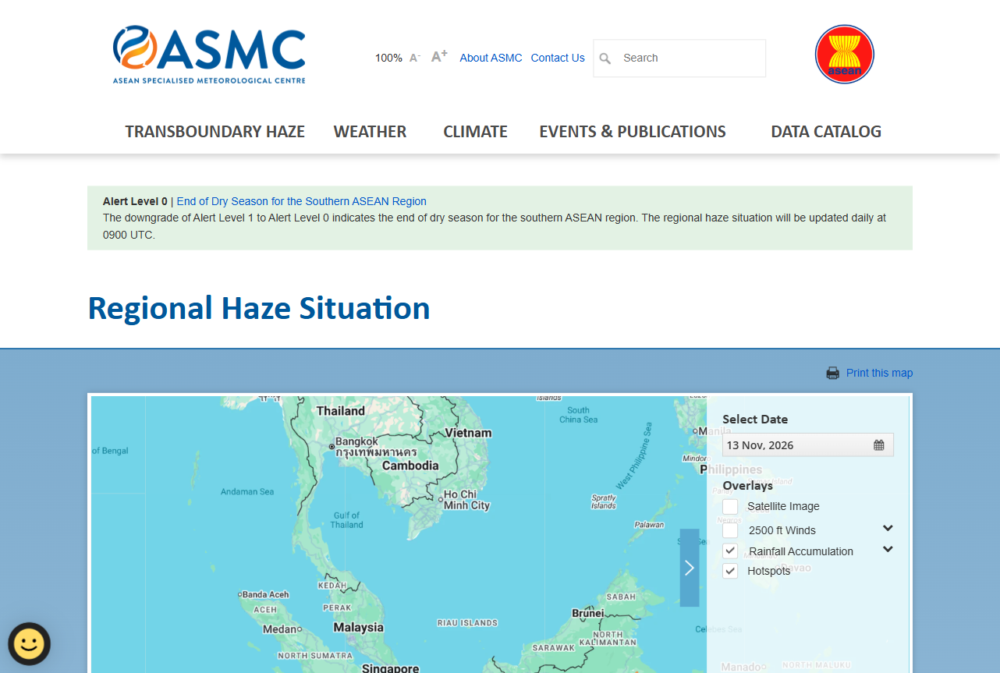
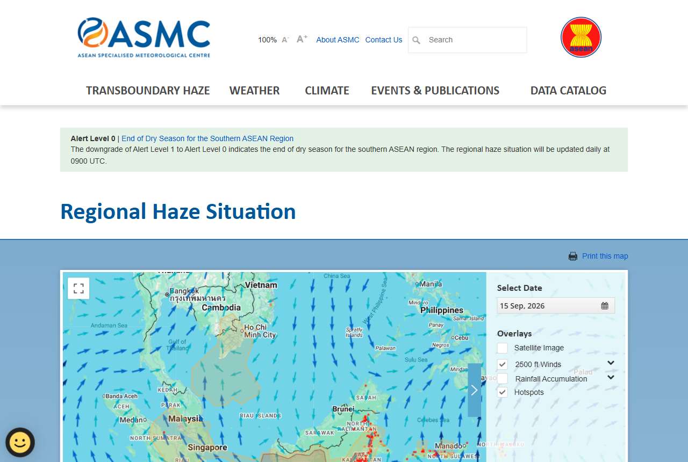
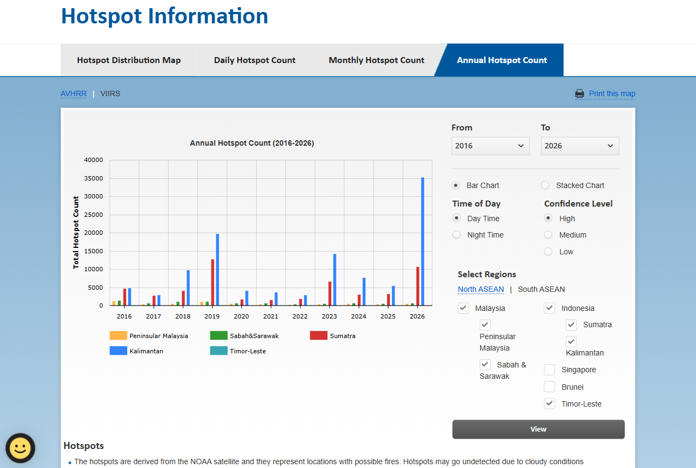
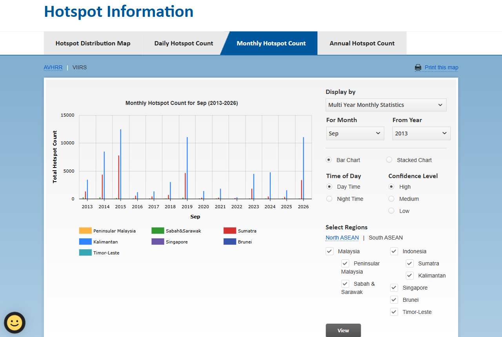
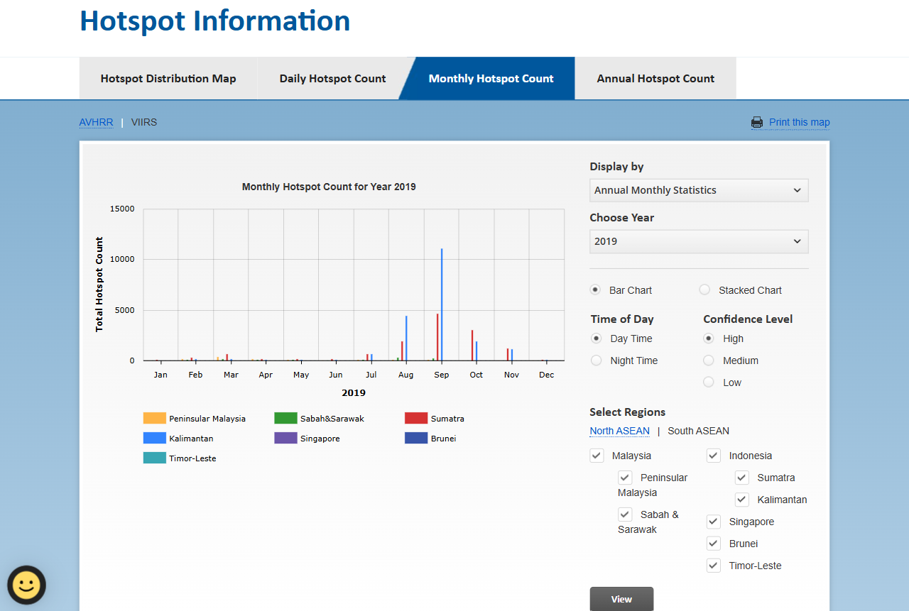
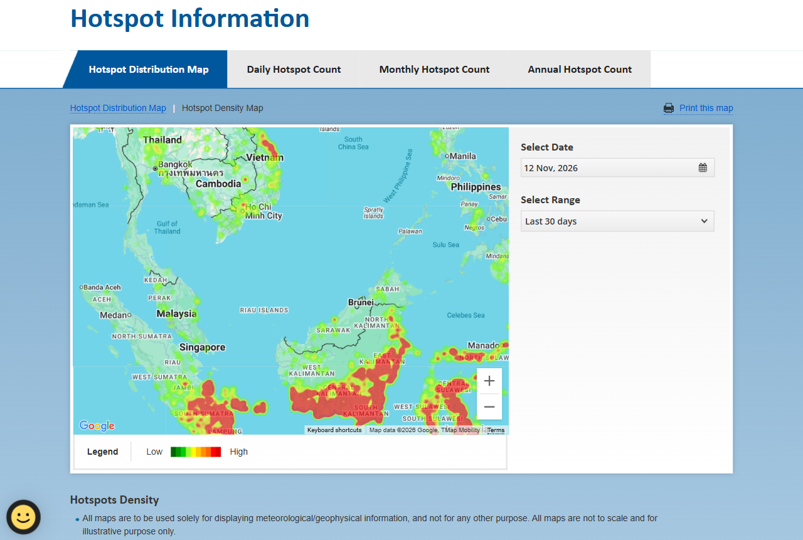
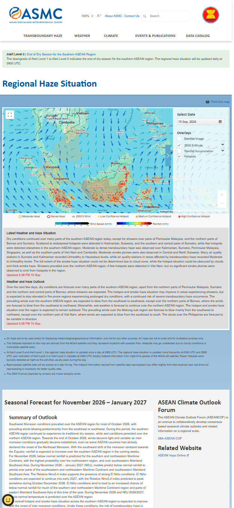
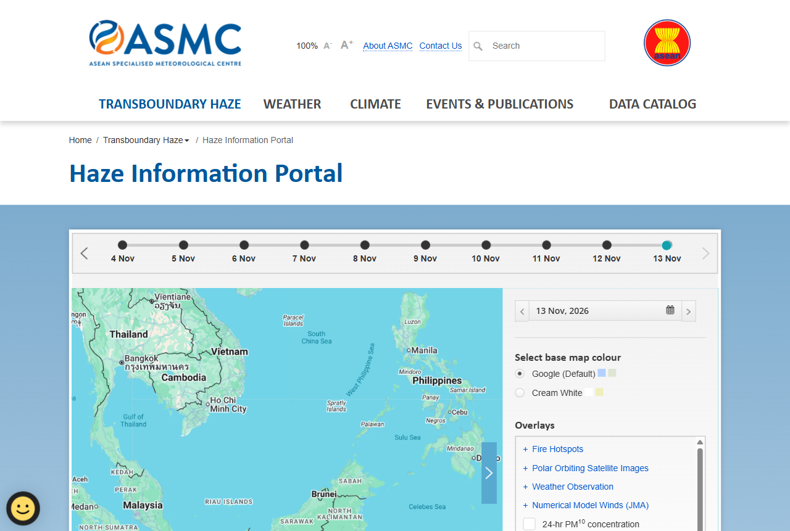

# ASMC (ASEAN Specialised Meteorological Centre) hotspot and haze maps
URL: https://asmc.asean.org/ · Audited: 2026-11-14 · Tier: 1

## Summary
ASMC is the regional authority's public face for transboundary haze: a map-first "Regional Haze Situation" home (daily hotspots, haze shading, 2500 ft winds, rainfall on a Google Maps base), a Hotspot Information section with Daily/Monthly/Annual Hotspot Count charts, a Hotspot Density Map, and a Haze Information Portal that layers hotspots with PM10, peatlands and satellite imagery. Its two best offerings for IGNIS are the daily haze narrative that sits right under the map (Hotspots + smoke + air quality explained in prose, updated daily) and the sensor-provenance honesty (AVHRR | VIIRS chart twins, with an explicit note that counts come from Suomi-NPP for 2013–2018 and NOAA-20 from 2019 — exactly the discontinuity IGNIS's Harmonized Hotspot Count and Overlap Period exist to fix). It does not merge sensors and it offers no calendar or year-over-year seasonality view; every comparison is a chart you must configure dropdown-by-dropdown.

## Task walkthrough
| Task | Steps / clicks | Result | Notes |
|---|---|---|---|
| Hotspots in West Kalimantan last September | 4 (open date field, prev, prev, pick 15 Sep) + 4 double-click zooms | Partial: map shows dense red Hotspot dots over Kalimantan and grey haze shading for 15 Sep 2026; the daily narrative names "Kalimantan" in prose | Home map's date picker only reaches back to 17 Aug 2026 (a ~90-day window), so "last September" was only just reachable at audit time. Typed date entry is rejected (input resets to current date); calendar clicks only. No region search, no draw-an-box, no admin-boundary overlay — "West Kalimantan" can only be eyeballed by zooming. |
| Which months burn most, year over year | 5 per year (Display by → Annual Monthly Statistics, Choose Year → e.g. 2019, View) | Supported but tedious: 2019 chart shows the southern ASEAN shape — Sep peak (Kalimantan ≈ 11,000, Sumatra ≈ 4,700), Aug secondary, Oct–Nov tail, Jan–Jul near zero | Answering "year after year" means repeating the 5 clicks per year, or flipping the transposed Multi Year view 12 times (once per month). There is no single seasonality-at-a-glance view — the gap IGNIS's Typical Year fills. |
| 2023 vs 2019 | 7 (Display by → Multi Year Monthly Statistics, For Month → Sep, From Year → 2013, View) | Yes, directly comparable in one chart: Sep 2019 ≈ 11,000 vs Sep 2023 ≈ 1,800–2,000 (high-confidence default filter), Sep 2015 ≈ 12,400 tallest | The Multi Year mode is month-first: one month's bar per year, from a chosen start year. It answers single-month comparisons well, but two whole years cannot be overlaid, and counts default to High-confidence Hotspots only — easy to misread as all detections. |

## Checklist
| # | Item | Observation | Responder 0-2 | Scientist 0-2 | Land mgr 0-2 | Verdict |
|---|---|---|---|---|---|---|
| 1 | First screen | Map-first home under an Alert Level 0 banner; "Latest Weather and Haze Situation" prose with timestamp sits right under the map. Heavy load: ~250 resources, ~2.4 MB, DOMContentLoaded ≈ 9.3 s, load ≈ 18 s on this connection. | 2 | 1 | 1 | adapt |
| 2 | Time controls | Single-day Bootstrap calendar on home (reachable range only 17 Aug–14 Nov 2026); GIS portal adds prev/next-day steppers and a rolling 10-day date-chip strip; Density Map has Select Range; charts are Daily/Monthly/Annual pages. No playback or presets; data gaps explained in prose ("full extent … could not be determined due to cloud cover") plus a reprocessed-data caveat. | 1 | 1 | 1 | adapt |
| 3 | Space controls | None on the maps: no search, no draw-a-box, no boundary overlay — pan/zoom eyeballing only. Region selection exists only in the charts, as fixed preset checkboxes (Sumatra, Kalimantan, Sabah & Sarawak, Peninsular Malaysia, Singapore, Brunei, Timor-Leste; North/South ASEAN switch). | 0 | 1 | 1 | avoid |
| 4 | Hotspot display | Uniform red dots at every zoom — no clustering, no density behaviour in-page (cluttered at region zoom; dots stay dots when zoomed). A separate Hotspot Density Map page renders a Google heatmap with a Low→High gradient legend, date and range selectors. | 1 | 1 | 1 | adapt |
| 5 | Sensor handling | AVHRR \| VIIRS exist as separate page twins (never merged). VIIRS page states: 2019+ counts from NOAA-20, 2013–2018 from Suomi-NPP; home notes night passes (NOAA-20, 0300 UTC) appear only at Alert Level 2–3. Confidence Low/Medium/High appears both in the map legend and as a chart filter (High is the default). | 1 | 2 | 1 | adapt |
| 6 | Color and legend | Legend permanently visible under the map: Moderate/Dense Haze, 2500 ft Wind, Low/Medium/High Confidence Hotspot, plus Wind Speed (km/h) and Rainfall (mm) gradient bars. Light Google basemap; red dots on grey-blue base read acceptably; GIS portal offers a Cream White basemap alternative. | 1 | 1 | 1 | adapt |
| 7 | Linked views | Picking a date updates the map and the daily narrative together — text and map are one unit. But charts live on separate pages: no click-a-bar-to-see-the-map, no map-to-chart hand-off, and the selected date is not carried anywhere. | 1 | 1 | 1 | adapt |
| 8 | Comparison | Multi Year Monthly Statistics gives one month across years (Sep 2013–2026 in one chart); Annual page has From/To year range over 2016–2026 totals. No year-over-year overlay, no anomaly-vs-baseline, no Typical Year equivalent. | 1 | 1 | 1 | adapt |
| 9 | Explaining the data | Strong: identical caveat block under every map (NOAA-derived, possible misses under cloud/canopy, reprocessing, alert-level update cadence, model winds); expandable FAQ explains the contextual detection algorithm, sub-pixel fires and false positives (gas flares, power plants), sourced to NASA. | 1 | 2 | 1 | inherit |
| 10 | Mobile | Tested via CDP emulation at 390×844 (not a real device): desktop layout simply squeezed — the date/overlays panel overlays the map's right edge, the map looks vertically squashed, nav and legend crowd; usable, no bottom sheet, no adapted layout. | 1 | 0 | 1 | avoid |
| 11 | Export/share | "Print this map" (browser print dialog) on every map; "Download Hotspot Coordinates Data" links out to the WIS2 catalog (wis2.asmc.asean.org). No CSV/PNG of charts; state is not in the URL — the selected date is lost on reload (charts use bare #anchors). | 1 | 1 | 0 | adapt |
| 12 | Language and locale | English only; no Malay/Indonesian despite the audience. Dates as "15 Sep, 2026"; 12-hour timestamps. A−/A+ text-size control and an accessibility widget exist. | 1 | 1 | 1 | adapt |
| 13 | Performance | ~2.4 MB across ~250 resources (WordPress + Google Maps + Google Charts); load ≈ 18 s here; map interactions fine after load. Too heavy for a responder on a slow connection. | 1 | 1 | 1 | adapt |

## Screenshots
-  Landing view: Regional Haze Situation map with date picker (13 Nov 2026), Overlays panel (Satellite Image / 2500 ft Winds / Rainfall Accumulation / Hotspots), Alert Level 0 banner.
-  Task 1 state: 15 Sep 2026 selected via the calendar (4 clicks); dense red Hotspot dots over Kalimantan, grey haze shading, wind arrows on.
-  Zoomed toward Borneo: Hotspot dots stay uniform red points at higher zoom — no clustering or density change.
-  Monthly Hotspot Count (VIIRS, 2026): per-region bars with full control panel — Display by, Choose Year, Bar/Stacked, Time of Day, Confidence Level, Select Regions, View.
-  Annual Hotspot Count 2016–2026 stacked by region, with From/To year range.
-  Task 3 view: Multi Year Monthly Statistics — September counts per year, 2013–2026 (Sep 2015 ≈ 12,400; 2019 ≈ 11,000; 2023 ≈ 2,000).
-  Task 2 view: Monthly Hotspot Count for 2019 — Sep peak, Aug secondary, Oct–Nov tail; the seasonality shape a Typical Year must summarise.
-  Hotspot Density Map page: Google heatmap with Low→High legend, Select Date and Select Range.
-  Home at 390 px (emulated): desktop layout squeezed; overlays panel covers the map's right edge; no mobile adaptation.
-  Haze Information Portal: rolling 10-day date chips, prev/next day, basemap colour choice, and overlays incl. Fire Hotspots, PM10, Peatlands, JMA winds, rainfall.

## Patterns worth taking
- **Daily haze narrative under the map**: one dated prose block ("Latest Weather and Haze Situation" + outlook, "Updated 4:52 PM 13 Nov") sitting directly beneath the map, translating Hotspots into smoke, haze and air-quality consequences for the region. IGNIS should pair its heatmap with an equivalent plain-language reading for the Sarawak/Kuching Impact Area audience; serves responders and the public angle.
- **Alert-level banner tied to update cadence**: a coloured banner (Alert Level 0) that also tells you how often data refreshes (daily 0900 UTC; twice daily at Level 2–3). Sets expectations about freshness — cheap to inherit for IGNIS's Coverage Area header.
- **Confidence tiers everywhere**: Low/Medium/High Confidence Hotspot in the map legend and as a chart filter. IGNIS should keep confidence visible at both display and analysis time; serves scientists and responders.
- **Meteorological overlay panel**: Hotspots next to 2500 ft winds, rainfall accumulation and satellite image toggles — fire reads differently with wind and rain. Adapt for the IGNIS heatmap as optional context layers; serves responders.
- **Rolling 10-day date-chip strip + prev/next steppers** (Haze Information Portal): fast recent-days browsing without opening a calendar. Inherit for recent-Hotspot browsing; serves responders.
- **Month-first multi-year chart**: "For Month Sep, From Year 2013" renders one month's bar per year — a clean primitive for IGNIS's Burning Calendar grid columns and for spotting the 2015/2019 El Niño years; serves land managers.
- **Sensor-era provenance note**: the one-line caveat "2019 onwards NOAA-20; 2013–2018 Suomi-NPP" is ASMC's answer to the record discontinuity IGNIS solves with Harmonized Hotspot Counts and the Overlap Period — proof users need this stated, and that a caveat line is the minimum, harmonized data is better.
- **Inline caveat block under every map and chart**: same five bullets (possible misses, cloud cover, reprocessing, night passes, model winds) repeated on every view. Inherit the discipline of never showing a Hotspot without its caveats; serves scientists.
- **Separate density map page**: points map and density heatmap as siblings with a shared legend language (Low→High). Adapt for IGNIS as one heatmap with a display toggle rather than two pages.
- **Fixed preset region checkboxes for charts**: Sumatra, Kalimantan, Sabah & Sarawak etc. as first-class chart series. Adapt into IGNIS Areas of Interest presets alongside drawn areas; serves land managers.
