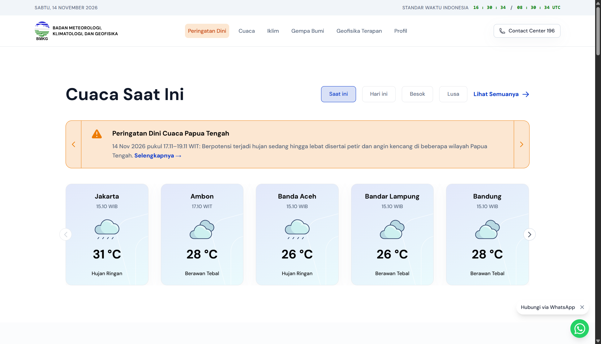
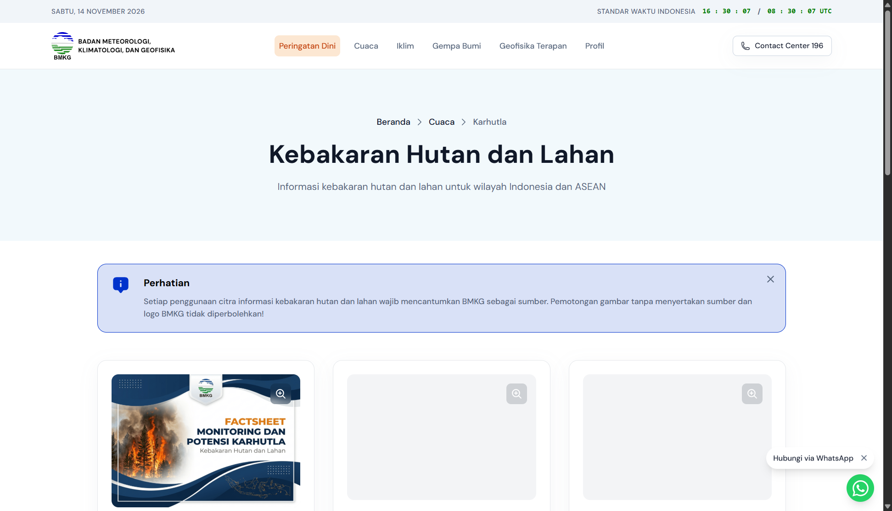
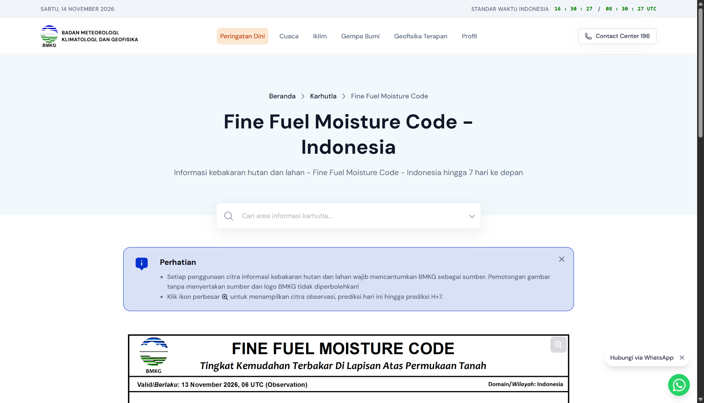
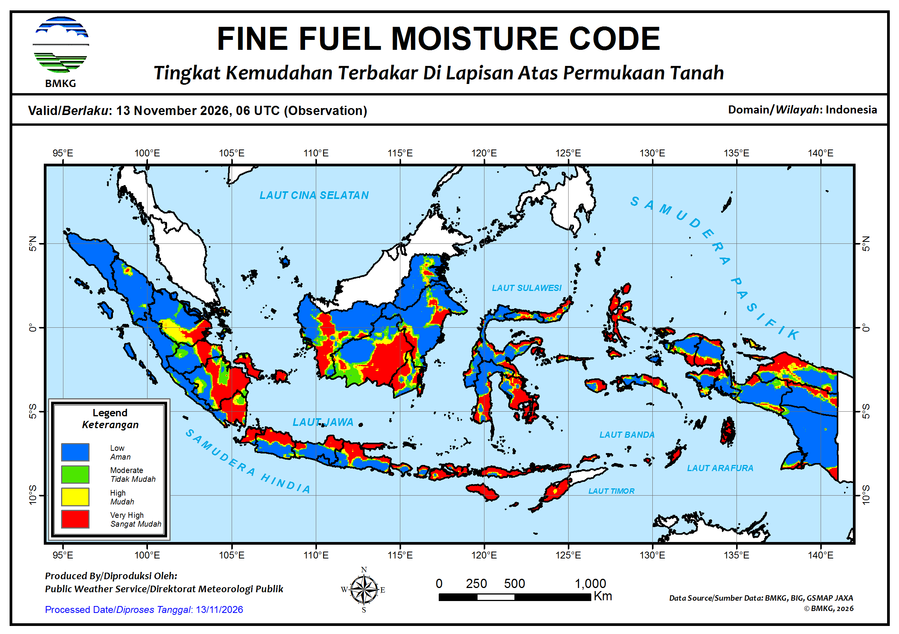
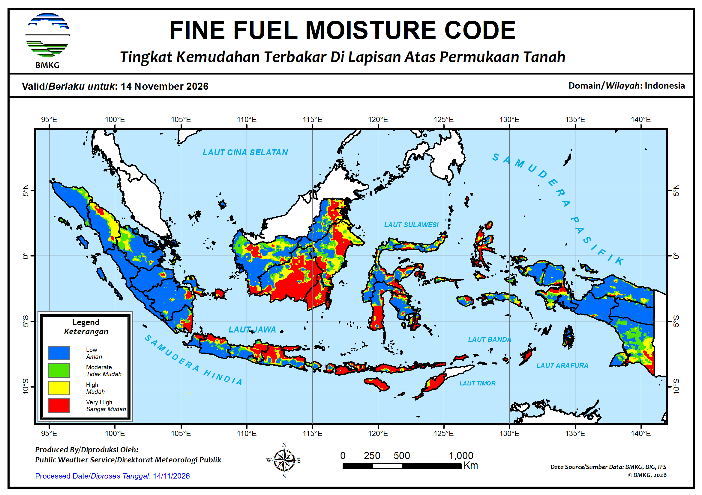
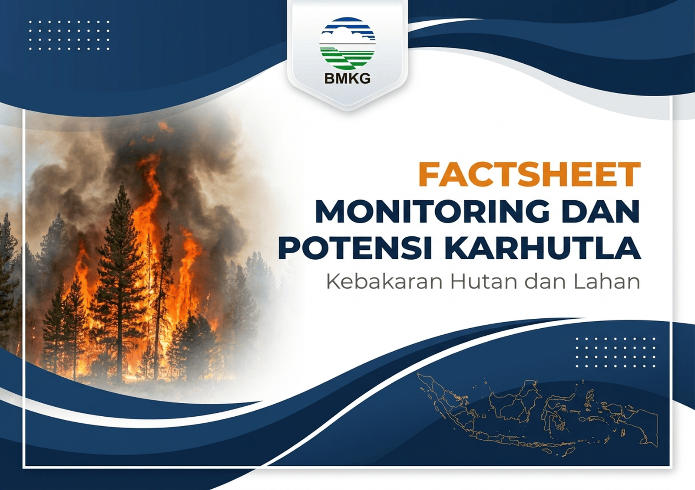
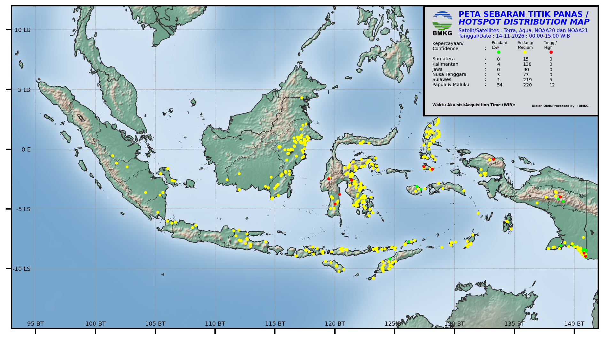
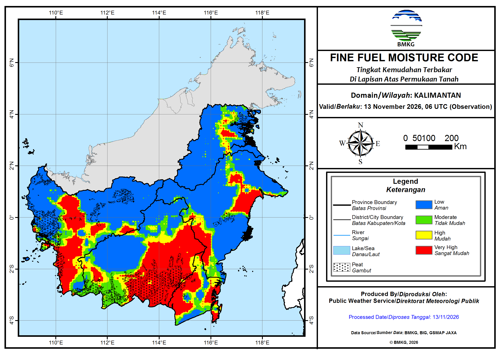
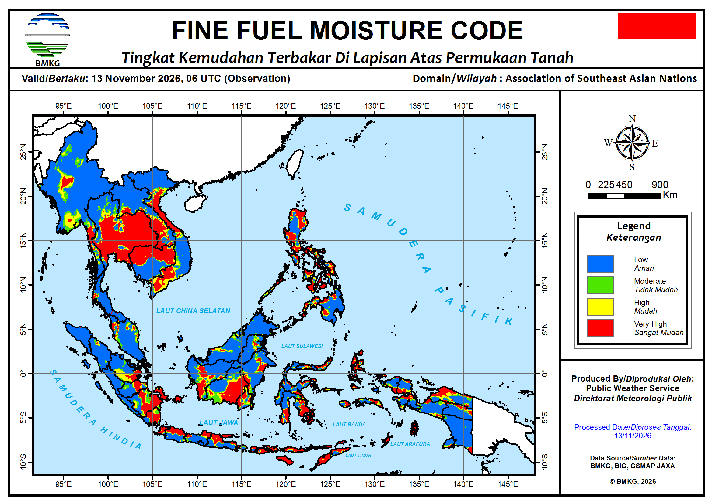

# BMKG fire potential (Kebakaran Hutan dan Lahan)
URL: https://www.bmkg.go.id/cuaca/karhutla · Audited: 2026-11-14 · Tier: 1 · Supplement: Borneo

Note on method: the BrowserOS session was not connected this audit (4 tool attempts over ~90 s all failed `fetch failed`), so no live clicks were possible. All evidence below was gathered on 2026-11-14 by direct HTTP fetches of the public pages (raw HTML + rendered reads), by parsing the daily factsheet PDF, and by vision-analysis of the downloaded product PNGs; page screenshots were captured with a headless capture tool, and the product PNGs were downloaded directly. Walkthrough click counts are **documented-not-executed** — derived from the verified navigation structure, not from live clicking. The brief's scoping note said the homepage card "Potensi Kebakaran Hutan" links to FFMC images under `dataweb.bmkg.go.id/cuaca/spartan/`: the site has since been rebuilt (Nuxt), the homepage card is gone, and fire content now lives at `/cuaca/karhutla` under the Cuaca mega-menu — but the spartan image URLs are unchanged and verified live (HTTP 200, 2026-11-14).

## Summary
BMKG's rebuilt site presents karhutla fire danger as a grid of static daily map images: one card per FDRS index (FFMC, DMC, DC, BUI, ISI, FWI) plus smoke imagery and a same-day VIIRS+MODIS hotspot map, each card opening a detail page with a Bahasa Indonesia methodology paragraph, a numeric legend table, and a 9-frame image ladder (observation + forecast H+0–H+7) per area. Areas form a preset ladder of 34 provinces (all five Kalimantan provinces) plus Sumatera/Kalimantan/Indonesia/**ASEAN** rollups — the ASEAN FFMC map already colors Sarawak, Sabah and Brunei, the one place this national service covers the whole Coverage Area. What it does best for IGNIS is prove how far a static-image product can go (bilingual in-image legends, per-island confidence counts, a daily narrative factsheet PDF) and exactly where it stops: no archive, no linked views, no comparison, Bahasa Indonesia only.

## Task walkthrough
Tasks adapted to BMKG's own risk-forecast product per the brief ("where is potential highest / when does it peak / compare two periods"). Clicks documented-not-executed (browser session unavailable); counts derived from the verified navigation structure.

| Task | Steps / clicks | Result | Notes |
|---|---|---|---|
| Adapted 1 — "Where is fire potential highest in Kalimantan?" (for "Hotspots in Central Kalimantan last August") | ~5 documented, not executed: hover Cuaca (1) → Kebakaran Hutan dan Lahan (1) → FFMC card "Lihat Detail" (1) → area search box (1) → pick "Kalimantan" or "Kalimantan Tengah" (1) | Answerable for today, not for last August. Factsheet PDF of 2026-11-14: "Wilayah Kalimantan diprediksi… rentang kategori Rendah (biru) hingga Sangat Tinggi (merah). Potensi kebakaran hutan dan lahan dengan risiko tertinggi terdapat di sebagian wilayah Kalimantan Timur dan Kalimantan Selatan." The Kalimantan FFMC obs map (valid 13 Nov 2026, 06 UTC) shows its red "Sangat Mudah" zone across south-central Kalimantan (Barat/Tengah/Selatan) — Central Kalimantan sits inside the red zone today | No history at all: fixed filenames like `38_kalimantan_ffmc_obs.png` are overwritten daily; "last August" is unanswerable from the product (the app complements IGNIS's detection record exactly where IGNIS is strong — the past) |
| Adapted 2 — "West Kalimantan vs Sarawak, same season" | n/a | **not supported** | Kalimantan Barat is a first-class preset (file `20_kalbar_ffmc_*`), but Sarawak exists only inside the ASEAN rollup map — colored (mostly blue/Low today) yet unlabeled, with no per-state image, no numbers, no side-by-side. The Kalimantan island map draws the whole of Borneo but greys out Sabah/Sarawak/Brunei with no FFMC colors. Cross-border comparison must be done by eyeballing two static PNGs |
| Adapted 3 — "Is 2023 worse than 2019?" (compare two periods) | n/a | **not supported** | Only today's observation plus H+0–H+7 forecast frames exist; there is no archive, no date picker, and image URLs carry no date parameter — yesterday's map is gone. This is the static-image baseline IGNIS's Burning Calendar and Typical Year must beat |

## Checklist
Users scored 0–2: Responder (R), Scientist (S), Land manager (L). Verdict = inherit / adapt / avoid.

| # | Item | Observation | R | S | L | Verdict |
|---|---|---|---|---|---|---|
| 1 | First screen | Homepage lands on "Cuaca Saat Ini" city weather cards + early-warning banner carousel; zero fire content above the fold, fire product is 2 clicks deep (Cuaca mega-menu → Kebakaran Hutan dan Lahan). The karhutla page itself answers fast: a card grid whose first card is today's factsheet cover. No fire potential on the homepage at all | 1 | 1 | 1 | adapt — IGNIS should land map-first, but the one-page card grid (all indices at a glance) is worth inheriting |
| 2 | Time controls | The only time navigation is the 9-frame fancybox gallery per index: captions "Observasi … hari ini", "Prediksi … H+0" → "H+7" (files `_obs`, `_00`…`_07`). No date picker, no slider, no playback, no archive; gaps are never shown — the image is simply today's | 1 | 1 | 1 | adapt — the obs→H+7 forecast ladder is the right horizon for an ignition-risk product; IGNIS adds the historical axis BMKG lacks |
| 3 | Space controls | Searchable area combobox on each index page ("Cari area informasi karhutla…" + "Tampilkan semua area informasi karhutla"): 42 presets — 34 provinces incl. all five Kalimantan provinces (kalbar/kalsel/kalteng/kaltim/kaltara) plus rollups Sumatera, Kalimantan, Indonesia, ASEAN. No map pan/zoom, no draw-an-Area-of-Interest; the map is a picture | 1 | 1 | 2 | adapt — the preset ladder is exactly IGNIS's region-panel pattern; add draw + tri-country presets |
| 4 | Hotspot display | "Sebaran Titik Panas (Hotspot)" card is one static PNG (inderaja.bmkg.go.id, dated 14-11-2026 00.00–15.00 WIB): confidence-colored dots (green/yellow/red), same at any "zoom" (none exists), plus an in-image count table per island: Kalimantan 4 low / 138 medium / 0 high; Sulawesi 1/219/5; Papua & Maluku 54/220/12 (national sum 784, my addition) | 1 | 1 | 1 | adapt — inherit the in-image per-region count table; the static dots themselves are the anti-baseline |
| 5 | Sensor handling | Card text names sensors as platforms: "VIIRS dan MODIS pada satelit polar (NOAA20, S-NPP, TERRA dan AQUA)" — but today's hotspot image itself lists "Terra, Aqua, NOAA20 dan NOAA21": page copy has drifted from the product (SNPP retired, NOAA-21 in, no notice — the exact drift SiPongi covers with a homepage banner). FFMC/FWI maps are model output: no sensor question arises | 1 | 2 | 1 | adapt — platform naming (Terra/Aqua/NOAA-20/21) beside MODIS/VIIRS is good; never let copy drift from data |
| 6 | Color and legend | Two-layer legend system: the page carries a numeric table (FFMC 0–72 / 73–77 / 78–82 / >82 with plain-language fuel descriptions) and every map PNG embeds its own bilingual 4-class legend (Low/Rendah blue → Very High/Sangat Mudah red) plus boundary symbols — Kalimantan map adds rivers, lakes and a **peat (Gambut) stipple**. Single-hue blue→red ramp is colorblind-safer than red/green pairs. Wording drifts between maps (Kalimantan "Sedang" vs ASEAN "Tidak Mudah"/"Aman") and the factsheet speaks of five categories ("Rendah … Sangat Tinggi") | 2 | 2 | 2 | inherit — self-describing images: numeric thresholds on the page, qualitative bilingual legend inside the image |
| 7 | Linked views | None. Every product is a separate static image; choosing an area or a forecast day never updates anything else. The page-to-fancybox link is the only coupling | 0 | 1 | 1 | avoid — this is the gap IGNIS's linked Burning Calendar ↔ heatmap exists to fill |
| 8 | Comparison | None: no year-vs-year, region-vs-region, baseline or anomaly view anywhere; comparing means opening two images in tabs | 0 | 1 | 1 | avoid — the static baseline the interactive views must beat |
| 9 | Explaining the data | Every index card + detail page opens with a BI methodology paragraph (e.g. FFMC = ease of ignition in fine fuels, litter layer 1–2 cm); map images carry credits ("Produced By/Diproduksi Oleh: Public Weather Service…", "Data Source/Sumber Data: BMKG, BIG, GSMAP JAXA", processed date, © BMKG 2026); a "Perhatian" box demands attribution ("Wajib mencantumkan BMKG sebagai sumber. Dilarang memotong gambar tanpa logo!"). No uncertainty language anywhere | 1 | 2 | 1 | adapt — per-index plain-language explainers belong beside IGNIS's FDRS-style context; add uncertainty |
| 10 | Mobile | `viewport width=device-width` declared and Tailwind responsive classes throughout (md:/xl: breakpoints seen in markup); phone-width layout not tested this session (no live browser) | 1 | 1 | 1 | adapt — untested; static images at least degrade simply on small screens |
| 11 | Export/share | No export function and no URL state — area and forecast day are client-side only; the shareable unit is the bare image URL (every PNG is a stable, directly linkable file, which is how these maps circulate on social media). Factsheet exists as a downloadable daily PDF (`dataweb.bmkg.go.id/cuaca/dokumen/factsheet-karhutla.pdf`) | 1 | 2 | 1 | adapt — image-URL-as-share-object + daily PDF is real-world sharing behavior; IGNIS adds state-in-URL (sentinel-hub.md) |
| 12 | Language and locale | Bahasa Indonesia only: `html lang="id"`, no EN toggle anywhere in nav, footer or page (checked in markup). Product names stay English ("Fine Fuel Moisture Code"), in-image legends and credits are bilingual EN/BI, dates are Indonesian-format ("Sabtu, 14 November 2026", "14-11-2026, 00.00–15.00 WIB"). Same title carries both vocabularies: "PETA SEBARAN TITIK PANAS / HOTSPOT DISTRIBUTION MAP" | 2 | 1 | 2 | adapt — a national service ships one language; IGNIS's Coverage Area spans three (B3, Q3): differ deliberately |
| 13 | Performance | Light pages: homepage HTML 210 KB (~1.3 s), karhutla 150 KB (~1.8 s), FFMC page 145 KB (~0.9 s) via curl from the audit location; product PNGs 150–220 KB each at 2340×1654, factsheet 599 KB, hotspot map 1.3 MB. Server-rendered content; no map tiles, no WebGL, nothing to break on a slow connection | 2 | 2 | 2 | inherit — static-image delivery is the cheap floor IGNIS's interactivity must justify |
| B1 | Tri-country admin-boundary hierarchies | Presets are Indonesia-only and one-depth (34 provinces; nothing for MY states or Brunei daerah — compare SiPongi's Desa→Provinsi chain, asmc.md's flattened presets). Inside the Kalimantan PNG, two ID levels are drawn (thick provinsi, thin kabupaten/kota). Preset list tracks current boundaries — Kalimantan Utara and the four new Papua provinces are present, no pre-2012 staleness (contrast gwis.md) | 1 | 1 | 1 | adapt — single-country, single-depth; IGNIS needs mixed-depth presets across all three countries |
| B2 | Cross-border region comparison | The one cross-border move is the ASEAN rollup FFMC map: it colors Sabah, Sarawak, Brunei and Singapore (mostly Low today) in one frame — but with no country labels, no per-state data, no comparison tool, and Indonesian national branding (BMKG logo + Indonesian flag) on the regional product. The Kalimantan island map draws the whole of Borneo yet colors only the Indonesian side, leaving Sabah/Sarawak/Brunei grey and unlabeled | 1 | 1 | 1 | adapt — the ASEAN frame is the precedent for IGNIS's whole-Coverage-Area view; IGNIS must label and treat all three countries equally |
| B3 | Tri-lingual language handling | BI-only UI with bilingual legends baked into images; no EN/BM toggle, no place-name localization (no labels to localize on the ASEAN map); EN glosses appear beside BI terms in titles ("TITIK PANAS / HOTSPOT"). No Iban/BM reach at all | 1 | 1 | 1 | adapt — evidence for Q3: even a regional product can stay monolingual; IGNIS serves a tri-lingual audience BMKG does not address |
| B4 | Cross-source count attribution | BMKG's own two daily counts differ in scope with no reconciliation note: the factsheet counts high-confidence hotspots only (13 Nov full day: national 26, Kalimantan 2), while the hotspot image counts all confidences intraday (14 Nov to 15:00 WIB: Kalimantan 142, national 784 by my sum) — same sensors, both "official". No comparison to KLHK/SiPongi or ASMC numbers, no "why we differ" affordance (the Harmonized Hotspot Count precedent). The attribution rule (credit BMKG, don't crop the logo) is a source-attribution pattern, not a methodology note | 1 | 2 | 1 | adapt — same-day, same-agency divergent counts are the strongest argument for IGNIS's Harmonized Hotspot Count + explanation affordance |

## Screenshots
-  Homepage (2026-11-14): "Cuaca Saat Ini" city weather cards and an early-warning banner lead; no fire content above the fold — the fire product hides in the Cuaca mega-menu; no language switcher anywhere
-  /cuaca/karhutla: hero ("Informasi kebakaran hutan dan lahan untuk wilayah Indonesia dan ASEAN"), the "Perhatian" attribution warning, and the start of the product card grid — first card is the factsheet cover, "Ikhtisar Pemantauan dan Potensi Karhutla", with fancybox zoom icons
-  FFMC detail page: title "Fine Fuel Moisture Code - Indonesia … hingga 7 hari ke depan", the searchable area box ("Cari area informasi karhutla…"), the no-cropping warning, and the top of the obs image (Valid 13 November 2026, 06 UTC; Domain/Wilayah: Indonesia)
-  The national FFMC observation map PNG (36_indonesia_ffmc_obs.png, 2340×1654) as embedded on the page — the product IGNIS's interactive heatmap must beat
-  First forecast frame (36_indonesia_ffmc_00.png = "Prediksi … H+0" per the gallery caption) — the obs→H+7 ladder is the product's only time control
-  The factsheet cover image (spartan/factsheet.png) used as the ikhtisar card thumbnail — a cover, not data; the narrative lives in the daily PDF
-  "PETA SEBARAN TITIK PANAS / HOTSPOT DISTRIBUTION MAP" (14-11-2026, 00.00–15.00 WIB): confidence-colored dots, sensor line "Terra, Aqua, NOAA20 dan NOAA21" (page copy still says S-NPP), and the in-image per-island count table — Kalimantan 4/138/0
-  Kalimantan island FFMC map (38_kalimantan_ffmc_obs.png, valid 13 Nov 2026 06 UTC): whole-of-Borneo frame, FFMC colors only on the Indonesian side, Sabah/Sarawak/Brunei drawn grey and unlabeled; legend shows province/kabupaten boundaries, rivers and peat (Gambut) stipple; red "Sangat Mudah" across south-central Kalimantan
-  ASEAN FFMC map (35_asean_ffmc_obs.png): the one BMKG product covering the whole Coverage Area — Sarawak, Sabah, Brunei and Singapore are colored (mostly Low) but no country is labeled; BMKG logo and Indonesian flag on a regional product; bilingual legend (Low/Aman … Very High/Sangat Mudah)

## Patterns worth taking
- **Forecast-day image ladder (Observasi → H+7)**: each index × area ships 9 dated frames — one observation plus 8 forecast days — browsed in a single lightbox with captions. For IGNIS: pair the Burning Calendar's historical axis with this exact short-horizon ignition-risk ladder ("where might it catch fire next week"), which is the question the detection record cannot answer. Serves First responder + Land manager.
- **Self-describing map images**: every PNG embeds its own bilingual legend, boundary/peat symbols, validity timestamp, producer and data sources, so the image stays correct wherever it is reshared. For IGNIS: every exported heatmap or calendar PNG must carry legend, Harmonized Hotspot Count definition and source — exports that survive being screenshot into WhatsApp groups. Serves all three users.
- **Preset ladder: province → island → nation → region**: one searchable combobox spanning 34 provinces plus Kalimantan/Sumatera/Indonesia/ASEAN rollups. For IGNIS's region panel (open question Q2): Kalimantan provinces at provinsi depth, plus a whole-Coverage-Area rollup — BMKG's ASEAN map proves the data already spans Sarawak/Sabah/Brunei. Serves Land manager + Scientist.
- **In-image count table by region and confidence**: the hotspot PNG carries low/medium/high counts per island next to the dots (Kalimantan 4/138/0 today). For IGNIS: put the Harmonized Hotspot Count per Area of Interest into the map corner, not a separate page. Serves First responder.
- **Daily narrative brief**: a one-page factsheet PDF per day — yesterday's high-confidence counts with province breakdown, trend words per priority province ("menurun"/"fluktuatif"), per-island risk outlook, weather-modification operations. For IGNIS: an auto-generated daily "Burning Brief" per Area of Interest, with the Typical Year as its baseline. Serves First responder + Land manager.
- **Attribution rule stated where the data lives**: "Wajib mencantumkan BMKG sebagai sumber. Dilarang memotong gambar tanpa logo!" sits on every karhutla page, next to the images it governs. For IGNIS: put citation format and provenance beside every export button, not in a footer. Serves Scientist.
- **Cautionary patterns (avoid)**: static images only — no linked views, no archive (fixed filenames overwritten daily, so "2023 vs 2019" is structurally impossible), area and forecast day never enter the URL, page copy drifting from the product (card says S-NPP while the image lists NOAA-21 — SiPongi handles the same transition with a dated notice), a regional map that colors three countries but labels none, and a monolingual BI UI for a product whose frame spans four more official languages.
