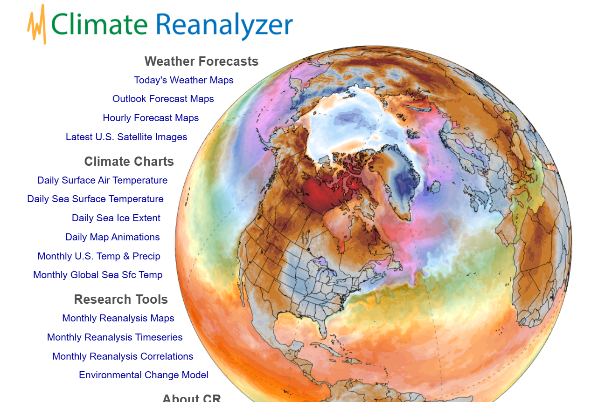
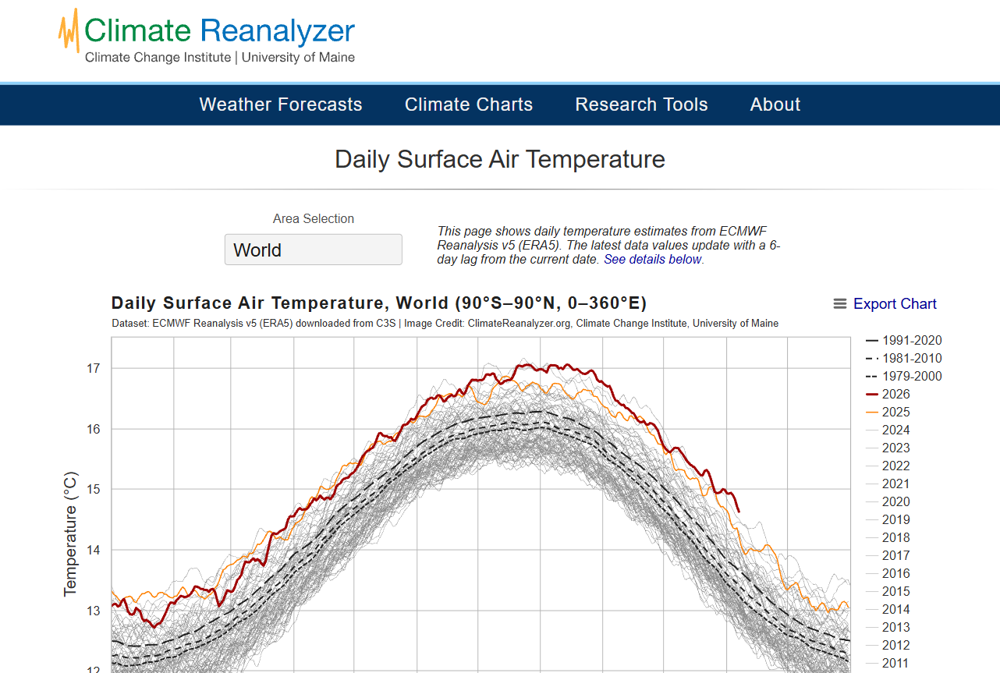
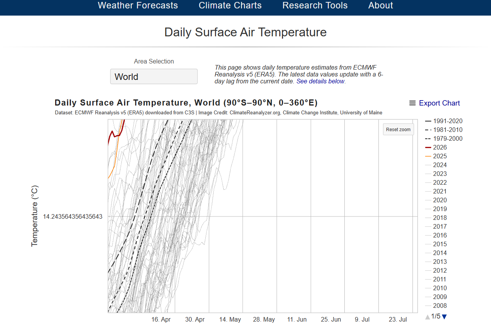
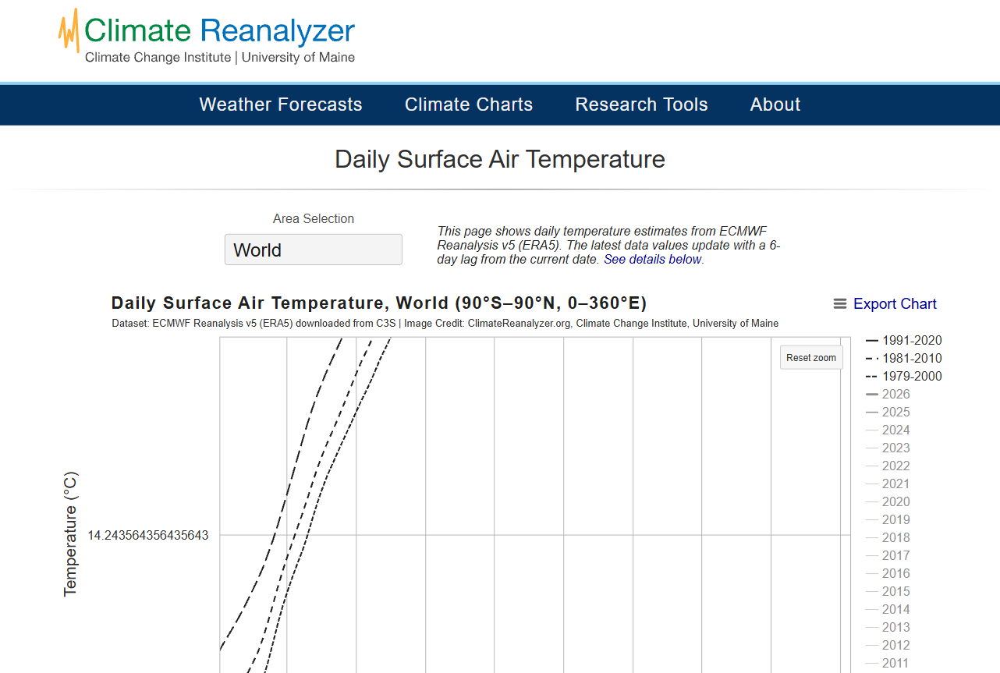
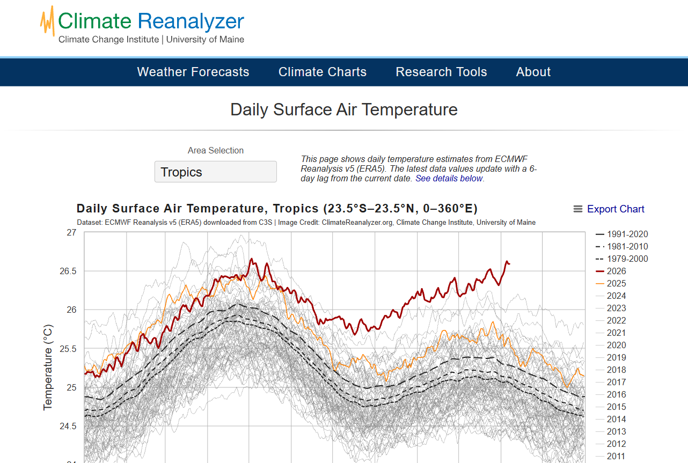
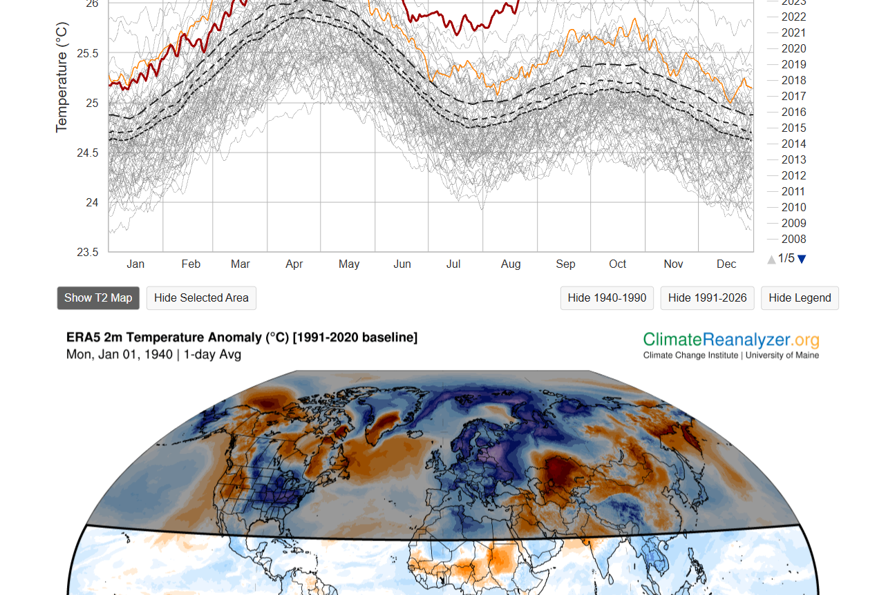

# Climate Reanalyzer ("climate stripes" year-over-year charts)
URL: https://climatereanalyzer.org/clim/t2_daily/ · Audited: 2026-11-14 · Tier: 3

## Summary
Climate Reanalyzer (Climate Change Institute, University of Maine) publishes daily-updated climate charts; its Daily Surface Air Temperature page is the reference "climate stripes as lines" pattern: every year 1940–2026 (90 series × 365 daily bins) overlaid as thin gray lines on one shared January–December axis, with the current year bold red, the prior year orange, and three 30-year climatology normals in black. For IGNIS this is the strongest existing answer to "year-over-year seasonality in one glance": the whole archive lands with zero interaction, and two era-toggle buttons declutter 87 lines to 3 reference lines. Its weaknesses are equally instructive: arbitrary year-pair comparison was fragile-to-broken in practice, the layout is a fixed 1024 px desktop canvas, and heavy 90-series redraws stall the page.

## Task walkthrough
Tier 3 source with no fire data: the Hotspot walkthrough is replaced by how the pattern handles time-binned data at a glance. All observations below were executed in-browser on 2026-11-14 (page state verified against the live Highcharts object, not just visuals).

| Task | Steps / clicks | Result | Notes |
|---|---|---|---|
| Time-binned data at a glance (replaces "Hotspots in West Kalimantan last September") | 1 click (homepage → "Daily Surface Air Temperature"); 0 after | One chart shows 90 series × 365 daily bins (~32,850 points): all years 1940–2026 as gray `rgb(144,144,144)` lines, 2026 dark red `rgb(160,0,0)`, 2025 orange `rgb(255,128,0)`, plus 1979-2000 / 1981-2010 / 1991-2020 normals in black (solid + dashed). Verified from the chart object: 90 series, all `visible: true`, one per year plus 3 normals | The gray mass reads preattentively as "typical range"; recency gets ≤2 highlight colors. This is the IGNIS Typical Year + history grid distilled into one glance |
| Which months peak, year after year | 0 clicks beyond navigation (+1 to switch Area preset) | Seasonality is read directly off the envelope and the three normals; no interaction needed. Switching Area Selection to "Tropics" (1 click) updated the title to "Tropics (23.5°S–23.5°N)" and the URL to `?dm_id=tropics` — preset regions only (world/nh/sh/arctic/antarctic/tropics), no drawn Area of Interest | No confirmed numeric readout: tooltips are enabled in config (`shared: false`) but synthetic hover never surfaced one in this session; the zoomed screenshot caught a raw hover label "14.243564356435643" (unrounded float) on the y-axis |
| 2023 vs 2019 | 2 clicks verified (Hide 1940-1990, Hide 1991-2026); further clicks attempted but not landed | Partially supported. The two era toggles collapsed 87 year-lines to the 3 normals (verified: 87 hidden, visible = 1979-2000/1981-2010/1991-2020). But the per-year "Show 2023" / "Show 2019" buttons could not be activated: ref-clicks were reported as covered by the sticky `#header-top`, coordinate clicks on the legend items did not toggle, and keyboard focus+Enter did not toggle. Arbitrary year-pair isolation was not achieved | Default year contrast is only current-vs-prior (2026 red vs 2025 orange). Lesson for IGNIS: make any-two-year comparison a first-class, robust control — do not bury it in per-series legend toggles |

## Checklist
Scored 0–2 per user (Responder / Scientist / Land manager). Items 4 and 5 are N/A: this is a single-dataset climate chart, not a fire-Hotspot viewer.

| # | Item | Observation | Responder 0-2 | Scientist 0-2 | Land mgr 0-2 | Verdict |
|---|---|---|---|---|---|---|
| 1 | First screen | Homepage is a plain link directory (no chart); the chart page itself lands directly on the full 87-year chart — 1 click to first useful answer | 1 | 2 | 2 | adapt |
| 2 | Time controls | X-axis is one calendar year (day-of-year bins). Drag-zoom `xy` verified + "Reset zoom" button verified (zoomed to ~16 Apr–23 Jul). Era hide/show toggles verified. No date-range picker, no playback, no presets; data gaps not applicable (continuous reanalysis) | 1 | 1 | 2 | adapt |
| 3 | Space controls | Preset dropdown `#location_dropdown` with 6 fixed regions only; no draw-a-box, no search, no admin boundaries. Region state travels in the URL (`?dm_id=`) | 1 | 1 | 1 | adapt |
| 4 | Hotspot display | N/A — no fire/point data. Analog worth noting: density is encoded as a gray mass of lines, not points/clusters | N/A | N/A | N/A | N/A |
| 5 | Sensor handling | N/A — single dataset (ERA5), no multi-sensor merge UI. Inheritable bit: dataset + version named in the chart subtitle ("ECMWF Reanalysis v5 (ERA5) downloaded from C3S") | N/A | N/A | N/A | N/A |
| 6 | Color and legend | Gray for all history, exactly 2 highlight colors (dark red current, orange prior), black line-style variants for normals. Right-side legend, newest first, paginated ("1/5") when the year list is long; era-group buttons under the chart | 2 | 1 | 2 | adapt |
| 7 | Linked views | One-way reveal only: "Show T2 Anomaly Map" toggles an inline world anomaly map (`#map_container`, `t2anom_*.png`) below the chart on the same page. No chart→map cross-filtering, no click-a-date updates the map | 1 | 1 | 1 | adapt |
| 8 | Comparison | Year-vs-year by full overlay; era hide/show groups; anomaly-vs-baseline on the map panel ("ERA5 2m Temperature Anomaly (°C) [1991-2020 baseline]"). Arbitrary year-pair isolation failed in practice (see walkthrough); no region-vs-region | 1 | 2 | 2 | adapt |
| 9 | Explaining the data | Strong: "latest data values update with a 6-day lag" sits above the chart; "Page Overview & Data Sources" below with ERA5 description, links to NCAR Climate Data Guide + reanalyses.org, a dataset-comparison image, ERA5 attribution DOIs, CC BY 4.0 license | 1 | 2 | 1 | inherit |
| 10 | Mobile | Fixed-width layout: `<meta viewport width=1024>`, pinch-zoom only. Not tested at a real phone width in this session (no viewport resize available) | 0 | 1 | 1 | avoid |
| 11 | Export/share | Highcharts menu verified: View in full screen, Print, Download PNG/JPEG/PDF/SVG, and Download JSON data. Region state in URL; chart toggle state (hidden eras) is not in the URL | 2 | 2 | 2 | inherit |
| 12 | Language and locale | English only; US date style ("Mon, Jan 01, 1940"); no locale switcher | 1 | 1 | 1 | avoid |
| 13 | Performance | Measured in-session: DOMContentLoaded ~4.0 s, load ~4.8 s, 25 requests, ~1.3 MB transferred; data ships as one JSON per region (~231 KB each: `era5_world_t2_day.json`, `era5_tropics_t2_day.json`); map PNGs ~180 KB. Heavy toggles (36–51 series at once) repeatedly stalled the main thread past 8–30 s, and the page reset scroll to top after redraws | 1 | 1 | 1 | adapt |

## Screenshots
-  Homepage: a plain directory of links; every chart is one click away.
-  Default chart: 90 series — gray history 1940–2025, 2026 dark red, 2025 orange, three climatology normals in black; legend right, newest first.
-  Drag-zoom active (~16 Apr–23 Jul) with the "Reset zoom" control; note the raw-precision hover label (14.243564356435643).
-  After 2 clicks ("Hide 1940-1990", "Hide 1991-2026"): only the three climatology normals remain — the decluttered seasonality view.
-  Area Selection switched to Tropics (title and URL `?dm_id=tropics` updated) — the flat tropical seasonality is still readable from the envelope.
-  "Show T2 Anomaly Map" reveals the inline anomaly map below the chart ("ERA5 2m Temperature Anomaly (°C) [1991-2020 baseline]", dated Mon, Jan 01, 1940); chart legend paginated "1/5".

## Patterns worth taking
- **All-years envelope**: every year as one thin gray line on a shared Jan–Dec axis, current year bold red, prior year orange. The entire archive is legible in a single glance with zero clicks — exactly the job of IGNIS's Burning Calendar history grid. Serves land managers (seasonality) and responders (is this year unusual?) alike.
- **Typical Year as reference lines**: three 30-year normals (1979-2000, 1981-2010, 1991-2020) drawn in black — one solid, two dashed — each individually toggleable. IGNIS should render its Typical Year (and optionally the Overlap Period average) as reference lines/bands every year is read against. Serves land managers and scientists.
- **Era group toggles**: two buttons ("Hide 1940-1990" / "Hide 1991-2026") collapse 87 lines to 3 in two clicks. Bulk declutter by group beats 87 individual checkboxes for any IGNIS view with per-year series. All three users.
- **Inline latency disclosure**: "latest data values update with a 6-day lag" sits directly above the chart. IGNIS should state Hotspot data latency the same way, in the same breath as the chart, not on a separate page. Responders first.
- **Chart and map on one page**: the anomaly map toggles in below the chart instead of navigating away, keeping when and where adjacent. IGNIS should co-locate Burning Calendar and heatmap with a similar reveal — but link them (click a month → highlight the map), which this app stops short of.
- **Export menu with raw data**: one menu offers PNG, JPEG, PDF, SVG, print, fullscreen and Download JSON data. IGNIS should ship chart-image + Harmonized Hotspot Count CSV export from the same control. Scientists especially.
- **URL-carried state**: `?dm_id=tropics` makes a region view shareable and bookmarkable. IGNIS should put Area of Interest, year range and sensor toggles into the URL; this app shows the pattern half-done (chart toggle state is lost).
- **Version-labeled methodology block**: dataset + version in the subtitle ("ERA5 v5 downloaded from C3S"), full overview, external guides, DOIs and license below the fold. Direct model for IGNIS's about/method view and its MODIS/VIIRS harmonization notes. Scientists.
- **Anti-pattern — interactive overload**: 90 live SVG series made every toggle a multi-second main-thread stall, scroll jumped to top on redraws, and the per-year a11y toggle buttons ended up covered by the sticky header (year-pair comparison failed in practice). IGNIS: pre-aggregate the Typical Year and quantile bands server-side, keep only a handful of full-year series live, and make any-two-year compare a dedicated control that never depends on fragile per-series toggles.
