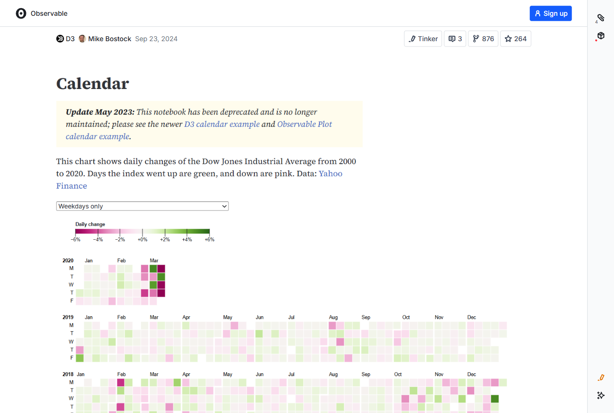
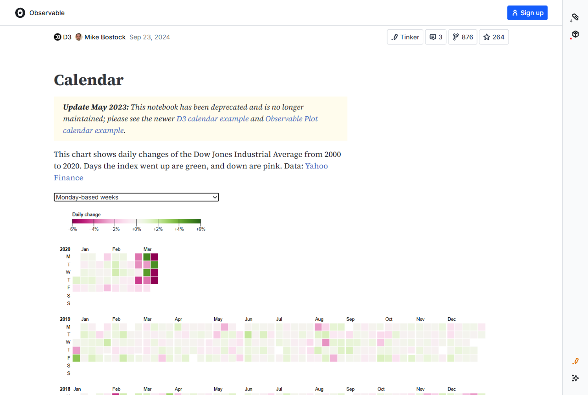
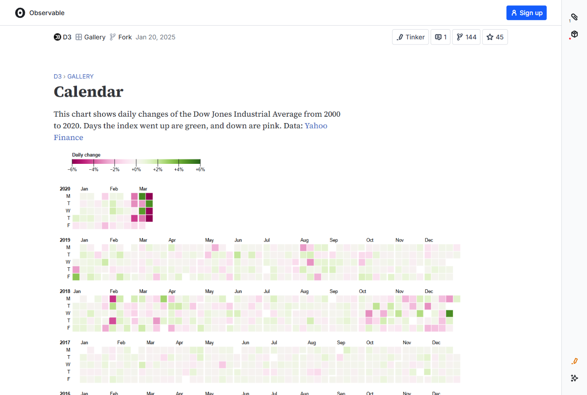
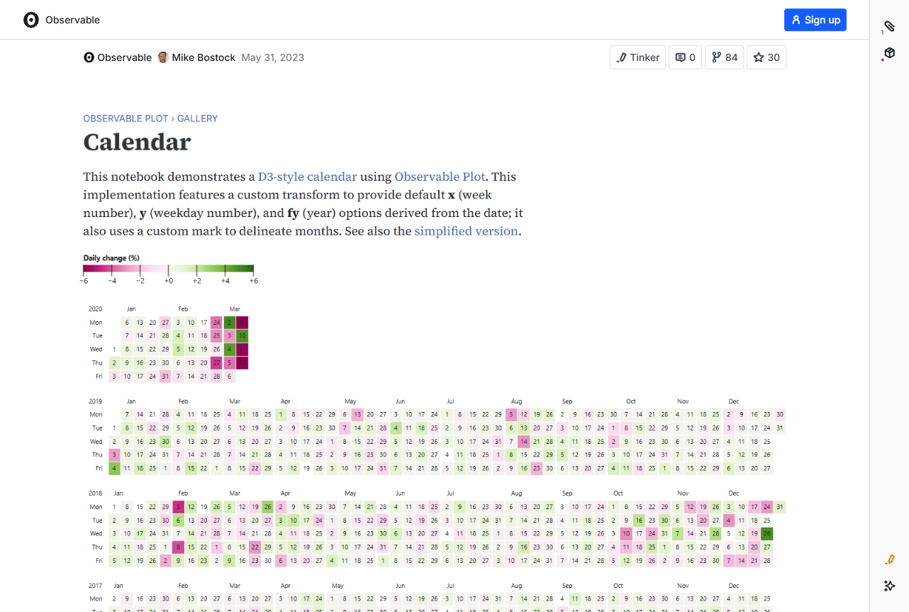
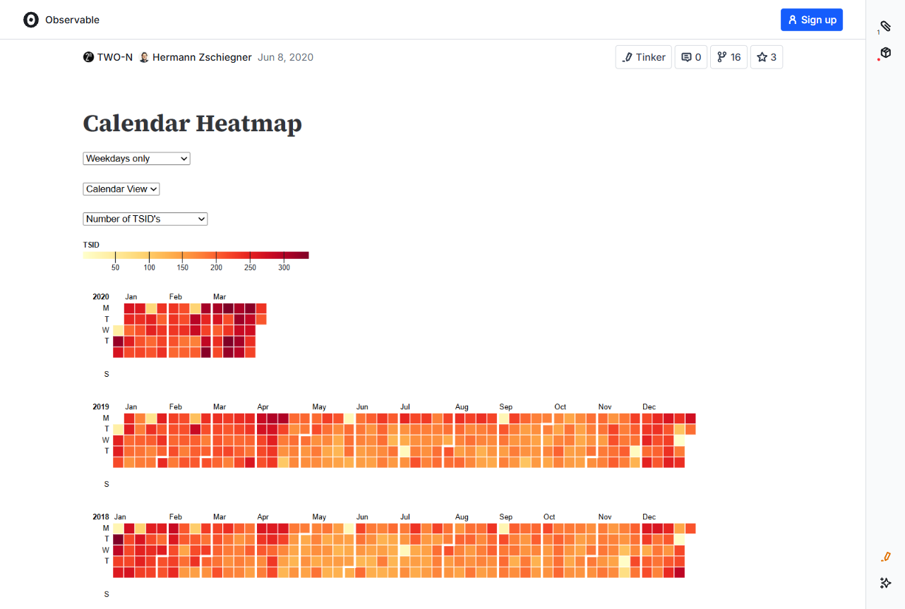
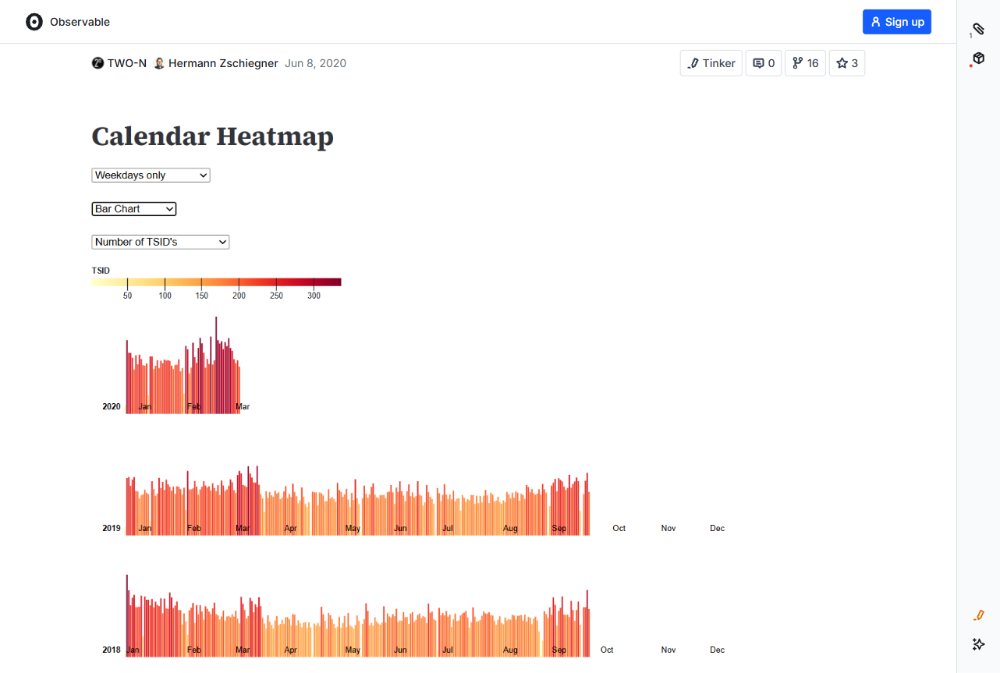
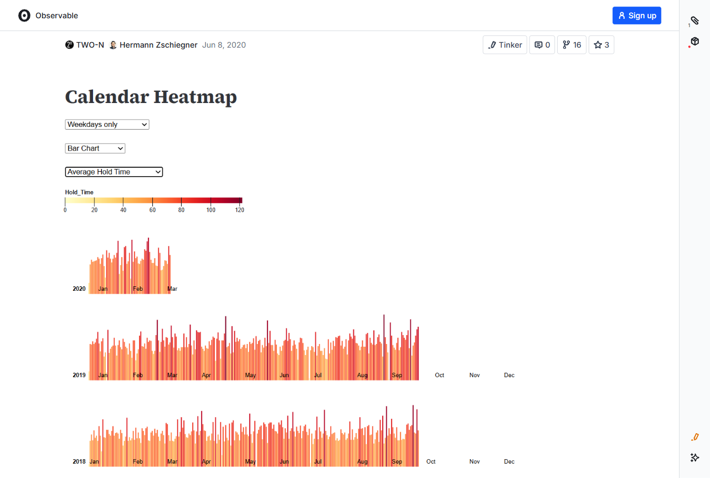
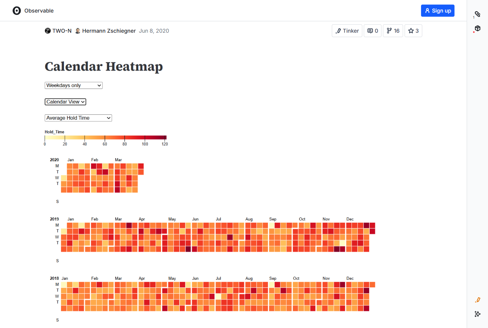
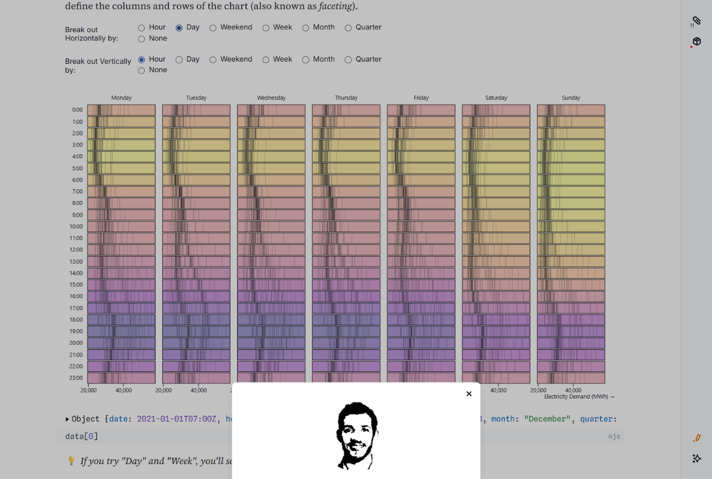
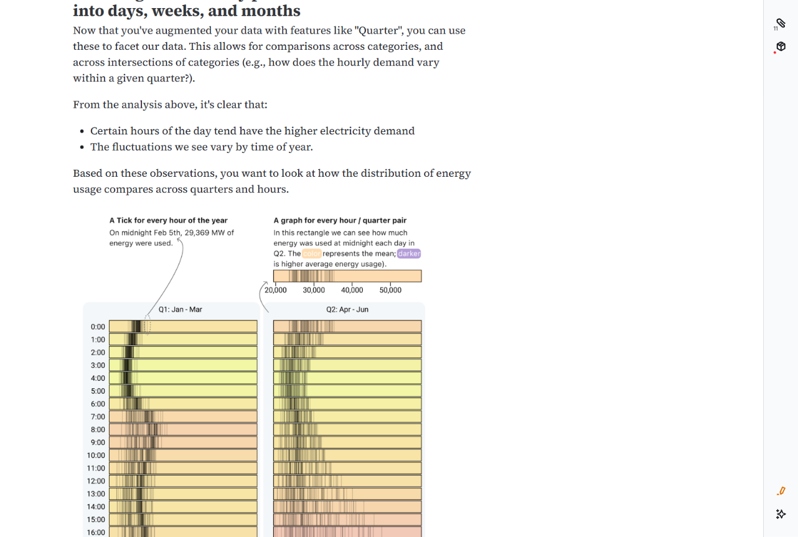

# Observable D3 calendar heatmap examples
URL: https://observablehq.com/@d3/calendar · Audited: 2026-11-14 · Tier: 3

## Summary
A family of Observable notebooks that implement the GitHub-style calendar heatmap with D3 and Observable Plot: the deprecated `@d3/calendar` (Calendar View, weekday dropdown, hover titles), its successor `@d3/calendar/2` (current d3js.org gallery example, outlier-robust color scale), `@observablehq/plot-calendar` + `@observablehq/plot-simplified-calendar` (Plot cell marks, per-year facets), `@two-n/calendar-heatmap` (calendar↔strip view switch, metric switch), and `@observablehq/discovering-date-patterns` (facet re-binning radios, brush-filter import, aggregated tooltips). For IGNIS it is the reference for the Burning Calendar's cell grid, color scale discipline, and re-binning controls — and a cautionary tale on hover (native `<title>` tooltips) and click-to-filter (absent everywhere we clicked).

## Task walkthrough
| Task | Steps / clicks | Result | Notes |
|---|---|---|---|
| Hotspots in West Kalimantan last September | — | not supported | Tier 3 pattern source: no fire or geographic data. Replaced (per plan) with time-binned data at a glance: 0 clicks — the year-stacked weekday grid surfaces the March 2020 crash cluster instantly (verified in screenshots 01/03); bin (day/week/month) is chosen by control, not by zoom. |
| Which months burn most, year over year | 0 (render) / 2-click-equivalent for layout controls | supported as pattern | Year rows aligned by week-of-year make seasonality and anomalies scannable without interaction (@d3/calendar, @d3/calendar/2); TWO-N's Bar Chart mode (focus + ↓ + Enter) shows the same series as dense per-day strips where seasonal density reads even faster. |
| 2023 vs 2019 | 0 | not supported as explicit compare | Only visual scan of adjacent year rows; no click-to-compare. Clicking a cell does nothing in `@d3/calendar` (tested: no selection, popup, or filter — pixel-diff showed no chart change) and nothing in `@two-n/calendar-heatmap` (tested click at a cell; byte-identical render). The one-click re-binning that does exist is in `discovering-date-patterns` (1 click on the "Day" facet radio rebuilt the chart as Day×Hour, verified). |

Hover evidence note: hover behavior is code-verified, not pixel-captured. `@d3/calendar` and the Plot variants attach native SVG `title` tooltips (`yFormat: "+%" // show percent change on hover` in `@d3/calendar`; `title:` channel in `plot-simplified-calendar`); native browser tooltips do not render in automated (CDP) screenshots — three hover attempts produced no tooltip pixels, so this is documented-not-visualized. `@two-n/calendar-heatmap` has no hover at all (hover over a verified cell coordinate returned an identical screenshot hash). The brush in `discovering-date-patterns` (`brushFilterX` import plus a pointer-cursor chart node in the accessibility tree) was never landed on by my drag attempts: code-verified, interaction not executed.

## Checklist
| # | Item | Observation | Responder 0-2 | Scientist 0-2 | Land mgr 0-2 | Verdict |
|---|---|---|---|---|---|---|
| 1 | First screen | The calendar chart is the first thing rendered, above the fold, with legend inline (`@d3/calendar`, `@d3/calendar/2`). Instant visual answer, zero navigation. | 1 | 2 | 2 | inherit |
| 2 | Time controls | No date-range picker or time slider anywhere. Instead: bin/layout controls — weekday-mode dropdown (Weekdays only / Sunday-based / Monday-based, instant relayout), granularity radios (Hourly / Daily / Weekly / 28-day), facet radios (Hour / Day / Weekend / Week / Month / Quarter / None). All keyboard-operable. | 1 | 1 | 2 | adapt |
| 3 | Space controls | No geography in these notebooks. | N/A | N/A | N/A | N/A |
| 4 | Hotspot display | No hotspots. Nearest analog: TWO-N switches cell grid ↔ 1.7px-wide strips (density display) for the same dates. | N/A | N/A | N/A | N/A |
| 5 | Sensor handling | No sensors. Nearest analog: TWO-N's metric dropdown (5 call-center measures) re-colors the same calendar and relabels the legend. | N/A | N/A | N/A | N/A |
| 6 | Color and legend | Diverging PiYG for +/- change; `@d3/calendar/2` derives a symmetric domain from `d3.quantile(data, 0.9975, |value|)` so outliers don't wash out normal days; Plot variants pin the domain ([-0.06, 0.06]) constant across versions so colors stay comparable; legends sit above the chart with signed percent ticks (−6%…+6%); TWO-N's legend title follows the metric ("Hold_Time", 0–120). | 2 | 2 | 2 | inherit |
| 7 | Linked views | Controls re-render the single chart reactively; no chart↔map linking (no map), no cross-filtering between views. Facet radios rebuild the cross-tab in one click. Brush imported (`brushFilterX`) but not executed. | 0 | 1 | 1 | adapt |
| 8 | Comparison | Year-over-year by stacked, week-aligned year rows (2016–2020 visible at once) — the core at-a-glance comparison; no explicit two-year A/B tool. | 1 | 2 | 2 | inherit |
| 9 | Explaining the data | Notebooks show code and comments next to the chart; tooltips carry units (%, $, MWh); `@d3/calendar` carries a visible deprecation banner pointing to successors. No methodology page. | 1 | 1 | 1 | adapt |
| 10 | Mobile | Responsive via SVG `viewBox` + `max-width: 100%`; `discovering-date-patterns` abbreviates weekday/month ticks to single letters under 600px. But a user comment on `@d3/calendar/2` ("Width of 928 isn't quite enough, the right edge of December is truncating") matches the December clipping visible in screenshot 03. | 1 | 1 | 1 | adapt |
| 11 | Export/share | "Copy code" / "Copy Observable JavaScript" buttons on every cell; versioned shareable URLs (`/@d3/calendar/2`). No CSV/PNG export of the chart itself. | 1 | 1 | 0 | adapt |
| 12 | Language and locale | English-only labels (M/T/W/T/F, Jan–Dec); date/label formats are code-level formatters (`formatDay`, `%x`, `Plot.formatWeekday`), not a UI locale switch. | N/A | N/A | N/A | adapt |
| 13 | Performance | Pure SVG, ~1,300 rects per year × 5 years; all five notebooks rendered within seconds in this session on a normal connection. No formal measurement taken. | 1 | 1 | 1 | inherit |

## Screenshots
-  `@d3/calendar` default view: deprecation banner (May 2023) with links to the two successor examples, "Weekdays only" dropdown, "Daily change" −6%…+6% legend, and week-aligned year rows 2020/2019/2018 with the March 2020 crash cluster in dark green/magenta.
-  Same notebook after switching the weekday dropdown to "Monday-based weeks": 7 weekday letters (M T W T F S S) and weekend cells appear — instant relayout.
-  `@d3/calendar/2` (Jan 2025, current d3js.org gallery example): no dropdowns, weekdays-only rows 2016–2020, quantile-capped PiYG scale; note the slight December clipping at the right edge (matching the user comment about width 928).
-  `@observablehq/plot-calendar` "fancy" Plot version: per-year facets, year labels in the left margin, month header labels, legend "Daily change (%)" with signed ticks −6…+6; no hover titles in this variant (no `title` channel).
-  `@two-n/calendar-heatmap` default: three dropdowns — weekday filter, Calendar View ↔ Bar Chart, and metric (call-center measures) — above square calendar cells.
-  Same notebook after the view switch (focus + ↓ + Enter): each day becomes a 1.7px strip; bar height and color encode the value — dense seasonal structure reads faster than cells.
-  After switching metric to "Average Hold Time": the same strip view re-colors and the legend relabels itself to "Hold_Time" with a 0–120 gradient — legend tracks the selected measure.
-  Back in Calendar View with the Hold Time metric: square cells; months with no data (Oct–Dec) keep their labels with empty space — gaps are shown, not hidden.
-  `@observablehq/discovering-date-patterns` after one click on the "Day" facet radio: the chart rebuilt as Day (columns Mon–Sun) × Hour (rows 0:00–23:00); the two radio groups are labeled "Break out Horizontally by" / "Break out Vertically by" — axis-to-control mapping made explicit.
-  Same notebook, teaching section: annotated tick-rug small multiples (Q1/Q2 panels) with leader-line callouts ("A tick for every hour of the year", "29,369 MW at midnight Feb 5") and a mean-color legend — annotation as onboarding.

## Patterns worth taking
- **Year-stacked weekday calendar**: one row per year, all aligned by week-of-year, month labels above each row — seasonality and anomalous years are readable with zero interaction. This is the IGNIS Burning Calendar's core layout. Serves Land managers and Scientists.
- **Outlier-robust symmetric color scale**: cap the diverging domain at a high quantile (`d3.quantile(data, 0.9975, Math.abs)`) so extreme days saturate instead of compressing every other day to pale. Directly applicable to Harmonized Hotspot Counts, whose peak-burning days would otherwise wash out the Typical Year's quieter months. Serves Scientists and Land managers.
- **Pinned color domain across views**: the Plot variants hard-code [-0.06, 0.06] so colors mean the same thing in every variant; IGNIS should pin the Hotspot color scale across Areas of Interest and years so a "red month" is always the same red. Serves all three users.
- **Rebin-by-click facet radios**: "Break out Horizontally/Vertically by Hour/Day/Week/Month/Quarter/None" rebuilds the entire cross-tab in one click, and the control labels name the axis they change. This is the granularity answer for the Burning Calendar (day/week/month cells) — cheaper and clearer than a zoom. Serves all three users.
- **View-mode switch, same data**: TWO-N's Calendar View ↔ Bar Chart toggle renders identical dates as cells or as dense per-day strips; two densities, one dataset, one control. IGNIS could offer calendar ↔ strip for scanning long Overlap Periods. Serves Land managers and Responders.
- **Metric switch with self-relabeling legend**: choosing another measured variable re-colors the chart and renames the legend ("Hold_Time", 0–120) with its own tick range. The IGNIS analog is switching between raw MODIS count, VIIRS count and Harmonized Hotspot Count. Serves Scientists.
- **Multi-line aggregated tooltip**: `discovering-date-patterns` builds hover text as "Avg. Demand: 29,369 MWh / Hour: 0:00 PST / Day: Friday" — value with units plus the bin labels. For IGNIS: "Harmonized Hotspot Count: N / Sep 2019 / West Kalimantan". Serves all three users.
- **Responsive tick abbreviation**: weekday and month tick labels collapse to single letters under 600px width, decided per axis direction. Cheap mobile pattern for the Burning Calendar. Serves Responders.
- **Empty bins stay labeled**: TWO-N renders Oct–Dec month labels with no bars rather than hiding missing months — an honest gap display IGNIS needs for months with no Hotspot record. Serves Scientists.
- **Avoid: native `<title>` as the only hover affordance**: the canonical D3 example's tooltip is the browser's slow, unstylable default (and the Plot "fancy" variant drops hover entirely). IGNIS should ship a real tooltip component (as `@mkfreeman/plot-tooltip` does) from day one. Serves all three users.
- **Avoid: clickable-looking cells that do nothing**: calendar cells show a pointer cursor in some variants but no click handler exists anywhere we tested — no click-to-filter, no selection, no drill-down. If IGNIS cells are clickable (drill to the heatmap for that period), they must visibly respond; if not, don't imply it.
- **Watch: December truncation on narrow widths**: a 53-week row barely fits 928px and clips December (user-reported and reproduced visually). IGNIS's 12-month rows need a width budget or horizontal scroll for mobile. Serves Responders.
