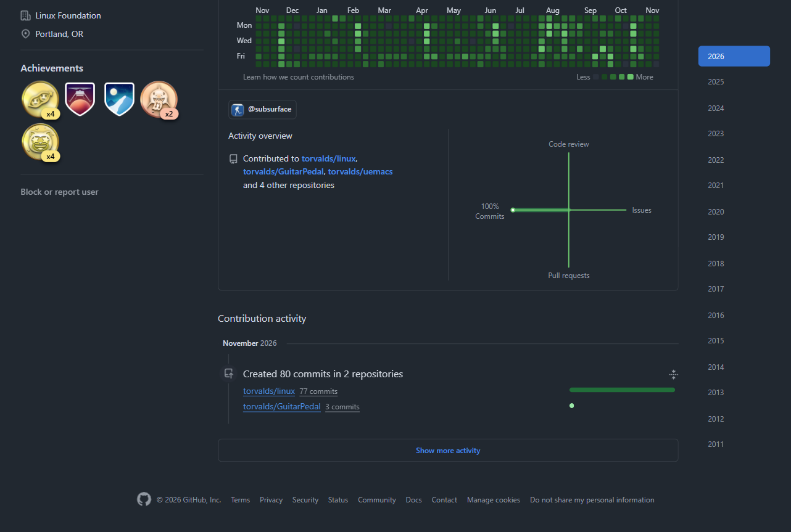
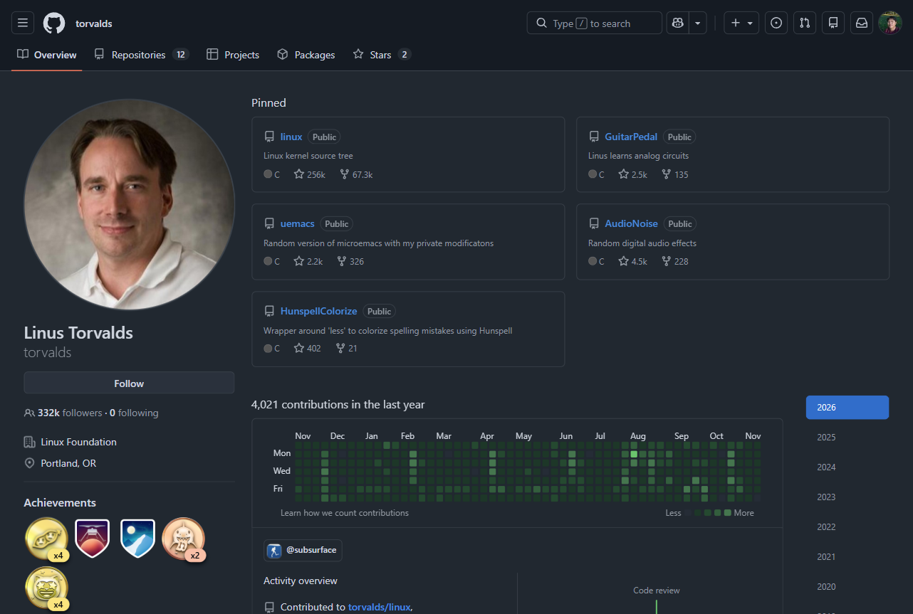
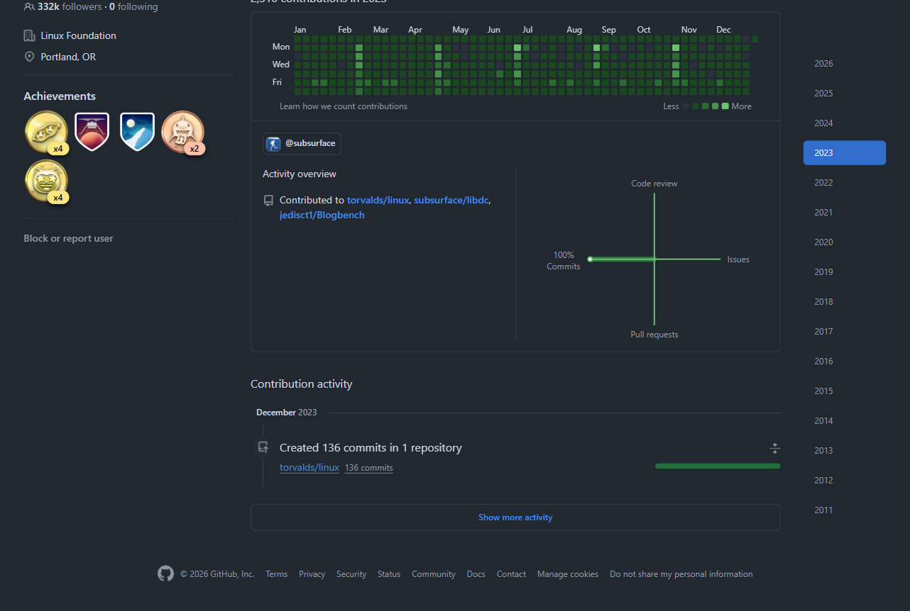

# GitHub contribution graph

URL: https://github.com/torvalds (pattern lives on every user profile Overview tab) · Audited: 2026-11-14 · Tier: 3

Focus: day/week calendar heatmap readability, zero-config first impression. Tier 3 source with no fire data: the three fire tasks are replaced with the equivalent time-binned-data questions, and checklist rows that need a map or fire layers are marked N/A.

## Summary

GitHub's contribution graph is a server-rendered week-column/day-row calendar heatmap that shows a full year of daily-binned counts with zero configuration: it arrives in the first HTML paint, needs no controls, and reads at a glance through a 5-step single-hue intensity ramp, sparse axis labels (Mon/Wed/Fri; month names only where a month starts) and a Less/More mini-legend anchored to the grid. What it does best for IGNIS is the read-then-drill ladder: plain-language annual total ("4,021 contributions in the last year") → shape-of-the-year at a glance → hover a cell for the exact count ("65 contributions on August 3rd.") → click the cell to filter a detail feed below to that date, with a per-source breakdown and a methodology link one screen away. It is the strongest reference for the Burning Calendar's at-a-glance layer; it deliberately offers no year-vs-year comparison and no export, which IGNIS must add for scientists and land managers.

Observed facts this audit rests on (checked in the live DOM on 2026-11-14): rolling 12-month window 2025-11-09 → 2026-11-14 (371 dated cells, 53 week columns, cells 10×10 px with 2.4 px gutters in a 729 px grid); color levels `data-level` 0–4 distributed 10/257/66/24/19; dark-theme ramp rgb(42,49,60) empty, then rgb(27,71,33), rgb(43,106,48), rgb(70,149,74), rgb(107,196,109); every cell is `role="gridcell"` with `tabindex="0"` and a native `tool-tip` (377 in DOM) linked via `aria-labelledby`; month headers carry full name + abbreviation ("November Nov") for responsive swapping; year list 2011–2026 renders as links whose `from=/to=` URL params make each year view shareable.

## Task walkthrough

Tier 3 substitution: instead of fire tasks, the same three questions asked of time-binned data at a glance.

| Task | Steps / clicks | Result | Notes |
|---|---|---|---|
| See a year of daily-binned counts at a glance (stands in for: Hotspots in West Kalimantan last September) | 0 clicks | Graph renders on profile load; 53 week columns × 7 day rows, month labels on top, annual total in the heading. | Server-rendered in the initial HTML — the full grid was present in the first accessibility snapshot at load; no settings, toggles or zoom needed. Default window is a rolling last-12-months, not a calendar year. |
| Which days/weeks are most active, and what exactly happened then (stands in for: which months burn most, year after year) | 1 hover + 1 click | Hover shows a tooltip with count + date ("65 contributions on August 3rd."); clicking that cell selects it and re-filters the "Contribution activity" feed below to a heading "August 3, 2026" with "Created 65 commits in 3 repositories" expandable into per-repo counts, each deep-linking to a date-filtered commit list (`since=2026-08-02&until=2026-08-03`). | Peaks are found by eye through the intensity ramp, then confirmed by tooltip. The drill-down is one-way (grid → feed); the feed does not highlight the grid. |
| This year vs an earlier year (stands in for: 2023 vs 2019) | 1 click on a year link | Clicking "Contribution activity in 2023" swaps the whole grid to calendar 2023 (heading "2,510 contributions in 2023", cells 2023-01-01 → 2023-12-30) and encodes it in the URL (`?from=2023-12-01&to=2023-12-31`). | Sequential swap only — no side-by-side, no overlay, no anomaly-vs-baseline. Comparing two years means holding one in memory. The year state is shareable via URL. |

## Checklist

Scores 0–2 per user (Responder / Scientist / Land manager). Items that need a map or fire layers are N/A for this Tier 3 pattern source.

| # | Item | Observation | Responder 0-2 | Scientist 0-2 | Land mgr 0-2 | Verdict |
|---|---|---|---|---|---|---|
| 1 | First screen | Calendar heatmap is part of the profile's first paint, server-rendered, zero config; a one-line annual total ("4,021 contributions in the last year") answers "how much" before any interaction. | 2 | 2 | 2 | inherit |
| 2 | Time controls | No date picker, slider or presets. Default rolling last-12-months; a 2011–2026 year-link strip swaps the whole grid; clicking a day narrows the feed to that date. Gaps read as the distinct empty color. | 1 | 1 | 2 | adapt |
| 3 | Space controls | No geography in this pattern — a profile, not a map. | N/A | N/A | N/A | N/A |
| 4 | Hotspot display | No points/clusters/density map; the density metaphor lives in the cell ramp instead. | N/A | N/A | N/A | N/A |
| 5 | Sensor handling (multi-source merge) | Analogy only: commits, PRs, issues and reviews are merged into one count; the day drill-down breaks it down per repository with deep links, and a "Learn how we count contributions" link sits directly under the grid. Exactly the Harmonized Hotspot Count shape: one harmonized number, breakdown and method one click away. | 1 | 2 | 1 | adapt |
| 6 | Color and legend | 5 steps: one distinct empty color + a 4-step single-hue (green) lightness ramp; "Less ▢▢▢▢ More" legend anchored at the grid's bottom-right. Single-hue lightness ramp is readable next to the dark slate empty cell; no red/green divergence. | 2 | 2 | 2 | inherit (re-hue for Burning Phases) |
| 7 | Linked views | Cell click filters the activity feed below to that date; per-repo rows deep-link to date-filtered lists. One-directional; no chart↔map loop (no map here). | 1 | 2 | 2 | adapt |
| 8 | Comparison | Year links swap the grid sequentially; no side-by-side, no baseline overlay, no anomaly highlighting. | 0 | 1 | 1 | adapt (avoid the swap-only limit) |
| 9 | Explaining the data | "Learn how we count contributions" links to docs.github.com from directly under the graph; tooltip text is plain-language ("No contributions on December 15th."). | 1 | 2 | 1 | adapt |
| 10 | Mobile | Not tested — no viewport resize available in this session; a stylesheet media-query scan returned nothing accessible (cross-origin CSS). Month headers do ship full + abbreviated names for responsive swap. | N/A | N/A | N/A | N/A (not tested) |
| 11 | Export/share | Share: each year view is a stable URL (`from=/to=` params). Export: none — no CSV/PNG of the graph observed. | 1 | 1 | 1 | adapt (inherit URL state, add export) |
| 12 | Language and locale | English only as observed ("August 3rd." ordinals, month abbreviations); follows account locale settings, which I did not change. Borneo audience needs EN/MS/ID day and month names. | 1 | 1 | 1 | adapt |
| 13 | Performance | Full 371-cell grid present in the first snapshot at load — server-rendered HTML, no spinner, no lazy fetch for the graph itself. 377 tooltip elements ship in the DOM (small, bounded overhead). No load-weight numbers measured. | 2 | 2 | 2 | inherit |

## Screenshots

-  Zero-config first impression: the calendar heatmap as it renders on profile load — month labels Nov→Nov across the top, day labels thinned to Mon/Wed/Fri, the green intensity ramp with its distinct empty color, and the "Less/More" legend anchored bottom-right. (Verified visually.)
-  The drill-down state after clicking one 10×10 px cell (Aug 3, 2026): the selected day cell plus the "Contribution activity" feed re-filtered to that exact date, headed "August 3, 2026 — Created 65 commits in 3 repositories" with per-repo breakdowns. (Framing grounded in the DOM state at capture; visual re-check was rate-limited.)
-  Year navigation via the year-link strip: one click on "Contribution activity in 2023" swaps the grid to calendar 2023 — heading "2,510 contributions in 2023", cells 2023-01-01 → 2023-12-30, URL now carrying `from=2023-12-01&to=2023-12-31`. (Framing grounded in the DOM state at capture; visual re-check was rate-limited.)

Not captured: the hover tooltip. Synthetic hover did not hold the CSS `:hover` state long enough to photograph; its content and per-cell wiring were verified in the DOM instead (each cell `aria-labelledby`-linked to a `role="tooltip"` reading e.g. "65 contributions on August 3rd.").

## Patterns worth taking

- **Zero-config server-rendered calendar**: the whole year grid ships in the first HTML paint — no controls, no loading state, no choices before the first answer. For IGNIS this argues the Burning Calendar for a default Area of Interest (or the whole Coverage Area) should render server-side on first load. Serves all three users.
- **Read-then-drill ladder**: annual total in a heading → year shape via color → hover for exact count → click to filter a detail list to that date. Maps directly onto IGNIS: Typical Year on top, year grid below, day cell → that day's Hotspot list and heatmap filter. Serves Responders (fast glance) and Scientists (drill to records).
- **Five-step quantized ramp with a distinct empty color**: one hue, four intensity steps, plus a separate "no data / zero" color — enough resolution to see seasonality, few enough steps to name each bucket (the direct precedent for Burning Phase coloring). Legend is five swats wide and anchored to the grid. Serves all three users.
- **Sparse axis labels**: day-of-week thinned to Mon/Wed/Fri, months labeled only where they start, full and abbreviated month names both in the DOM for responsive swap. Keeps a 53-column grid legible without a single rotated label. Serves all three users.
- **Plain-language count in the tooltip and aria label**: "65 contributions on August 3rd." / "No contributions on December 15th." — the same string serves mouse users (tooltip) and screen readers (gridcell label), with keyboard focus on every cell (`tabindex="0"`, `role="gridcell"`). For IGNIS: "12 Hotspots on Aug 3rd" as cell label, screen-reader readable. Serves all three users.
- **Year strip with shareable URL state**: 16 year links, each encoding its window as `from=/to=` params — a year-by-month history grid whose every state is linkable without bespoke share buttons. For IGNIS's year-by-month grid and Overlap Period years. Serves Scientists and Land managers.
- **Methodology link adjacent to the chart**: "Learn how we count contributions" one line under the grid — the place IGNIS should explain the Harmonized Hotspot Count and the Overlap Period calibration, instead of a separate methods page nobody opens. Serves Scientists most.
- **Merged count with drill-down breakdown**: multiple contribution types collapse into one cell count; the day detail re-splits it per source with deep links. Precedent for showing only the Harmonized Hotspot Count in the grid while keeping per-sensor (MODIS/VIIRS) breakdown one click down. Serves Scientists and Land managers.
