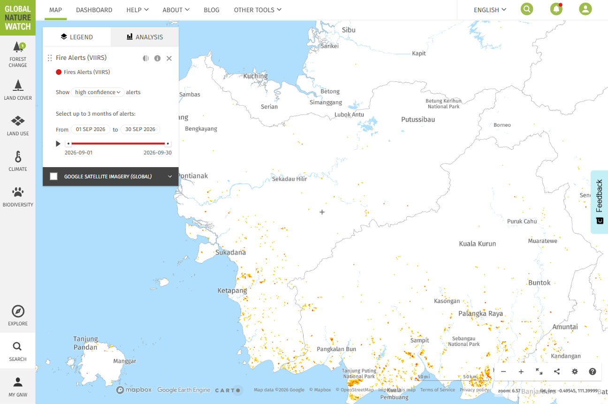
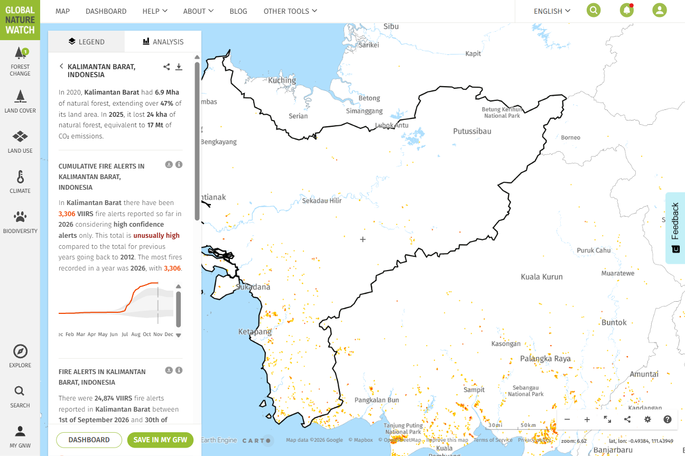
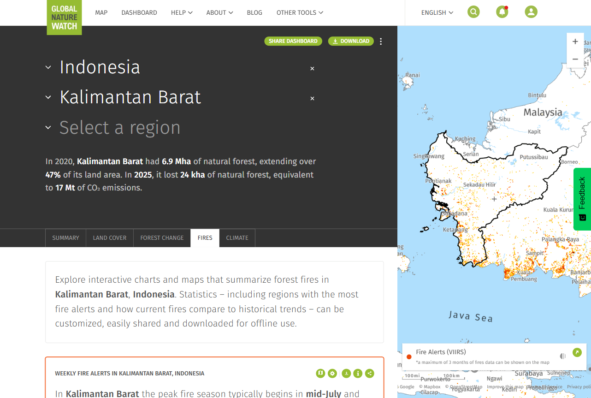
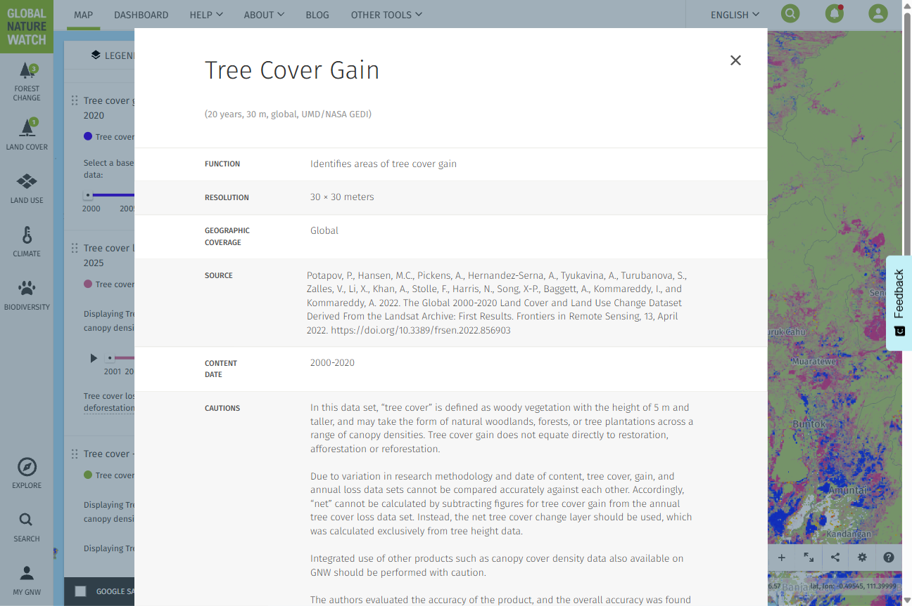
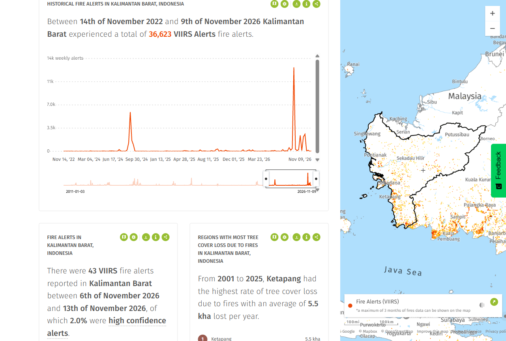

# Global Forest Watch (now Global Nature Watch)

URL: https://www.globalforestwatch.org/ (redirects to https://globalnaturewatch.org/; map at /map/, dashboards at /dashboards/) · Audited: 2026-11-14 · Tier: 1

## Summary

Global Forest Watch was rebranded to **Global Nature Watch (GNW)** during 2026 — every globalforestwatch.org URL redirects, and the old GFW map lives on unchanged at `globalnaturewatch.org/map/`. For IGNIS its most valuable pieces are the **Fire Alerts (VIIRS)** layer (daily, 375 m, NASA; archive 2012–present, high-confidence/all toggle), the click-a-province **Area of Interest → ANALYZE** flow, and the region **dashboard Fires tab**, which answers IGNIS's core "when vs Typical Year" question directly: it states the peak fire season in one sentence ("typically begins in mid-July and lasts around 13 weeks"), plots weekly alerts against a shaded **Normal Range** band with Above/Below-Normal markers, and offers a 2011–2026 historical chart with a draggable brush navigator. Weaknesses to avoid: a heavy first load, a 3-month cap on the map layer's date window, no MODIS sensor pairing, and an inconsistent count widget.

All observations below were executed live in BrowserOS neo on 2026-11-14 unless marked otherwise. Terms follow `GLOSSARY.md`.

## Task walkthrough

| Task | Steps / clicks | Result | Notes |
|---|---|---|---|
| Hotspots in West Kalimantan last September | ~11 clicks: FOREST CHANGE menu (1), Fire Alerts (VIIRS) toggle (2), SEARCH (3), type "West Kalimantan" (typed), result click (4), start-date button (5), month select (6), day 1 (7), end-date button (8), month select (9), day 30 (10), collapse search (11); +5 optional de-clutter clicks (remove 3 default forest layers, re-search province) | Done. Layer card shows window `01 SEP 2026 → 30 SEP 2026`; AOI popup confirms "Kalimantan Barat, Indonesia, total area of 15Mha"; analysis widget: **24,874 VIIRS fire alerts 1–30 Sep 2026, of which 3.0% high confidence** (707 high / 24,167 other). Fire dots confirmed rendering on the dashboard map of the same layer (shot 05) | Date buttons open a calendar with month/year dropdowns; year options run 2012–2026 (the VIIRS archive). Layer card states "Select up to 3 months of alerts" — a hard window cap. Default layers (tree cover gain/loss) initially drown the fire dots; removing them took 3 clicks |
| Which months burn most, year over year | Map path: click province shape (1) → popup "Kalimantan Barat … 15Mha" → ANALYZE (2); widgets render: Cumulative Fire Alerts chart (Dec–Dec axis, per-year curves) + "unusually high … most fires recorded in a year was 2026, with 3,306". Dashboard path: DASHBOARD link (1) → Fires tab (1) → **"the peak fire season typically begins in mid-July and lasts around 13 weeks"**; weekly chart Nov 2025–Nov 2026 with **Normal Range** band and Above/Below Normal Range legend; Historical Fire Alerts widget: weekly line 2011–2026 + mini brush navigator with draggable selection window | Answered directly — the dashboard's season sentence plus the Normal-Range band is exactly IGNIS's Typical Year question answered in one glance | The peak-season sentence is auto-generated per Area of Interest. Historical widget read: 36,623 alerts total Nov 2022–Nov 2026; spikes ~Sep 2024 (≈5k/week) and Nov 2026 (≈13k/week). Brush interaction itself observed but not dragged (not exercised) |
| 2023 vs 2019 | Not supported as a one-shot compare. Manual re-windowing via the layer date pickers (~9 interactions per year: LEGEND, start button, month, year, day, end button, month, day, ANALYSIS): **Sep 2019 = 25,321 alerts (5.0% high conf, 1,294 high)** vs **Sep 2023 = 5,489 alerts (4.0% high conf, 219 high)** — Sep 2023 was ~4.6× lighter than Sep 2019 (Sep 2026 = 24,874, near 2019 levels) | Answered, but laboriously; no year-vs-year or region-vs-region diff tool exists. The Cumulative Fire Alerts widget overlays all years 2012–2026 for visual comparison only | Inconsistency observed: the "Fire Alerts Count" widget returned **0** for both historical windows while the adjacent "Fire alerts" widget reported thousands for the same window; for Sep 2026 it read 745 vs the other widget's 707. The panel notes "This algorithm approximates the results by sampling the selected area" — treat sampled counts as approximate |

## Checklist

Scores 0–2 per user (First responder / Scientist / Land manager).

| # | Item | Observation | Responder 0-2 | Scientist 0-2 | Land mgr 0-2 | Verdict |
|---|---|---|---|---|---|---|
| 1 | First screen | `/map/` loads map-first but with 3 default *forest* layers; fire is 2 clicks into FOREST CHANGE. Homepage is now a rebrand marketing page. Time-to-first-fire-answer ≈ 11 clicks (Task 1) | 1 | 1 | 1 | adapt |
| 2 | Time controls | Dual date buttons (`13 OCT 2026` style, DD MMM YYYY) opening a calendar with month+year dropdowns (years 2012–2026); default window = last 30 days; play button + range sliders on the layer card; dashboard brush navigator spans 2011–2026. Hard cap: 3 months per map window. No explicit "no-data/gap" marks observed | 1 | 2 | 2 | adapt |
| 3 | Space controls | SEARCH panel (Locations / Datasets / Coordinates with decimal-degrees + UTM); ANALYSIS panel offers "CLICK A LAYER ON THE MAP" or "DRAW OR UPLOAD SHAPE"; boundary presets: Political boundaries / Terrestrial ecoregions / River basins. Clicking the province → popup with area in Mha → ANALYZE. AOI lands in the URL path (`/map/country/IDN/12/`). Draw/upload entry discovered but its tools not exercised | 1 | 2 | 2 | inherit |
| 4 | Hotspot display | Fire Alerts (VIIRS) renders as point dots (confirmed on the dashboard map, shot 05); separate "Emerging hot spots" analytical dataset (2002–2025, tropics, WRI) and "Tree cover loss due to fires" (annual 30 m UMD/GLAD). No cluster/density toggle or zoom-dependent behavior exercised this session | 2 | 1 | 1 | adapt |
| 5 | Sensor handling | Single sensor only: VIIRS (daily, 375 m, global, NASA). Confidence control on the layer ("high confidence" default vs "all") and restated in every widget sentence. No MODIS layer anywhere in this app — the harmonization problem IGNIS solves is absent here | 1 | 2 | 1 | adapt |
| 6 | Color and legend | LEGEND panel lists active layers with symbols (red dot for fire) + per-layer opacity and mute buttons; satellite imagery toggle. Sequential-scale choice / colorblind safety not assessed (not exercised) | 1 | 1 | 1 | adapt |
| 7 | Linked views | Layer date range drives the analysis widgets (verified: re-windowing 2026→2019→2023 re-ran all widgets); AOI selection drives the whole panel; dashboard historical chart has a brush selection window over the archive (drag not exercised) | 1 | 2 | 2 | inherit |
| 8 | Comparison | Weekly chart vs shaded **Normal Range** + Above/Below Normal markers; per-year cumulative overlay 2012–2026; auto-verdict text ("unusually high", "most fires in a year was 2026"); "Regions with the most fire Alerts" sub-region ranking. No explicit A-vs-B year or region diff — Task 3 needed ~18 manual interactions | 0 | 1 | 2 | adapt |
| 9 | Explaining the data | Per-dataset metadata modal (Overview, Citation with DOI, CC-BY licence, LEARN MORE — shot 04); dataset subtitles ("daily, 375 m, global, NASA"); sampling-uncertainty note under analysis; dashboard caveat "methods … changed over time. Be cautious comparing … before/after 2015" with link. Excellent model for IGNIS's about/method view | 1 | 2 | 2 | inherit |
| 10 | Mobile | Not tested — no viewport resize performed in this session (background-tab constraints). Homepage advertises a separate offline mobile app, Forest Watcher | 0 | 0 | 0 | adapt |
| 11 | Export/share | URL carries full state: AOI in path, datasets + opacity + date window + menu in `?map=` base64 (verified round-trip: the URL updated itself when dates changed). Dashboard header "Download" → country stats XLSX (S3 link); per-widget toolbar icons (share/download) present on dashboard | 1 | 2 | 2 | inherit |
| 12 | Language and locale | Language switcher offers English, 中文, Français, **Bahasa Indonesia**, Português, Español (verified by opening the dropdown). Dates as `13 OCT 2026` / "1st of September 2019" | 2 | 1 | 2 | inherit |
| 13 | Performance | Measured in-page: navigation duration **12,501 ms**, **250 resources**, ≈**1.98 MB** transferred. Several scripted interactions exceeded 25–30 s on tile-heavy states; announcement modal blocked the dismiss button on load (hit-test covered) | 1 | 1 | 1 | avoid |

## Screenshots

-  Map centered on West Kalimantan with the Fire Alerts (VIIRS) layer card set to `01 SEP 2026 → 30 SEP 2026`, confidence selector and range slider (task 1 end state). Dot rendering corroborated via shot 05's dashboard map (same layer); this frame's pixels were not machine-verified (analyzer rate-limited).
-  Map analysis panel on the Kalimantan Barat AOI: Cumulative Fire Alerts sentence + chart, confidence split (707 high / 24,167 other), sampling caveat, save-area CTA.
-  Dashboard Fires tab: "Weekly Fire Alerts" widget with peak-season sentence and Normal Range / Above-Below Normal Range legend. Content verified via the page's DOM text; image analyzer rejected this file (parse error) so pixels not independently verified.
-  Per-dataset metadata modal (Overview, Citation + DOI, CC-BY, LEARN MORE) — the "explaining the data" pattern.
-  "Historical Fire Alerts" widget: weekly line chart (Nov '22–Nov '26, 0–14k scale) over a mini brush navigator spanning 2011–2026 with a draggable selection window; below it the current-week widget (43 alerts, 2.0% high conf) and "Regions with Most Tree Cover Loss Due to Fires" (Ketapang 5.5 kha/yr) with fire dots on the map.

## Patterns worth taking

- **Normal Range band**: the weekly fire chart shades the historical normal range and marks Above/Below-Normal weeks, so anomaly-vs-baseline reads without any math. This is the strongest single pattern for IGNIS's Burning Calendar's Typical Year row. Serves all three users; belongs on the calendar view.
- **Auto-verdict sentence**: widgets open with a plain-language verdict ("unusually high compared to previous years going back to 2012", "the most fires recorded in a year was 2026") — the chart's conclusion stated in words. Inherit for every IGNIS chart; serves responders and land managers most.
- **Peak-season sentence**: "the peak fire season typically begins in mid-July and lasts around 13 weeks" — an auto-computed Typical Year distilled to one line, exactly IGNIS's Burning Phase vocabulary. Inherit verbatim-style for the region panel.
- **Brush navigator over the full archive**: a mini 2011–2026 time chart with a draggable selection window that frames the main weekly chart. Adapt for the Burning Calendar's history grid (scrub the year range); serves scientists and land managers.
- **Layer card with dual date buttons + confidence select + play**: compact per-layer controls (DD MMM YYYY buttons → calendar with month/year dropdowns; "high confidence"/"all"; animate). Adapt, but drop the 3-month window cap and the fiddly calendar for IGNIS's preset chips (24 h / month / season).
- **URL as shareable state**: AOI in the path (`/map/country/IDN/12/`), datasets, date window and menu in query params — a copied link reproduces the exact view. Inherit for IGNIS (Burning Calendar state in the URL).
- **Click-a-shape AOI → ANALYZE popup**: clicking a province pops its name + area and an ANALYZE button that runs all widgets on that Area of Interest. Adapt for IGNIS's preset Areas of Interest (province/district), also available via search.
- **Per-dataset metadata modal**: overview, citation with DOI, licence, LEARN MORE behind an ⓘ on every layer card. Inherit for IGNIS's about/method view (Hotspot definitions, Harmonized Hotspot Count method, Overlap Period).
- **Confidence-split breakdown**: high-confidence vs other counts (with %) beside every total, and the confidence basis restated in each sentence. Adapt — IGNIS's equivalent is per-sensor counts beside the Harmonized Hotspot Count.
- **Sampling/harmonization caveat inline**: "This algorithm approximates the results by sampling" sits under the numbers. Adapt as IGNIS's harmonization caveat under every Harmonized Hotspot Count.
- **Sub-region ranking widget**: "Regions with the most fire alerts" ranks child areas inside the Area of Interest. Adapt for the region panel (districts within a province).
- **Multi-language incl. Bahasa Indonesia**: six UI languages cover the Borneo audience; the language switcher is one click. Inherit the scope for IGNIS v1 (English + Bahasa Indonesia).
- **Anti-patterns to avoid**: defaulting to non-fire layers that bury the fire dots; a 12.5 s / 2 MB first load; widgets that disagree with each other (0 vs thousands; 745 vs 707) without saying which is authoritative; a modal overlay that blocks its own dismiss button on load.
