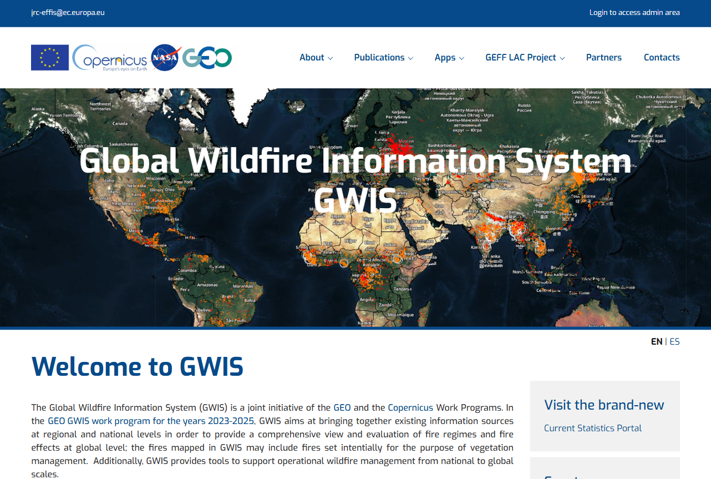
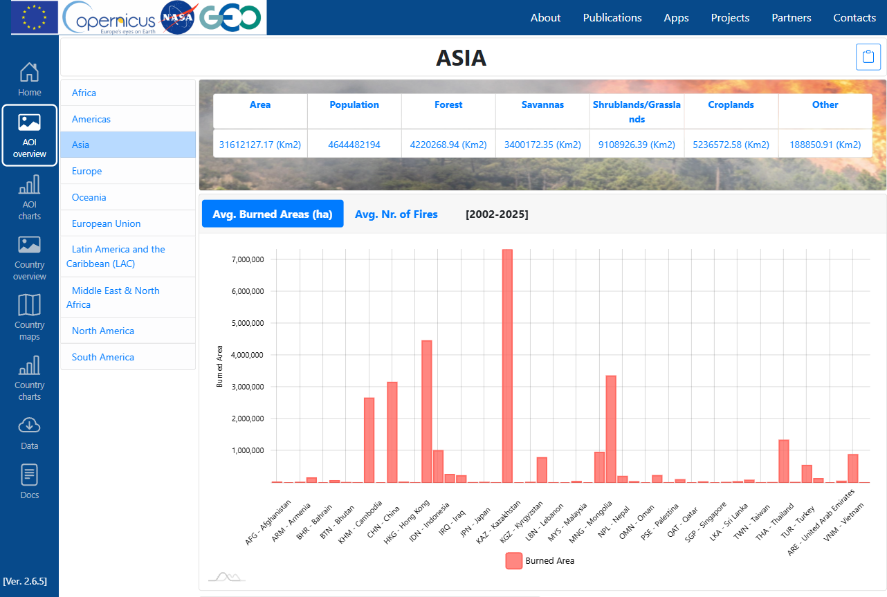
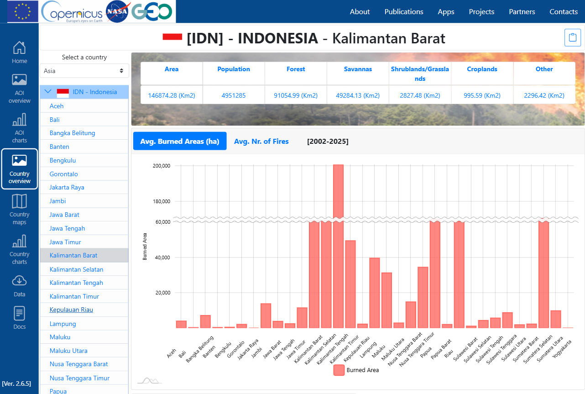
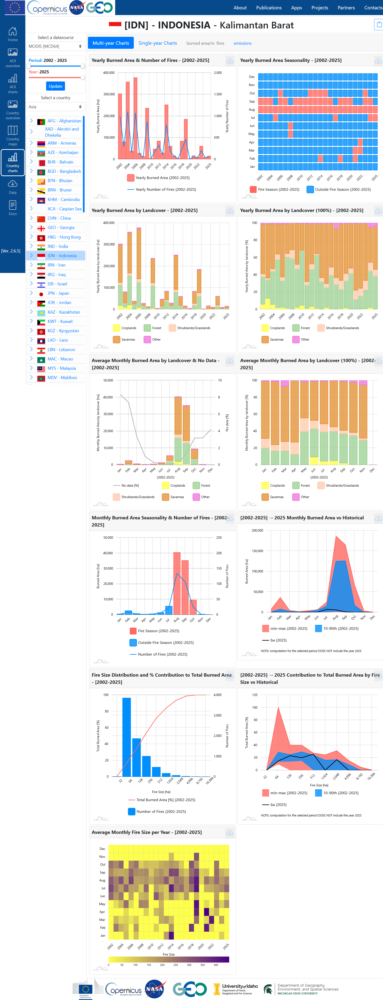
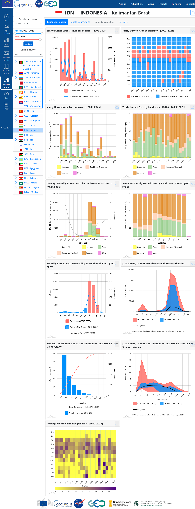
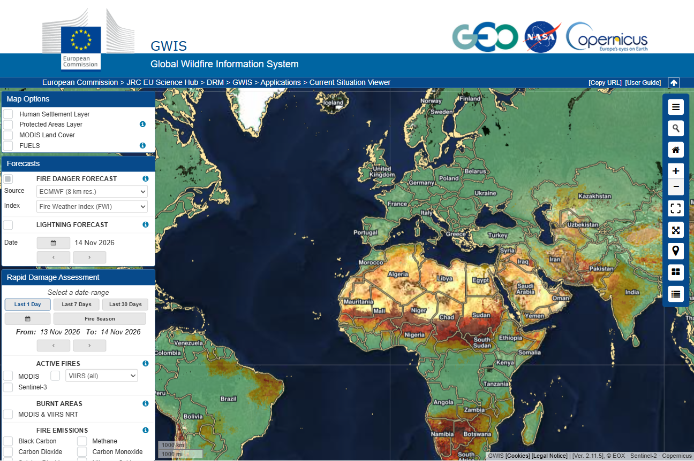
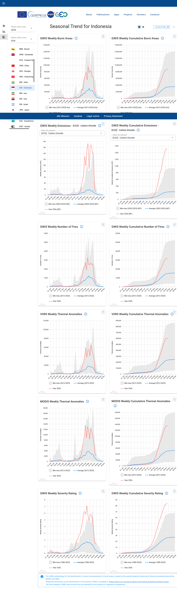
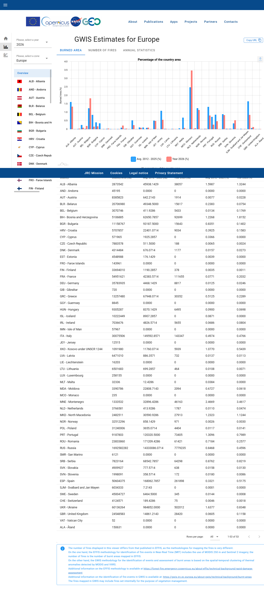

# GWIS / EFFIS (Copernicus)

URL: https://gwis.jrc.ec.europa.eu/ · Audited: 2026-11-14 · Tier: 1

## Summary

GWIS (Global Wildfire Information System, EC Joint Research Centre / Copernicus; EFFIS is its European twin) is not one app but a portal of five separate tools. For IGNIS the gold is in three of them: the **Country Profile** (sub-country drill-down to provinces with monthly burned-area statistics, a MODIS/VIIRS datasource switch, a month×year "fire season" heatmap, and current-year-vs-historical percentile envelopes), the **Current Statistics Portal → Seasonal Trend** (weekly charts where MODIS and VIIRS thermal anomalies sit side by side against the same 2012–2025 min–max/average envelopes), and the **Current Situation Viewer** (fire-danger forecast layers with a threshold legend table and time-range presets including "Fire Season to date"). GWIS shows burned area and fire/thermal-anomaly counts — never individual Hotspot points in the statistics tools — and it juxtaposes the two sensors rather than harmonizing them, which is exactly the gap IGNIS fills.

## Task walkthrough

| Task | Steps / clicks | Result | Notes |
|---|---|---|---|
| Hotspots in West Kalimantan last September | 4 clicks (Country Profile link → Country overview → expand IDN-Indonesia → click Kalimantan Barat) + 2 more to charts | **not supported (as Hotspot points)** | No tool shows historical Hotspot detections for a past month. Nearest equivalents actually reached: Country Profile → Kalimantan Barat → Country charts → "Monthly Burned Area Seasonality" shows September is a peak burning month (burned area, not Hotspots). The map viewer's Active Fires layers (MODIS / VIIRS / Sentinel-3) accept a custom date range, but I did not execute a September lookup there. |
| Which months burn most, year over year | 6 clicks (as above + Country charts nav + "Burned Area & Number of Fires >>") | Answered | Multi-year Charts for Kalimantan Barat [2002–2025]: "Yearly Burned Area Seasonality" heatmap paints Jul–Oct red ("Fire Season") in almost every year; "Average Monthly Burned Area" peaks Aug–Oct (Sep ≈ 40,000 ha/month avg). |
| 2023 vs 2019 | +4 interactions (focus Year slider, ArrowLeft ×2 to 2023, Update) | Answered (2019 much worse) | "Yearly Burned Area & Number of Fires" bars: 2015 and 2019 ≈ 300–380k ha vs 2023 ≈ 30–50k ha. "Monthly Burned Area vs Historical [2002-2025] → 2023" draws 2023 as a black line inside the 10–90th envelope — a below-average year. No yearA-vs-yearB picker; comparison is always "one chosen year vs history". |

## Checklist

Scores 0–2 per user (R = first responder, S = scientist, LM = land manager). Verdict = inherit / adapt / avoid.

| # | Item | Observation | R | S | LM | Verdict |
|---|---|---|---|---|---|---|
| 1 | First screen | Homepage is a text portal listing five apps; each tool opens separately. Current Situation Viewer is map-first (global FWI layer on by render); stats tools are chart-first with selectors. Time-to-first-answer is slowed by the portal hop. | 1 | 1 | 1 | adapt — IGNIS should land directly on map+calendar |
| 2 | Time controls | Map viewer: Last 1/7/30 Days presets, custom range, "Fire Season: from 01/01 to today", day-step arrows, date picker. Country Profile: period range sliders (start/end year) + Year slider + explicit **Update** button (changes don't apply until pressed). No visual indication of data gaps. | 2 | 2 | 2 | inherit presets + fire-season-to-date; adapt sliders (auto-apply, show gaps) |
| 3 | Space controls | Region tabs (Africa/Americas/Asia/Europe/Oceania + EU, LAC, MENA, …), country tree expandable to provinces (Kalimantan Barat reachable in 2 clicks), named AOIs (Brazilian Legal Amazon, AMAP/Arctic). No draw-a-box, no search, no click-map-to-select. | 1 | 1 | 2 | adapt — keep province presets, add draw + search for Areas of Interest |
| 4 | Hotspot display | Statistics tools show no points at all — everything is aggregated burned area / counts. Map viewer offers Active Fires points (MODIS, VIIRS, Sentinel-3) and burnt-area pixels; no clustering or density toggle observed. Zoom behavior not tested in depth. | 1 | 1 | 1 | adapt |
| 5 | Sensor handling | Best labeling seen in any audited app: datasource dropdown "MODIS [MCD64]" / "VIIRS [VMP64]" with product codes; period slider auto-clamps to the sensor's record (2002 vs 2013) when switching. Seasonal Trend shows MODIS and VIIRS thermal anomalies as **parallel chart pairs on a common 2012–2025 baseline** (≈ the Overlap Period) — juxtaposition, not harmonization; burnt-area map layer is merged "MODIS & VIIRS NRT". No confidence levels anywhere. | 1 | 2 | 1 | inherit labeling + record-aware periods; IGNIS adds the Harmonized Hotspot Count GWIS lacks |
| 6 | Color and legend | Fire Danger Classes table gives numeric thresholds per index (e.g. FWI: Low <11.2 … Very Extreme >70) — exemplary. Charts: salmon bars for burned area, grey/blue/red envelopes, red-vs-blue binary fire-season heatmap, yellow→purple continuous fire-size heatmap. Colorblind safety not verified; legends sit under charts as toggleable switches. | 2 | 1 | 1 | inherit the threshold legend table |
| 7 | Linked views | None within a tool: charts never update the map and vice versa. Cross-app deep link exists (Seasonal Trend → "Country Profile" button → /apps/country.profile/overview/ADM0/IDN). Selecting a date on a chart does nothing spatial. | 0 | 1 | 1 | avoid the disconnection; inherit the deep-link idea |
| 8 | Comparison | Strong: current year vs min–max and 10–90th envelopes + average, per month and cumulative; ranked country table (Country Area ha, Avg 2012–2025 ha, Year ha, same in % of area); province bar comparison within a country; region overview bars (Avg. Burned Area per country, toggle Avg. Nr. of Fires). No yearA-vs-yearB and no regionA-vs-regionB picker. | 1 | 2 | 2 | inherit envelopes + ranked-table pattern |
| 9 | Explaining the data | ⓘ info button per layer/chart linking to technical-background pages; methodology banner (optical clustering of MODIS+VIIRS thermal anomalies) in Seasonal Trend; footnote that envelope stats exclude the selected year; README + DOI citations on every bulk download. | 1 | 2 | 1 | inherit |
| 10 | Mobile | Not tested — no phone-width emulation available in this environment. Layouts observed are desktop two/three-column with fixed left panels; no bottom-sheet pattern seen. | n/t | n/t | n/t | unresolved |
| 11 | Export/share | Per-chart amCharts menu with Image / Data / Print (submenu formats not verified). Data page: bulk global ZIPs (MODIS burned area 2002–2025, VIIRS 2013–2025, Globfire perimeters per year, emissions) with citations — no per-country CSV from the UI. "Copy URL" button in Estimates; Country Profile selections deep-linkable (/overview/ADM0/IDN), but chart-page state (sensor/period/year) is not in the URL. | 1 | 2 | 1 | adapt — IGNIS should export the visible series and share full state |
| 12 | Language and locale | Apps are English-only; a separate Spanish portal site (gwis-es) exists for static content. Dates shown as "14 Nov 2026" and dd/mm. No in-app language switch. | 1 | 1 | 1 | avoid — IGNIS ships EN/MS/ID from the start |
| 13 | Performance | Angular SPAs: Current Situation Viewer snapshot was empty for several seconds and showed unhydrated `{{source.value}}` templates; one Update re-render exceeded 5 s; one full-page screenshot timed out at 30 s then succeeded. Multi-year charts page mounts ~11 amCharts at once — heavy. | 1 | 1 | 1 | avoid the render-everything grid; lazy-load per view |

## Screenshots

-  GWIS homepage: a text portal introducing the five applications (Current Situation Viewer, Current Statistics Portal, Country Profile, Long-term Forecast, Data & Services).
-  Country Profile, Asia region overview: banner stats (area, population, land cover) over a wildfire photo, and the Avg. Burned Areas (ha) per-country bar chart [2002–2025], toggleable to Avg. Nr. of Fires.
-  Country overview drilled to Indonesia → Kalimantan Barat: sub-country header stats (Area 146,874 km², Forest 91,055 km²) and the province-comparison burned-area chart where Kalimantan Tengah towers at ~200k ha.
-  Country charts, Multi-year tab, MODIS [MCD64], 2002–2025: yearly bars + fire-count line, the month×year Fire Season heatmap, land-cover stacks, monthly averages, fire-size distribution, and the fire-size heatmap.
-  Same page with Year slider set to 2023: "Monthly Burned Area vs Historical" shows the 2023 black line inside the 10–90th envelope (below-average year) while 2019 stands tall in the yearly bars — the 2023-vs-2019 answer.
-  Current Situation Viewer with Fire Danger Forecast enabled: global FWI colored green→dark red, left Map Options panel (layer checkboxes, Source/Index dropdowns, Last 1/7/30 Days presets, Active Fires MODIS/VIIRS/Sentinel-3), date "14 Nov 2026".
-  Current Statistics Portal → Seasonal Trend for Indonesia: twelve weekly + cumulative charts, each with grey min–max band, blue average, red Year 2026 line — including paired MODIS and VIIRS Thermal Anomalies charts showing the ~6× scale gap.
-  GWIS Estimates for Europe: ranked table (Country Area, Avg 2012–2025 vs Year 2026 in ha and %) with Burned Area / Number of Fires / Annual Statistics tabs and a Copy URL button.

## Patterns worth taking

- **Fire-season month×year heatmap**: rows = months, columns = years, each cell classified red "Fire Season" vs blue "Outside" from the multi-year average — the closest existing ancestor of IGNIS's Burning Calendar grid; a Typical Year is readable as the solid red band. Serves land managers and responders. (04, 05)
- **Current-year vs historical envelopes**: min–max band + 10–90th band + average line + one black line for the chosen year, per month and cumulative — IGNIS's Typical Year with anomaly framing, and the honest way to answer "is this year worse?". Serves all three users. (05, 07)
- **Sensor-paired charts on a common baseline**: MODIS and VIIRS thermal-anomaly charts side by side, both baselined to 2012–2025 (effectively the Overlap Period), exposing the ~6× scale difference instead of hiding it — IGNIS should show this pairing *and* the Harmonized Hotspot Count that reconciles it. Serves scientists. (07)
- **Datasource selector with product codes and record-aware periods**: "MODIS [MCD64]" / "VIIRS [VMP64]" dropdown; the period slider auto-clamps to the sensor's record (2002 vs 2013) on switch. Cheap to build, huge for trust. Serves scientists. (04)
- **Time-range presets including Fire Season to date**: Last 1 / 7 / 30 Days, custom range, "Fire Season: from 01/01 to today", plus day-step arrows — responders get "now" in one tap. Serves responders. (06)
- **Threshold legend table**: one legend row per danger class with numeric cutoffs for every index — the pattern for IGNIS's heatmap legend (Hotspot count or Burning Phase thresholds spelled out, not just colors). Serves responders. (06, in-page table)
- **Ranked region comparison table**: Country | Area | Avg 2012–2025 | current Year, in absolute and % of area — a ready-made IGNIS region panel comparing Areas of Interest within the Coverage Area. Serves land managers. (08)
- **Sub-country drill-down tree with cross-app deep links**: region → country → province tree in two clicks, selection mirrored in the heading and a shareable URL (/overview/ADM0/IDN), plus a "Country Profile" button that jumps apps carrying context. Serves land managers and scientists. (03, 07)
- **Info-per-metric provenance**: an ⓘ on every layer and chart linking to methodology, envelope footnotes ("statistics exclude the selected year"), and DOI citations on downloads — the credibility pattern IGNIS's about/method view needs. Serves scientists. (06–08)

Caveats recorded while auditing: the portal text still describes Country Profile as "2002–2019" but the app itself serves 2002–2025; the Indonesian province list predates the 2012 Kalimantan Utara split; switching VIIRS→MODIS left my period slider at 2013 until manually widened; and some chart legends showed stale series labels after an Update (e.g. "2013-2025" inside a "[2002-2025]" chart title) — a re-render bug worth avoiding in IGNIS.
