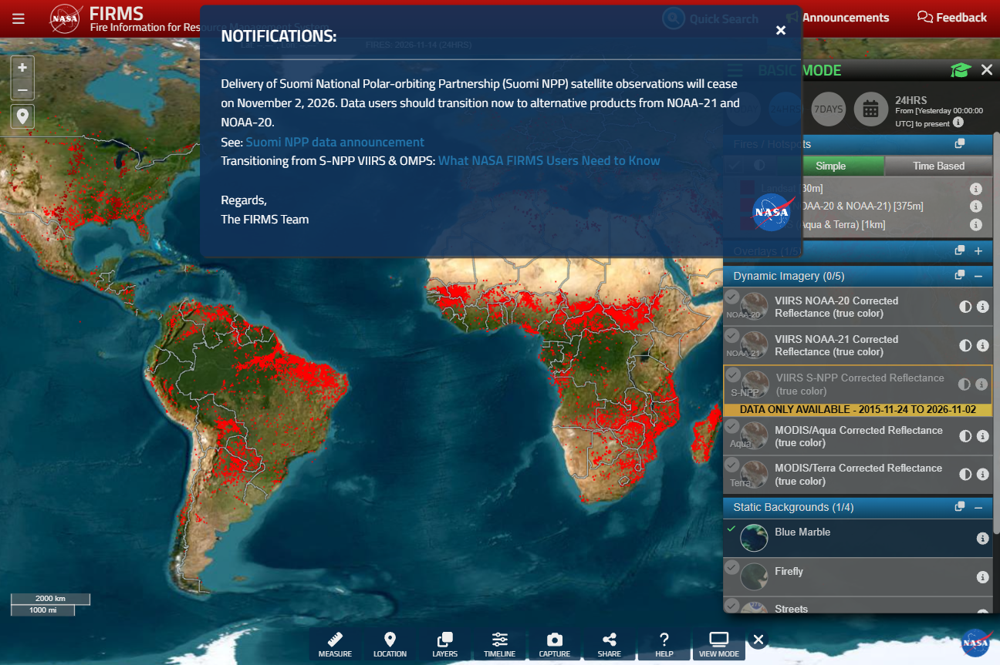
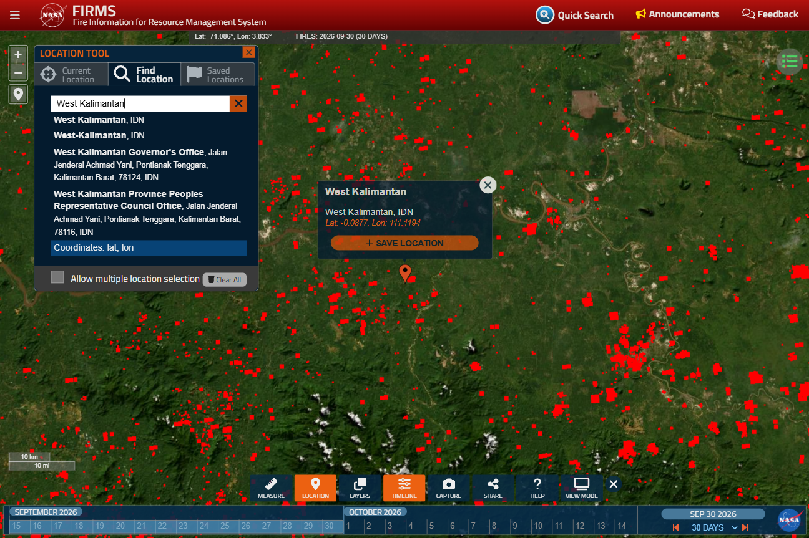
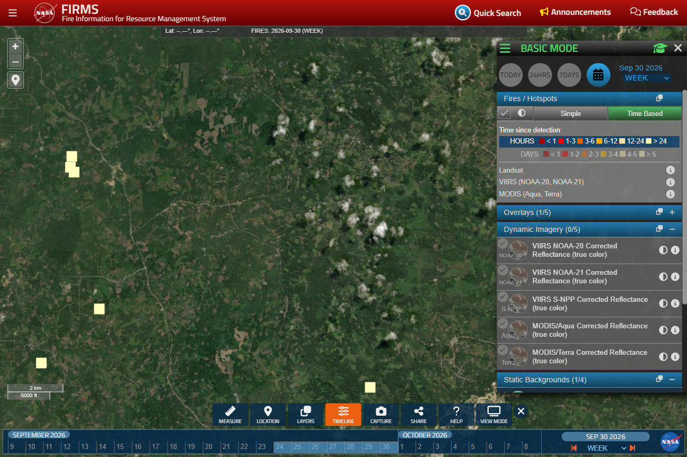
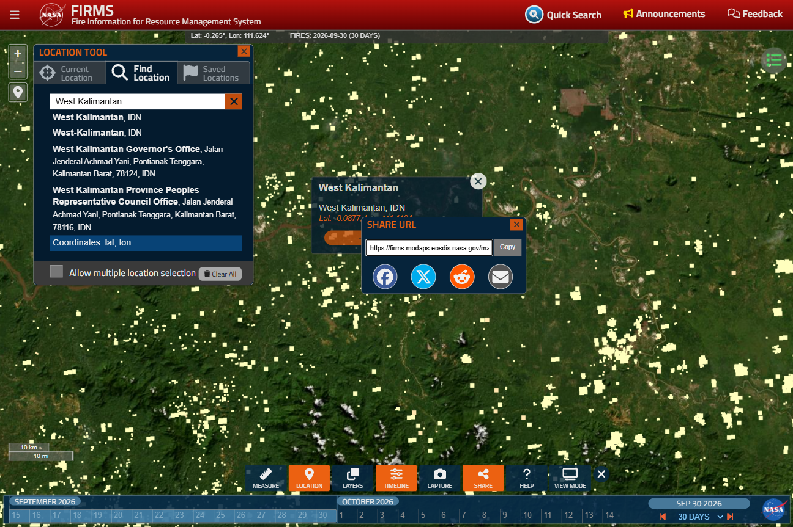
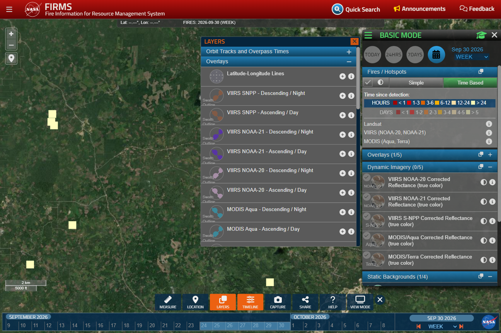
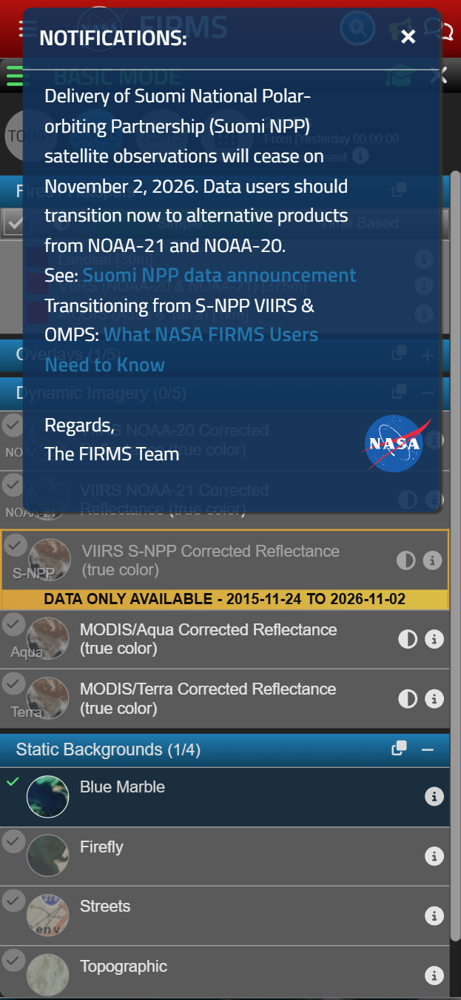

# NASA FIRMS Fire Map

URL: https://firms.modaps.eosdis.nasa.gov/map/ · Audited: 2026-11-14 · Tier: 1

## Summary

The canonical MODIS/VIIRS hotspot viewer: a canvas map that loads in ~3.5 s / 0.5 MB with the last 24 hours of Hotspots already drawn, a bottom timeline (end-date picker + 1–31-day window + TODAY/24HRS/7DAYS presets), and a right-hand layer dock. Its best ideas for IGNIS are full-state shareable URLs, a "Time since detection" age ramp for Hotspot dots, honest per-sensor labeling with temporal coverage, and state-encoded image export. Its biggest gaps are exactly IGNIS's signature features: no per-sensor Hotspot toggles in the UI, no aggregation or seasonality view (max window 31 days), no year comparison, and no per-point details.

## Task walkthrough

| Task | Steps / clicks | Result | Notes |
|---|---|---|---|
| Hotspots in West Kalimantan last September | 8 clicks + typing (1 date field → calendar; 2 month-dropdown → September; 1 day 30; 2 range → 30 days; 1 Quick Search; Enter; 1 result "West Kalimantan, IDN") | Done. ~150–250 red points across West Kalimantan, densest east/center; final state `#d:2026-09-01..2026-09-30;@111.12,-0.09,10.00z`, status readout "FIRES: 2026-09-30 (30 DAYS)" | Window is end-anchored: pick end date + length → [end−(days−1), end]. Geocode mixes POIs ("West Kalimantan Governor's Office") with the province relation — user must pick carefully. No draw-an-Area-of-Interest; search jumps center/zoom only. |
| Which months burn most, year over year | — | not supported | No chart, count, or aggregation anywhere in the UI; timeline window caps at 31 days (select options "1 day"…"31 days"). Nearest: manually re-pick month windows one at a time, or leave the map for the separate "DOWNLOAD ARCHIVED DATA" CSV flow. |
| 2023 vs 2019 | — | not supported | Single time window only; no year-vs-year, split, swipe, or baseline compare. Sequential re-dating of the same view and eyeballing is the only in-app path. |

## Checklist

Scores 0–2 per user (R = first responder, S = scientist, L = land manager).

| # | Item | Observation | R | S | L | Verdict |
|---|---|---|---|---|---|---|
| 1 | First screen | Map-first: globe at zoom 3 with last-24-h Hotspots drawn on load (`#d:24hrs;@0.0,0.0,3.0z`, "FIRES: 2026-11-14 (24HRS)"). But first visit opens a blocking NOTIFICATIONS modal (Suomi NPP cessation) over the map, and default extent is the whole world, not the user's region. | 2 | 1 | 1 | adapt |
| 2 | Time controls | Bottom timeline: flatpickr date box (month+year dropdowns), day-count select 1–31 with WEEK/2 WEEKS/3 WEEKS/4 WEEKS labels, back/forward-step buttons, presets TODAY/24HRS/7DAYS, and a vis-timeline strip (month calendar, selected range highlighted). Animation/rolling-mode control exists but was not run. Caps at 31 days; no month/season/year granularity; data gaps not marked. | 2 | 1 | 1 | adapt |
| 3 | Space controls | LOCATION TOOL: geocode search ("Search for location or enter coordinates"), coordinate entry, saved locations, multi-select. No draw-a-box, no admin-boundary presets — only global border overlays. | 1 | 1 | 1 | adapt |
| 4 | Hotspot display | Flat square points only, all sensors on one merged layer; no clustering or density view in this UI (a "GRIDDED FIRE HOTSPOTS" product exists only in the catalog). Per-point details: 4 click attempts on pixel-verified dot positions (zoom 10 and 13) produced no popup; attribute table (incl. confidence) appears only as documentation. | 1 | 0 | 1 | adapt |
| 5 | Sensor handling | One merged "Fires / Hotspots" layer; sensors told apart by dot color in Simple mode — Landsat [30m] dark red rgb(168,0,0), VIIRS (NOAA-20 & NOAA-21) [375m] red rgb(255,0,0), MODIS (Aqua & Terra) [1km]. No per-sensor toggle in the basic panel (clicking legend rows and Layer-Info entries changed nothing) and no confidence filter in the UI. Advanced LAYERS window offers per-satellite/per-orbit swath-outline overlays (VIIRS S-NPP/NOAA-20/NOAA-21 and MODIS Aqua/Terra Ascending/Day + Descending/Night, plus Sentinel-2 A/B/C, Landsat 9) shown "Offline" for past dates. Layer Information modal documents every product: temporal coverage (VIIRS S-NPP 2012-01-20→2026-11-02, NOAA-20 2020→present, NOAA-21 2024→present), latency, resolution, overpass times, attribute table. | 1 | 1 | 1 | adapt |
| 6 | Color and legend | Legend lives inline in the fires panel and swaps with mode: Simple = categorical sensor colors; Time Based = 12-bucket age ramp (HOURS <1, 1-3, 3-6, 6-12, 12-24, >24; DAYS <1, 1-2, 2-3, 3-4, 4-5, >5) from dark red to pale yellow. On long windows the ramp collapses to one bucket (all dots pale yellow at 30 days) — it only differentiates ≤ ~1-week windows. Colorblind safety of the red→yellow ramp untested. | 1 | 1 | 1 | adapt |
| 7 | Linked views | One view: date box, timeline strip, and presets all drive the same layer, with an always-visible "FIRES: <date> (<range>)" readout keeping context. No chart to link against. | 1 | 1 | 1 | adapt |
| 8 | Comparison | None: no year-vs-year, region-vs-region, or anomaly-vs-baseline anywhere. | 0 | 0 | 0 | avoid |
| 9 | Explaining the data | Strong. Inline note where the layer is toggled: "Do not use for the preservation of life or property… may be from fire, hot smoke, agriculture or other sources. Cloud cover may obscure active fire detections." HELP menu → About FIRMS, Active Fires/Thermal Anomalies, Citation, Disclaimer, FAQ, Layer Information (full product docs), Tutorials. First-load NOTIFICATIONS announces data cessation with links. | 1 | 2 | 1 | inherit |
| 10 | Mobile | Emulated 390×844 via CDP: layer dock legible, toggle targets adequate, no horizontal scroll, date controls still reachable. But the first-run NOTIFICATIONS modal covered most of the viewport until dismissed, and the bottom toolbar was not visible in the captured frame. Not tested on a physical touch device. | 1 | 0 | 1 | adapt |
| 11 | Export/share | SHARE dialog: full-state URL (`…/map/#t:tsd;d:2026-09-24..2026-09-30;@111.119,-0.088,13.000z` — display mode + date range + center/zoom) with Copy + Facebook/X/Reddit/Email. CAPTURE: "Download screenshot into image file" with Header/Timestamp/Scalebar checkboxes and format dropdown — verified download `FIRMS_2026-09-24_2026-09-30[@111.119,-0.088,13.000z].jpg` (state-encoded filename). No CSV export inside the map; data downloads live in separate site sections. | 1 | 2 | 1 | inherit |
| 12 | Language and locale | English only; no language switcher found in any menu; US-style dates ("Nov 14 2026", "SEP 30 2026"); decimal degrees. Nothing for Malay/Indonesian audiences. | 0 | 0 | 0 | avoid |
| 13 | Performance | Measured on one fresh load in-session: DOMContentLoaded 2360 ms, load 3554 ms, 64 requests, ~0.5 MB transferred, 42 tile requests. Light and responsive. | 2 | 2 | 2 | inherit |

## Screenshots

All captured 2026-11-14 with the browser screenshot tool from live sessions of the app (artifacts copied into place); each was verified by image analysis against what the screen showed.

-  Default first load: globe with last-24-h Hotspots, right-hand layer dock (Fires/Hotspots, Dynamic Imagery with S-NPP "DATA ONLY AVAILABLE … 2026-11-02", Static Backgrounds), and the blocking NOTIFICATIONS modal announcing Suomi NPP's cessation.
-  Task 1 result: West Kalimantan, Sep 1–30 2026 (30 DAYS), ~200 red Hotspot points, LOCATION TOOL with geocode results ("West Kalimantan, IDN" among POIs).
-  Time Based display, WEEK window: "Time since detection" legend with the 12-bucket hour/day ramp (dark red → pale yellow); all dots pale yellow because the window is historical; timeline strip with Sep 24–30 highlighted.
-  SHARE dialog over the map: full-state URL (mode + date range + view) with Copy and social buttons — the same URL restores the exact view.
-  LAYERS advanced window: "Orbit Tracks and Overpass Times" — per-satellite, per-orbit swath-outline rows (VIIRS S-NPP/NOAA-20/NOAA-21, MODIS Aqua…) shown "Offline" for a past date; fires panel with age-ramp legend at right.
-  390 px emulation: layer dock legible and scrollable, but the first-run NOTIFICATIONS modal covers most of the viewport until dismissed.

## Patterns worth taking

- **State-in-URL hash** (`#t:tsd;d:2026-09-01..2026-09-30;@111.12,-0.09,10.00z`): display mode, date range and view serialize into the address bar; SHARE is just this URL. IGNIS should make every Burning Calendar + heatmap state linkable the same way. Serves all three users. (heatmap + calendar)
- **End-anchored window picker**: pick an end date + a length (1–31 d, with WEEK labels), plus TODAY/24HRS/7DAYS presets, plus an always-visible "FIRES: <end date> (<length>)" readout. Cheap mental model, one status line keeps you oriented. Serves responders best. (heatmap)
- **"Time since detection" age ramp**: Hotspot dots recolored into hour/day buckets — answers "is it burning now?" at a glance. Caveat learned here: the ramp only differentiates on short windows; on a 30-day window every dot collapses to the oldest bucket. IGNIS should scale buckets to window length. Serves responders. (heatmap)
- **Sensor = legend = color**: one merged Hotspot layer where each sensor gets a color and an honest label with resolution — "VIIRS (NOAA-20 & NOAA-21) [375m]", "MODIS (Aqua & Terra) [1km]", "Landsat [30m]". Adapt, don't inherit: IGNIS scientists need real per-sensor toggles, which this UI lacks. (heatmap)
- **Inline methodology where the layer lives**: the accuracy caveat sits inside the fires panel next to the toggle, and the Layer Information modal carries per-product temporal coverage, latency, overpass times and an attribute table (incl. confidence). Inherit for IGNIS's about/method view. Serves scientists. (about/method)
- **State-encoded export filenames**: CAPTURE downloaded `FIRMS_2026-09-24_2026-09-30[@111.119,-0.088,13.000z].jpg`, with Header/Timestamp/Scalebar options — the file name alone reconstructs the view. Inherit for IGNIS exports. (heatmap)
- **Data-continuity notifications**: a first-load modal plus a greyed-out layer row ("DATA ONLY AVAILABLE - 2015-11-24 TO 2026-11-02") tell users a satellite ended. IGNIS needs the same for the MODIS→VIIRS Overlap Period story. Serves scientists and land managers. (about/method)
- **Per-orbit awareness (advanced)**: swath-outline overlays per satellite and orbit (Ascending/Day vs Descending/Night) explain *why* a night has no detections — the seed of IGNIS's sensor-gap explanation. Serves scientists. (heatmap, about/method)

Anti-patterns to avoid: blocking modal on first load; whole-globe default instead of the user's Coverage Area; no per-point details on click; custom widgets with no accessible labels (the page's controls were invisible to the accessibility tree, which also made automation click by DOM id).
