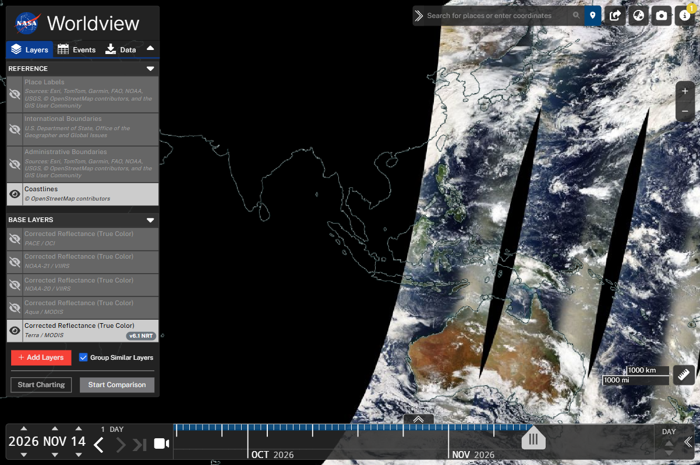
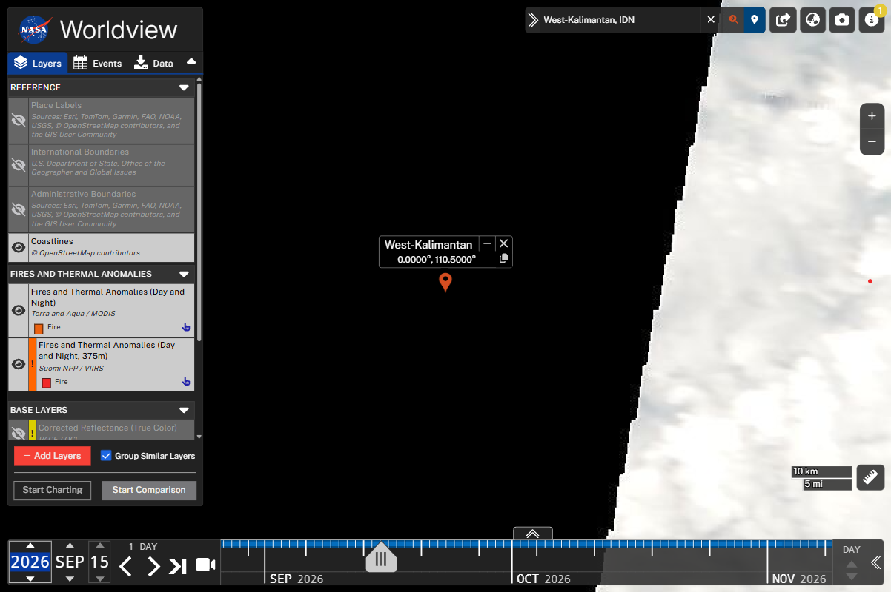
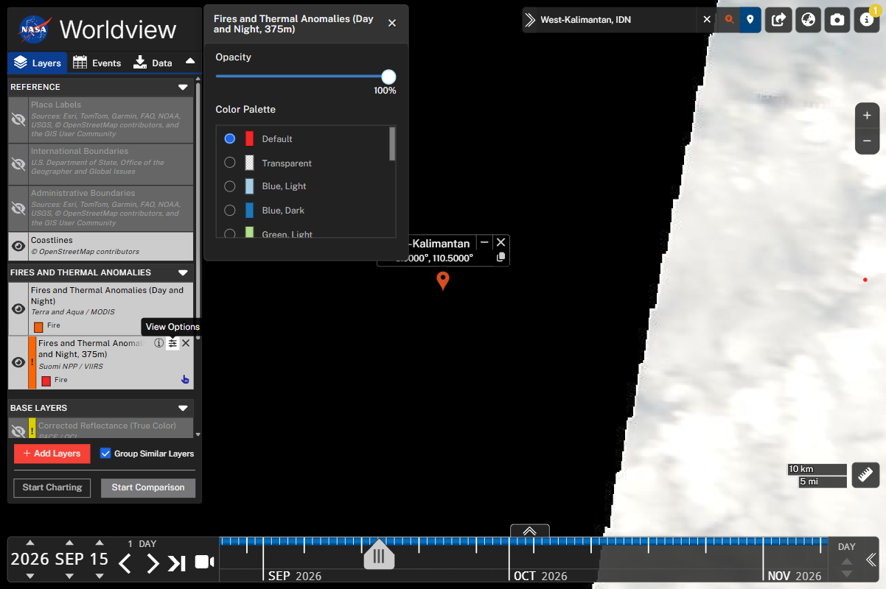
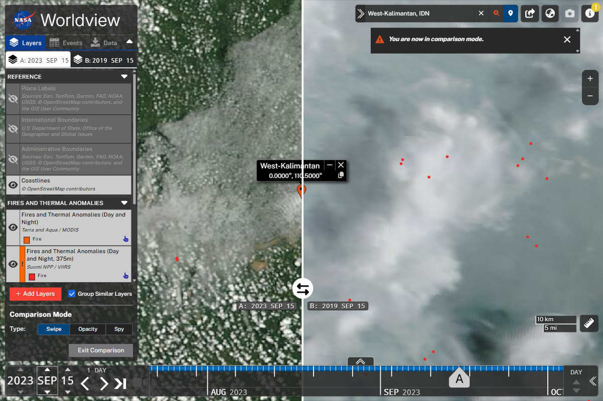
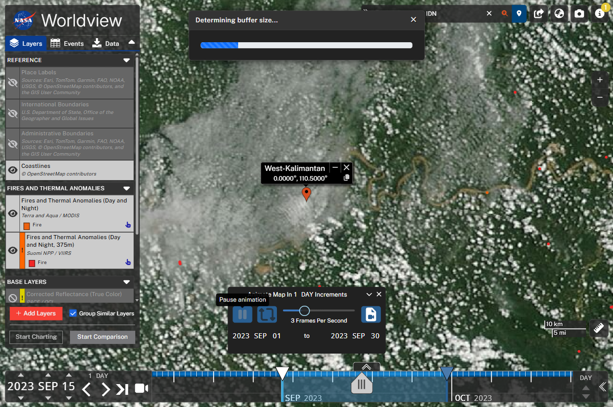
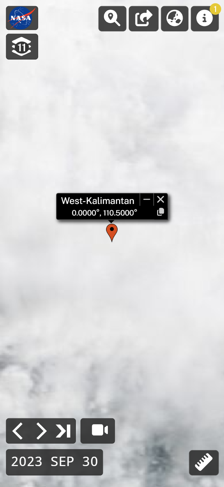
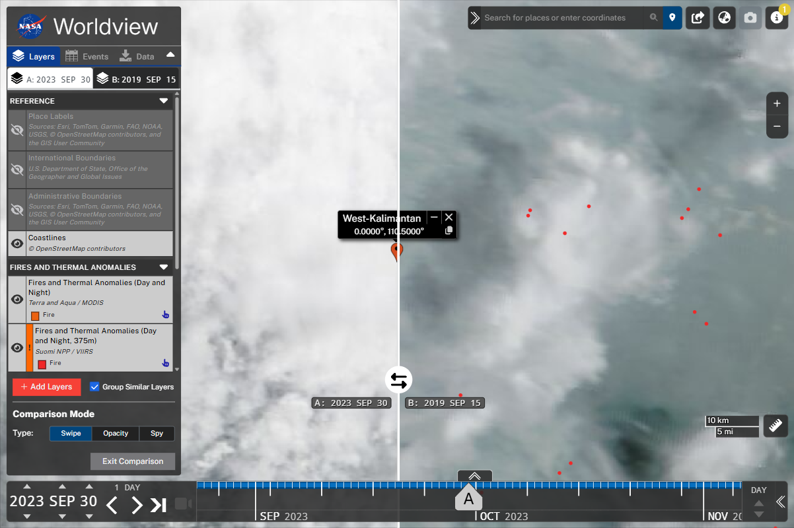

# NASA Worldview

URL: https://worldview.earthdata.nasa.gov/ · Audited: 2026-11-14 · Tier: 2

## Summary

NASA Worldview is a daily-resolution satellite imagery browser for NASA Earthdata (GIBS): map-first, layer-driven, with the strongest date controls of any app in this audit. For IGNIS it is the reference for three mechanics: a stepper-style date picker with switchable time granularity (Year/Month/Day/Custom), a four-mode comparison tool (side-by-side A|B, Swipe, Opacity, Spy) with an independent date per side, and a timeline animation widget with GIF export. It carries both MODIS and VIIRS fire layers as separate, explicitly named layers — useful vocabulary for our sensor handling — but it offers no aggregation: no Burning Calendar, no Typical Year, no Area of Interest statistics, and its charting mode rejects the fire layers.

All observations below were executed live in BrowserOS neo on 2026-11-14 unless marked *documented-not-executed*. Click counts are the literal interactions I performed.

## Task walkthrough

| Task | Steps / clicks | Result | Notes |
|---|---|---|---|
| Hotspots in West Kalimantan last September | 17 (1 Add Layers, 1 layer search, 2 layer cards + 2 Add Layer, 1 Esc close, 1 place search + ArrowDown/Enter, 5 zoom-in, 2 zoom-out, 1 interval menu, 2 date fills) | Done, with caveats: both fire layers shown — "Fires and Thermal Anomalies (Day and Night) Terra and Aqua / MODIS" + "(Day and Night, 375m) Suomi NPP / VIIRS" — at 2026 SEP 15 around Pontianak. Only 1 Hotspot pixel visible at that extent/date; much of the map was black (swath gaps render as blank/black tiles). | Place search "West Kalimantan, IDN" jumps to a point marker (0.0000°, 110.5000°), not the province polygon — I needed 5 zoom clicks to reach city scale, then 2 out for a usable view. With one sensor layer instead of two: 14 steps. Data gaps are shown passively (black tiles); a "Swath Gaps" story in the welcome modal explains them but nothing on-map flags a gap. |
| Which months burn most, year over year | not supported | No seasonality or aggregate view exists. Tested "Start Charting" (1 click): the mode prompt reads "Add a layer with a color palette to create a time series chart of a single variable" and neither fire layer gets a chart button — categorical fire classes are not chartable. | Workaround (not an equivalent): switch the interval chips to MONTH and step, or build an animation across a season. Worldview charts a single pixel's value, never an Area of Interest aggregate — the exact gap IGNIS's Burning Calendar and Harmonized Hotspot Count fill. |
| 2023 vs 2019 | 9 (1 Start Comparison, 1 B tab, 2 B date fills, 1 A tab, 1 A year fill, 1 Opacity, 1 Swipe, 1 divider drag) — side-by-side alone: 6 | Done: A: 2023 SEP 15 vs B: 2019 SEP 15. In side-by-side and in Swipe mode, the B (2019) half showed ~a dozen red Hotspot pixels while the A (2023) half showed essentially none at that extent — a readable same-season, year-vs-year answer. | Entering compare duplicates the layer list to the B side and defaults B to A minus 7 days. "Comparison Mode → Type:" offers Swipe / Opacity / Spy; the *disabled* button marks the active mode (confusing at first — I initially mis-read Swipe as unavailable). Exit Comparison discards B silently (no confirm). Compare mode locks out animation, snapshot, natural events and data download; `&ca=true` keeps compare state in the URL. |

## Checklist

Scores 0–2 per user (Responder / Scientist / Land manager). Worldview is Tier 2 but serves real MODIS/VIIRS fire layers, so all 13 items are scored (no N/A).

| # | Item | Observation | Responder 0-2 | Scientist 0-2 | Land mgr 0-2 | Verdict |
|---|---|---|---|---|---|---|
| 1 | First screen | Map-first with today's date (2026 NOV 14) and a True Color baselayer; a welcome modal lists story tours incl. "Satellite Detections of Fire (2021 update)". Zero fire data until you add a layer (~4 clicks) — slow path to "is it burning now". | 1 | 1 | 1 | adapt |
| 2 | Time controls | Best-in-class: year/month/day stepper textboxes (each with ▲▼), chevron popup with YEAR/MONTH/DAY/CUSTOM interval chips, ‹ › day steppers, "Latest available date" button, and a ticked timeline (month labels, scrubber). Animation advances the same date. Gaps: black tiles, no active flag. | 2 | 2 | 2 | inherit |
| 3 | Space controls | Geocoded place search ("West-Kalimantan, IDN" + POIs) and coordinate entry; zoom buttons/scale bar. No draw-an-Area-of-Interest, no province-polygon zoom, no admin filter — boundaries are visual reference layers only. | 1 | 1 | 1 | adapt |
| 4 | Hotspot display | One raster pixel per detection, per sensor layer; MODIS classes orange, VIIRS classes red (inline legend squares labeled "Fire"). No clustering or density grid at any zoom; pixels stay tiny at province scale. Layer hint says features are clickable for metadata at sufficient zoom ("Zoom in further to click features"); my one click attempt hit no feature — *not demonstrated*. | 2 | 2 | 2 | adapt |
| 5 | Sensor handling | Exemplary naming: sensor + satellite + resolution + day-part in every layer title — "Fires and Thermal Anomalies (Day and Night, 375m) Suomi NPP / VIIRS", "(Day and Night) Terra and Aqua / MODIS", NOAA-20/21, Day-only and Night-only variants. Layers toggle independently; no merging, no harmonization, no confidence UI (classes live in the palette). | 2 | 2 | 2 | inherit |
| 6 | Color and legend | Per-layer inline legend chip (red "Fire" square); View Options exposes Opacity (100%) and a customizable categorical palette with named classes (Transparent, Blue…Brown). Dark true-color basemap. Nothing marks the scale as colorblind-checked. | 1 | 2 | 1 | adapt |
| 7 | Linked views | One-way and partial: date drives the map; timeline scrubber sets the date; animation moves it. No chart exists for fire data (charting rejects fire layers), so there is no chart↔map linkage for our use case. | 1 | 1 | 1 | adapt |
| 8 | Comparison | The headline pattern: A|B with independent dates *and* layer lists per side, four modes (default side-by-side, Swipe divider, Opacity blend, Spy lens), draggable divider handle. Constraints: blocks animation/snapshot/events/download; B discarded on exit. | 1 | 2 | 2 | inherit |
| 9 | Explaining the data | Every layer row has "View Description" with source attribution; baselayer cards carry full credit strings (Esri/OSG S/USGS…); welcome stories teach concepts (Swath Gaps, fire detections). No uncertainty/confidence narrative on the map itself. | 1 | 2 | 1 | adapt |
| 10 | Mobile | Not responsive: at 390px the same desktop layout renders with the sidebar overlaying the map ("Expand/Hide sidebar" both present); full sidebar list, no bottom sheet. Desktop-only in practice. | 0 | 0 | 0 | avoid |
| 11 | Export/share | URL carries complete state — extent (`&v=`), layer list with hidden flags (`&l=`), date (`&t=`), compare flag (`&ca=true`) — verified across tasks. Share dialog: Link / Embed / Cite Us + "Shorten link". "Take a snapshot" dialog: resolution, format, Worldfile (.zip) georeferencing, "Select Entire Globe", raw/max size estimates, and a quality warning. Data Download tab exists (blocked during compare) — *not exercised*. No on-map CSV of Hotspots. | 1 | 2 | 2 | inherit |
| 12 | Language and locale | English only; no language or locale switcher found (page text search). Date format "2026 SEP 15" (month as 3-letter code). | 0 | 1 | 0 | avoid |
| 13 | Performance | Heavy: this session's navigation timing showed DOMContentLoaded 13.4s, load 15.6s, 250 resources, 6.5 MB transferred; several of my 30s tool calls timed out during tile loads and the animation showed a "Determining buffer size…" progress dialog. Fine on desktop broadband, painful otherwise. | 0 | 1 | 1 | avoid |

## Screenshots

-  First screen: map-first with today's date (2026 NOV 14), Terra/MODIS True Color default, layers sidebar, and the bottom date bar; welcome modal just dismissed.
-  Task 1 result: both fire layers over West Kalimantan at 2026 SEP 15. Sidebar shows the FIRES AND THERMAL ANOMALIES category with per-layer "Fire" legend squares; map mostly black (swath gap) with one Hotspot pixel.
-  VIIRS layer's View Options drawer: Opacity 100% and the customizable categorical Color Palette (named classes) — the legend lives inside the layer panel.
-  Task 3, side-by-side A|B: A: 2023 SEP 15 (left, few visible Hotspots) vs B: 2019 SEP 15 (right, ~a dozen red pixels) with draggable divider handle; "You are now in comparison mode" toast.
-  Animation widget: start/end date fields (2023 SEP 01–30), "Map In 1 DAY Increments", play/pause, loop, speed slider ("3 Frames Per Second"), "Create an animated GIF"; blue range highlighted on the timeline; a "Determining buffer size…" dialog shows the cost.
-  Mobile at 390px: same desktop layout with the sidebar overlaying the map — no responsive adaptation (caption grounded in the live 390px accessibility snapshot; image-model confirmation was rate-limited).
-  Swipe comparison mode: one map split by a draggable vertical divider, A: 2023 SEP 30 left / B: 2019 SEP 15 right; sidebar shows Comparison Mode → Type: Swipe (selected) / Opacity / Spy and Exit Comparison.

## Patterns worth taking

- **Swipe + Opacity + Spy comparison modes**: beyond side-by-side A|B, Worldview offers a draggable divider on a single map (Swipe), an opacity blend between dates (Opacity), and a magnifier lens (Spy) — each with an independent date per side. Year-vs-year is IGNIS's core question; swipe alone answers "is 2023 worse than 2019" in one screen. Serves land managers and scientists; belongs on the IGNIS heatmap.
- **Stepper date control with interval chips**: year/month/day are separate small textboxes with ▲▼ steppers, plus a YEAR/MONTH/DAY/CUSTOM chip row that changes both the timeline ticks and the step size. Directly adaptable to the Burning Calendar's granularity question (daily vs monthly cells); serves all three users.
- **Full-state shareable URL**: extent, layer stack (with hidden layers), date, and compare mode all serialize into the link, so any answer a user builds is shareable and citable ("Cite Us" tab). Inherit for IGNIS; serves all users, especially scientists.
- **Sensor-explicit layer naming**: "Fires and Thermal Anomalies (Day and Night, 375m) Suomi NPP / VIIRS" — sensor, satellite, resolution, and day-part in one label, per layer, with an eye-icon toggle. IGNIS should name its MODIS/VIIRS layers and the Harmonized Hotspot Count with the same discipline; serves scientists and responders.
- **Per-layer inline legend chip**: a small colored square + label ("Fire") inside each layer row, with the full palette editor one click away in View Options. Cheap, always visible, no separate legend panel to hunt for; serves responders.
- **Animation range widget with GIF export**: start/end date fields, frame interval, speed slider, loop toggle, and one-click animated GIF. Adaptable as the Burning Calendar's "play the season" control; the GIF export serves land-manager briefings.
- **Snapshot export with georeferencing**: image export dialog offering resolution, format, Worldfile (.zip), whole-globe option, and size estimates with a quality warning. Worth adapting so IGNIS map images stay GIS-usable.
- **(Anti-pattern) Mode exclusivity**: entering comparison locks out animation, snapshot, natural events, and data download (disabled with explanatory tooltips). IGNIS should compose its tools instead — comparison and animation are most powerful together for "play 2019 vs 2023".
- **(Anti-pattern) Point-only place search**: selecting "West Kalimantan, IDN" centers a pin at the province centroid and zooms to city scale, not the province polygon — cost me 7 extra zoom clicks. IGNIS Areas of Interest should zoom to the boundary extent.
