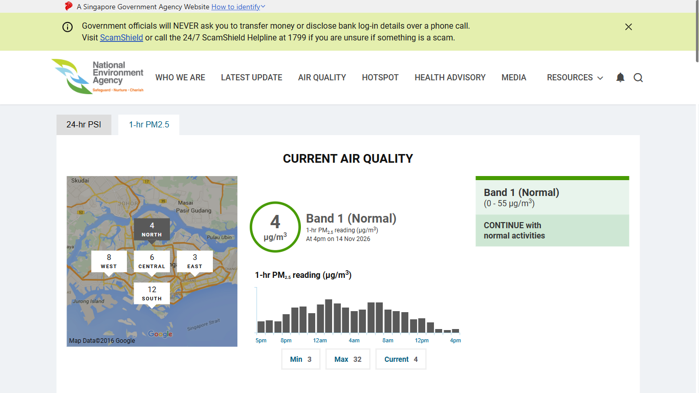
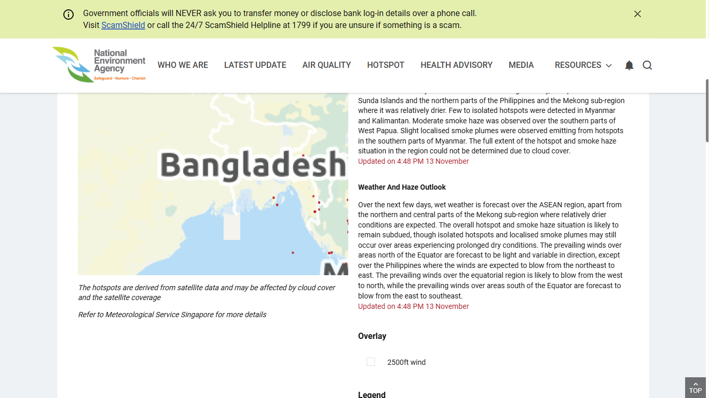
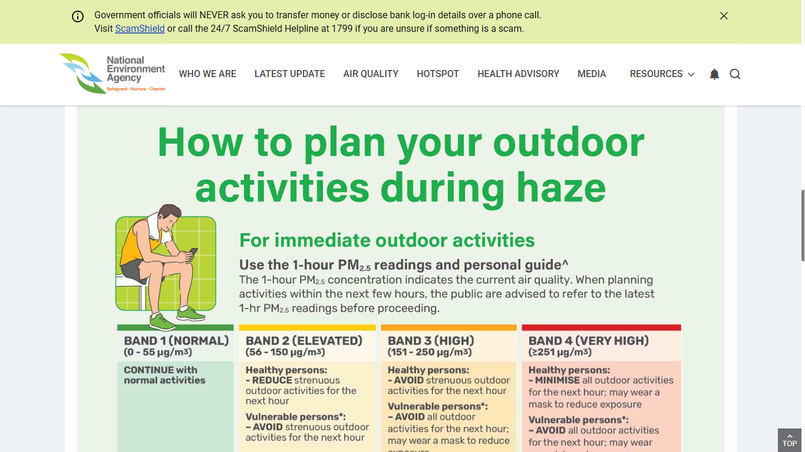
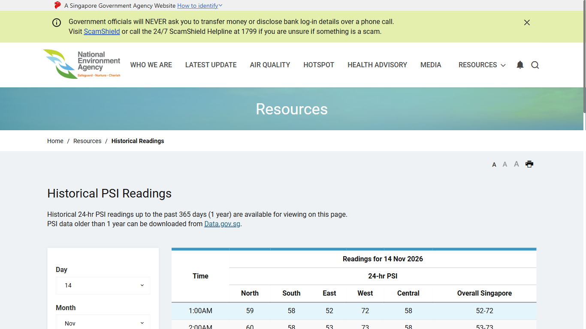
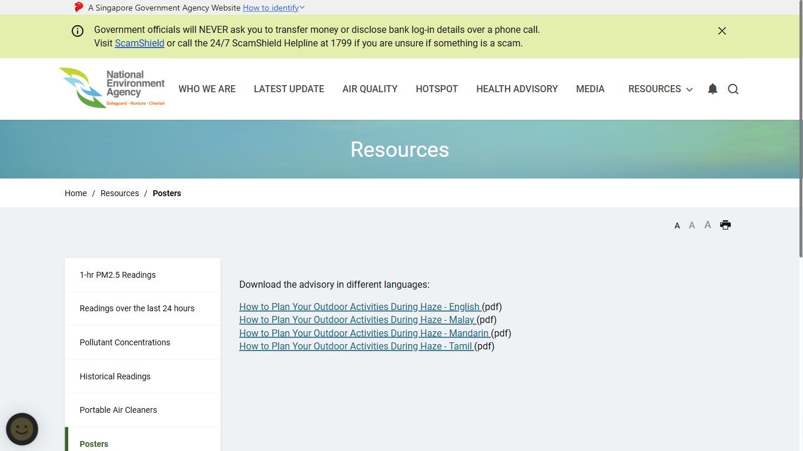

# NEA haze portal
URL: https://www.haze.gov.sg/ · Audited: 2026-11-14 · Tier: 2 · Supplement: Borneo

## Summary
Singapore NEA's national haze site (online since June 2013 per its Who We Are page): a single-page home — Latest Update · Air Quality · Hotspot · Health Advisory · Media · Resources — where a 24-hr PSI ↔ 1-hr PM2.5 toggle drives a five-region Google map (North/South/East/West/Central + Overall Singapore), a Band gauge and a past-24-hr chart, next to an ASEAN-wide Hotspot canvas with a red-dot legend, and a health-advisory section whose guide ships as PDFs in English, Malay, Mandarin and Tamil. Its best offering for IGNIS's tri-country Coverage Area is the discipline of translating burning into health outcomes: numbered color bands, one action per band, split by "healthy persons" vs "vulnerable persons", wrapped in a daily prose narrative that names the foreign source ("fires in Kalimantan"), the transport wind and the local consequence. It is also the strongest Q1 evidence in the supplement set: a cross-border problem presented own-country-first — Singapore's five regions are the only selectable Areas of Interest, and every neighbouring territory is prose.

Method note: the shared browser session was down all audit day (BrowserOS neo unreachable, four attempts), so no click-through was executed — every walkthrough row below is **documented-not-executed**. Evidence instead: live HTML/JS of the home and five subpages fetched 2026-11-14 via curl (`.audit-tmp/nea/`), rendered viewport captures of six states via an external page-capture service (verified against a vision model, saved in `img/nea-haze-portal/`), plus one *cached* render of the portal's episode state dated 15 Oct 2026 (clearly labeled wherever cited). The "24-hr PSI toggle, HOTSPOTS section with legend, HEALTH ADVISORY, downloadable PDF guides, region breakdown" named in the brief's scoping notes were all confirmed present and live.

## Task walkthrough
| Task | Steps / clicks | Result | Notes |
|---|---|---|---|
| Where were Hotspots in Central Kalimantan last August? | not counted — documented-not-executed (browser session down) | **not supported** | The Hotspot map loads exactly one latest KML per page load (filename-timestamped `Haze_Hotspots_20261113_164100.kml` in the live 2026-11-14 HTML); `hotspots.js` has no date parameter, no date picker exists anywhere in the section. No region filter or search; Central Kalimantan is reachable only by dragging the pan-only canvas (no zoom), and the default view opens on the NW corner of the ASEAN box (Myanmar/Bay of Bengal) — Borneo is off-screen. The Latest Update prose names Kalimantan only qualitatively ("Few to isolated hotspots were detected in Myanmar and Kalimantan", updated 4:48 PM 13 November). |
| Compare the burning season across borders: West Kalimantan vs Sarawak | not counted — documented-not-executed | **not supported** | No region selection, no counts and no comparison view anywhere on the site; both territories appear only as words inside the daily narrative (Sarawak: "few hotspots were detected in Sarawak" in the 15 Oct cached episode render). For fortnightly regional hotspot distribution the site explicitly delegates: "please refer to the ASEAN Specialised Meteorological Centre (ASMC) website" (cached episode render; live quiet state links ASMC under Haze-Related Links). This app's cross-border value is framing, not comparison — see B2. |
| Is 2023 worse than 2019? | not counted — documented-not-executed | **not supported** for Hotspots; partial, one day at a time, for PSI only | No hotspot counts exist to compare. The Historical Readings page serves "up to the past 365 days" in-page (Day/Month/Year dropdowns — Year options 2022–2026 in markup, behind a captcha; verified live 14 Nov 2026 rendering an hourly North/South/East/West/Central/Overall table for that single day) and older PSI only as an outbound Data.gov.sg dataset download (`data.gov.sg/dataset/historical-24-hr-psi`). 2019 lies entirely in the outbound tier, and the site offers no year-vs-year or anomaly view of any kind. |

## Checklist
| # | Item | Observation | Responder 0-2 | Scientist 0-2 | Land mgr 0-2 | Verdict |
|---|---|---|---|---|---|---|
| 1 | First screen | Quiet-state landing (verified render, 14 Nov 2026): scam banner + NEA masthead + anchor nav, then Latest Update accordion and Air Quality — `24-hr PSI \| 1-hr PM2.5` tabs, Google map with five numbered region markers (North 4 / West 8 / Central 6 / East 3 / South 12 µg/m³), a circular gauge "Band 1 (Normal), At 4pm on 14 Nov 2026", a past-24-hr bar chart (Min 3 / Max 32 / Current 4) and the band's action ("CONTINUE with normal activities"). First useful answer (Singapore air now) is immediate; burning is a scroll away. In the episode state (cached 15 Oct 2026 render) a "Haze Situation Update" block leads instead: forecast band in words, three-audience advisory, numbered paragraphs, embedded hotspot map image. | 2 | 1 | 1 | adapt |
| 2 | Time controls | Hotspot map: none — one latest snapshot, no date control (evidence: `hotspots.js` + KML filename timestamp). Air Quality: fixed past-24-hr window via the tab; Historical page: Day/Month/Year dropdowns + captcha, one day per query, "-" for missing hourly cells; cloud-cover gaps explained only in prose ("full extent … could not be determined due to cloud cover"). No slider, playback or presets. | 1 | 1 | 0 | avoid |
| 3 | Space controls | Air Quality map: five clickable region markers + region labels drive the stats panel (`region-selected-value` "NORTH"); that is the entire region model. Hotspot canvas: pan-only (cursor:grab, mouse+touch drag), no zoom, no search, no draw; neighbours are unlabelled KML boundary outlines named only in prose. | 1 | 0 | 0 | avoid |
| 4 | Hotspot display | Uniform red dots at one fixed zoom on a static ASEAN canvas (equirectangular bounds lat −18.6…32.6, lng 86…144 baked into `hotspots.js`); boundary polygons drawn from KML; 2500ft-wind overlay checkbox; satellite overlay vestigial (default off, no checkbox in markup). Verified render opened on Myanmar/Bay of Bengal — the fires that matter to Singapore (Borneo) start off-screen. No clustering, no zoom-dependent behaviour, no click-through on any dot. | 1 | 1 | 0 | avoid |
| 5 | Sensor handling | Absent by design: no MODIS/VIIRS naming, no confidence, no counts — provenance is one line ("The hotspots are derived from satellite data and may be affected by cloud cover and the satellite coverage — Refer to Meteorological Service Singapore"). Effective simplification for the public, fatal for a scientist; sensor detail is delegated to ASMC. | 0 | 0 | 0 | avoid |
| 6 | Color and legend | Two coherent four-band scales, hex-coded in markup: 24-hr PSI (0–100 Good to Moderate #479B02, 101–200 Unhealthy #FFCE03, 201–300 Very Unhealthy #FFA800, 301+ Hazardous #D60000) and 1-hr PM2.5 (Normal/Elevated/High/Very High with #479B02/#FFCE03/#E87D32/#D60000); numbers and descriptors always accompany color. Permanent legend under the Hotspot canvas: Dense Haze, Moderate Haze, Hotspot, 2500ft wind, Wind speed (km/h). Same green→red family `asmc.md` uses. | 2 | 1 | 1 | inherit |
| 7 | Linked views | Region marker ↔ gauge/stats/personal guide is a real link (aria-live advisory updates with the selected region); tab switch swaps chart *and* section title ("Current Air Quality" ↔ "Air Quality (Past 24 hours)"). But the Hotspot canvas is a dead end — no dot is clickable, no date/region state leaves the section, and nothing links narrative↔map mechanically (only adjacency). URL anchors (#1–#5) carry no view state. | 1 | 1 | 0 | adapt |
| 8 | Comparison | None for hotspots; none between years or regions in-page. Historical page is one day per captcha'd query; beyond 365 days PSI lives in an outbound Data.gov.sg dataset. No baseline, no anomaly framing — the exact gap IGNIS's Typical Year fills. | 0 | 1 | 0 | avoid |
| 9 | Explaining the data | Consistent caveats under every map ("derived from satellite data… cloud cover… satellite coverage"; "Maps are not to scale and are for illustrative purposes only"); Who We Are explains the indicator design itself (PSI vs 1-hr PM2.5 purposes, "scientific studies… based on a 24-hour exposure", "24-hour PSI forecast is only available during the haze season", commissioned June 2013); the advisory PDF repeats the method. Adds to `asmc.md`'s caveat discipline by explaining *why two indexes exist*. | 1 | 2 | 1 | inherit |
| 10 | Mobile | Markup-level evidence only (not rendered — browser session down): responsive viewport meta, a web-mobile manifest + Apple touch icons, touchstart/touchmove pan handlers on the hotspot canvas, SGDS `is-hidden-touch` nav collapsing. Cannot confirm layout quality; the fixed-height canvas and 6-column historical table are suspect on a phone. | 1 | 0 | 0 | adapt |
| 11 | Export/share | "Download PDF" advisory in four languages; historical PSI as an open-data dataset (Data.gov.sg) — the only real export. No CSV/PNG of charts or map; URL state (tab, region, hotspot view) is lost on reload — anchors only, the same sharing gap `sentinel-hub.md` solves with state-in-URL. | 1 | 2 | 1 | adapt |
| 12 | Language and locale | UI strictly English — zero language-toggle markup anywhere fetched. Multilinguality ships as downloadable artifacts: "How to Plan Your Outdoor Activities During Haze" in English, Malay, Mandarin and Tamil (`…-english_18-oct.pdf` etc., verified live). No Indonesian despite the burning being Indonesian — the audience is assumed downstream. Dates "14 Nov 2026", 12-hour times; A/A/A font-size control on every page. | 1 | 1 | 1 | adapt |
| 13 | Performance | ~2.4 MB over the ten main static assets alone, measured by download 2026-11-14: Kendo charts 721 KB, p5/sketch 706 KB, hotspot base canvas.png 480 KB, main.js 211 KB, jQuery 105 KB, home.html 65 KB — before Google Maps JS, three KML feeds, fonts and wogaa analytics. Same heavyweight class as `asmc.md` (~2.4 MB). Rendered fully within a 4 s wait in the external capture browser; no real-browser timing was possible. | 1 | 1 | 1 | adapt |
| B1 | Tri-country admin-boundary hierarchies | N/A — the only hierarchy surfaced is Singapore's five regions + Overall Singapore; every foreign territory (Kalimantan, Sarawak, Sumatra…) is an unsized prose name or a KML outline. Nothing here tests mixed Provinsi/division/daerah depths — see `sipongi.md` and `asmc.md` for that. | N/A | N/A | N/A | N/A |
| B2 | Cross-border region comparison | Framing without tools: the daily narrative is genuinely cross-border causal — cached episode render: "Dense smoke haze from fires in Kalimantan continued to drift towards Singapore under prevailing southeasterly winds. Smoke haze was also observed over Sumatra." — and the Haze-Related Links panel hands off to ASMC, the ASEAN haze portal and GFW Fires. But no foreign region is ever selectable, no count is ever shown, no two places are compared. The precedent worth taking is the *foreign-baseline framing* (your air today was made in Kalimantan), not any comparison UI. | 1 | 1 | 0 | adapt |
| B3 | Tri-lingual language handling | EN-only UI + four-language PDF artifacts (EN/MS/ZH/TA), EN place-name spellings ("West Kalimantan" style), no Bahasa Indonesia, no BM interface. For Q3: proof that a national portal can serve multilingual health guidance as downloadable artifacts while the UI stays English — a cheaper rollout than localized chrome, and one that still misses the source-side (BI) audience entirely. | 1 | 1 | 1 | adapt |
| B4 | Cross-source count attribution | N/A — the site publishes no hotspot counts at all (dots only, no numbers, no sensor naming), so there is no count to reconcile against KLHK/ASMC/FIRMS; where counts would appear it delegates verbatim to ASMC. No Harmonized Hotspot Count precedent here — the *absence* is itself the lesson: IGNIS showing counts must explain them; NEA avoids the problem by not counting. | N/A | N/A | N/A | N/A |

## Screenshots
-  Landing (quiet state, rendered 14 Nov 2026): 24-hr PSI | 1-hr PM2.5 tabs, Google map with five numbered region markers (North 4 / West 8 / Central 6 / East 3 / South 12 µg/m³), Band 1 (Normal) gauge at 4pm 14 Nov, past-24-hr chart Min 3 / Max 32 / Current 4, "CONTINUE with normal activities".
-  Hotspot section: static ASEAN canvas with red Hotspot dots and KML boundary outlines (default view on Myanmar/Bay of Bengal — Borneo off-screen), "Latest Weather and Haze Situation" + "Weather and Haze Outlook" prose "Updated on 4:48 PM 13 November", Overlay checkbox "2500ft wind", Legend heading (items continue below).
-  Health Advisory: the "How to plan your outdoor activities during haze" guide — four color bands (Normal 0–55 / Elevated 56–150 / High 151–250 / Very High 251+ µg/m³), each with separate actions for healthy vs vulnerable persons.
-  Historical Readings: Day/Month filter, "Readings for 14 Nov 2026" hourly table with columns North / South / East / West / Central / Overall Singapore, "PSI data older than 1 year can be downloaded from Data.gov.sg", A/A/A font-size controls.
-  Posters page: "Download the advisory in different languages" — English (pdf), Malay (pdf), Mandarin (pdf), Tamil (pdf); the site's entire multilingual surface.

All five are renders captured by an external page-capture service on 2026-11-14 (the shared browser being unavailable) and verified against a vision model; they are not in-browser screenshots.

## Patterns worth taking
- **Dual-index toggle with use-case-specific titles**: the `24-hr PSI | 1-hr PM2.5` tab pair, where switching tabs swaps not just the chart but the section's *question* — "Current Air Quality" vs "Air Quality (Past 24 hours)". IGNIS analog: a now-view vs record-view toggle over the same Coverage Area map, each named for the question it answers; serves responders (now) and scientists (record) with one control.
- **Health band = color + range + descriptor + action, split by audience**: every band cell carries the numeric range, a plain descriptor, and *two* actions — "Healthy persons – REDUCE…" / "Vulnerable persons – AVOID…" — with an aria-live advisory. This extends the Burning Phase tier cards in `apims-iqair.md` with the audience split IGNIS's haze-impact panel needs; serves the haze-impact audience.
- **Source→downwind causal narrative**: one dated paragraph that names the foreign source ("fires in Kalimantan"), the transport ("under prevailing southeasterly winds") and the local consequence (PSI range, advisory). Differs from `asmc.md`'s daily narrative by always ending in a health action; the exact template for IGNIS linking Coverage Area burning to Kuching/Kota Kinabalu/Bandar Seri Begawan outcomes; serves all three users plus the haze-impact audience.
- **Delegation over duplication**: where the portal does not own the data it says so with a link — fortnightly hotspot distribution to ASMC, older PSI to Data.gov.sg, regional context to the ASEAN haze portal and GFW Fires. IGNIS should likewise link FIRMS/ASMC/KLHK official numbers rather than half-reproduce them (the honest version of B4).
- **Translation as downloadable artifacts**: EN-only UI with the actionable guide shipped as four PDFs (EN/MS/ZH/TA). A concrete Q3 option — localize the *actions*, not the chrome — though the missing Bahasa Indonesia edition marks exactly the source-side audience it would miss.
- **Min/Max/Current triplet with numbered map markers**: every index reads as min/max/current beside a map whose region markers carry the value on the pin. Cheap, glanceable per-Area-of-Interest summary IGNIS could attach to heatmap selections; serves responders.
- **Two-state portal (quiet vs episode)**: the same site inverts its first screen under threat — quiet state leads with bands and a guide; episode state (cached 15 Oct 2026 render) leads with "Haze Situation Update": forecast band in words, three-audience advisory, numbered paragraphs and an embedded hotspot map image. Precedent for IGNIS promoting the heatmap/alert block when Burning Phases turn Peak; serves responders.
- **Pan-only static regional canvas as the anti-pattern**: no zoom, no click-through, and a default view (Myanmar/Bay of Bengal) that hides the very fires the site exists to explain. IGNIS's heatmap must open framed on the Coverage Area, be zoomable and clickable — recorded so the mistake is not inherited.
- **Data-availability ladder, stated in one sentence**: "readings up to the past 365 days are available on this page; older data can be downloaded from Data.gov.sg." A clean tiering of in-page depth vs export depth for IGNIS's own historical record; serves scientists and land managers.
