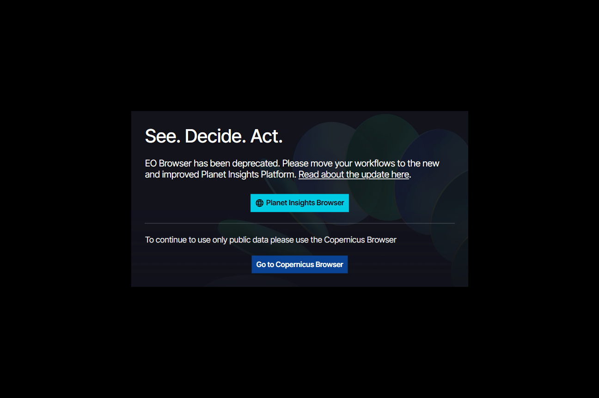
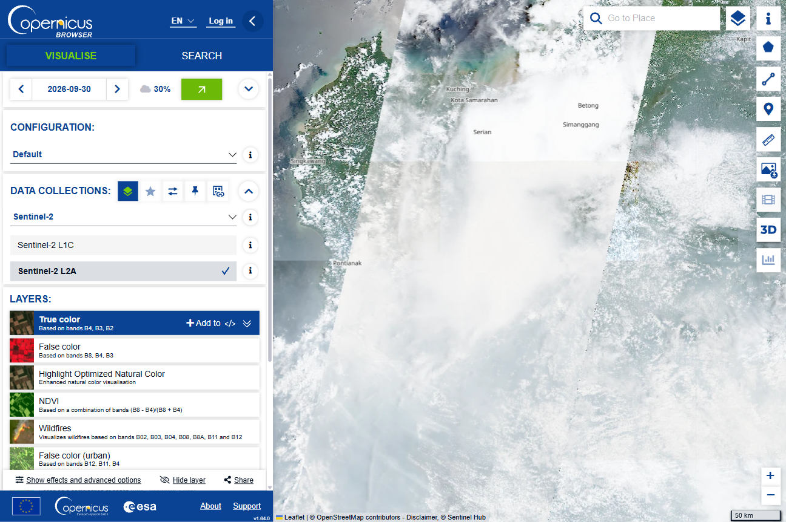
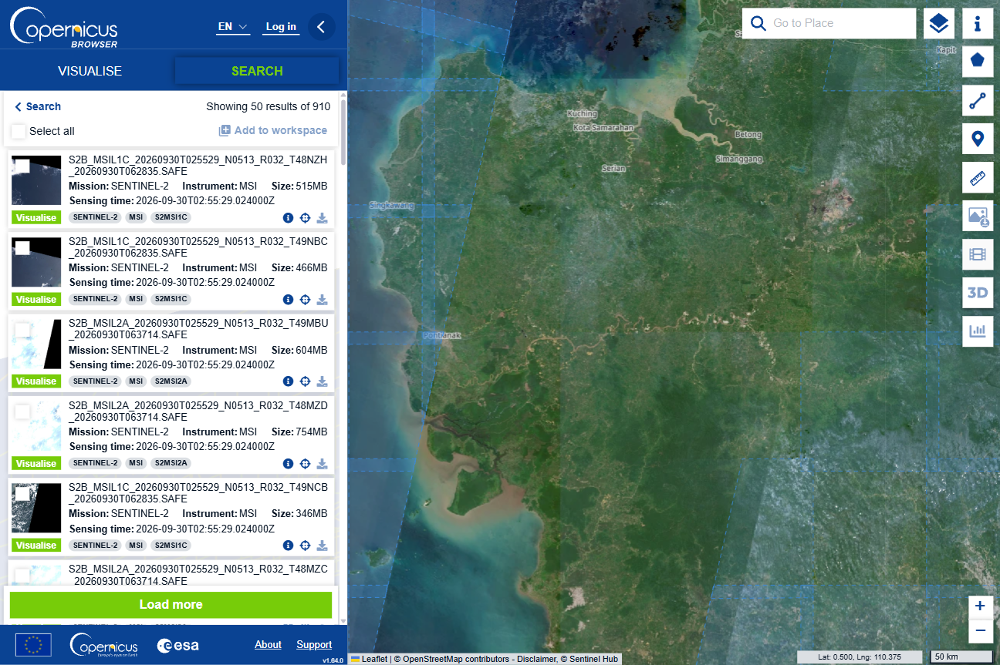
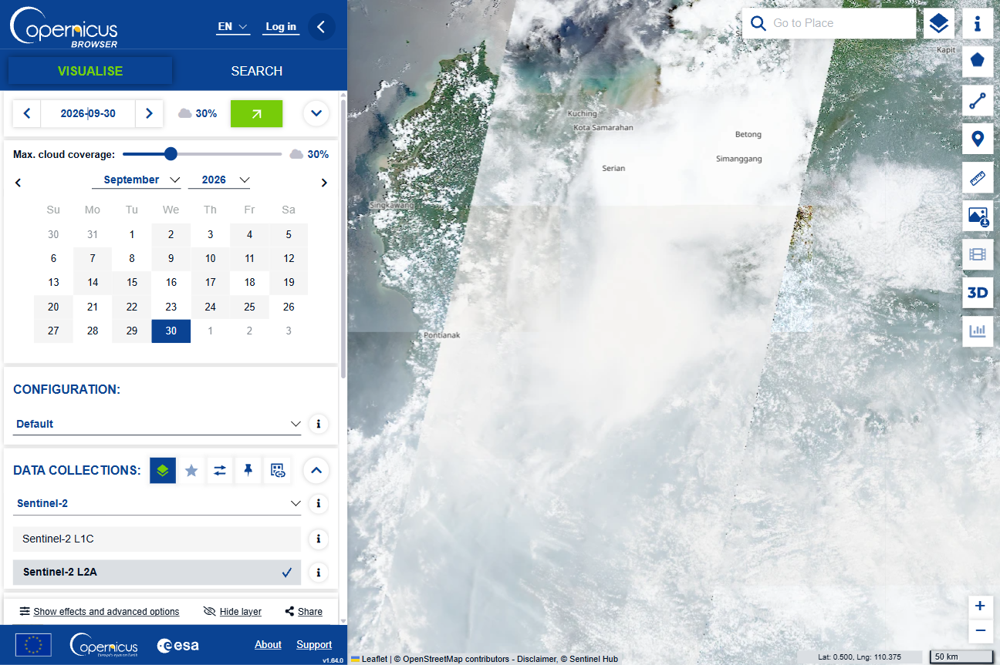

# Sentinel Hub EO Browser
URL: https://apps.sentinel-hub.com/eo-browser/ (dead — redirects to a sunset notice) · Audited: 2026-11-14 · Tier: 2

> **The app moved.** The original EO Browser URL now shows only a sunset page linking to two successors: **Planet Insights Browser** (insights.planet.com — official successor, **login-walled**, not audited behind the wall) and **Copernicus Browser** (browser.dataspace.copernicus.eu — free, anonymous, same Sentinel Hub codebase lineage, `eob-btn` CSS classes still present). This audit is of **Copernicus Browser v1.64.0**, the accessible current home of the EO Browser patterns. Sunset evidence: Planet Community post "Important Update: Sunset of EO Browser and Sentinel Hub Dashboard" (Feb 5, 2026): *"Sentinel Hub web applications, including EO Browser and the Dashboard application, will no longer be accessible on March 20, 2026."*

## Summary
A full-resolution satellite imagery explorer (Sentinel-1/2/3/5P/6, DEM, CLMS layers) with the best-in-class **shareable-URL state model**: zoom, dataset, time range, layer, cloud filter and active panel all live in the address bar. For IGNIS the valuable parts are the **Single Date / Mosaic / Time Range** date-mode control, the named **area-of-interest drawing suite** (AOI / line / POI / measure), and catalog **search with a "Filter by months"** seasonality filter. Notably, the successor has **dropped** the classic EO Browser bottom timeline with per-day data-availability marks — a loss IGNIS should not repeat. There is **no MODIS/VIIRS Hotspot point data** anywhere in the app; the nearest fire feature is a Sentinel-2 "Wildfires" band-visualization layer.

## Task walkthrough
| Task | Steps / clicks | Result | Notes |
|---|---|---|---|
| Hotspots in West Kalimantan last September | 7 clicks/fills to results (Use anonymously 1 · close welcome 1 · SEARCH tab 1 · check SENTINEL-2 1 · From 2026-09-01 1 · Until 2026-09-30 1 · Search 1); +4 for the mosaic view (Time Range 1 · From 1 · Until 1 · Mosaic 1) | **not supported** for Hotspots — no MODIS/VIIRS hotspot layer exists. Nearest equivalent executed: **"Showing 50 results of 910"** Sentinel-2 scenes over the Borneo view (zoom 8, 0°N 111°E) for Sept 2026, plus a cloud-filtered Sept mosaic on the map. A "Wildfires" layer (bands B02/B03/B04/B08/B8A…) can visualize burn areas in imagery. | View is a free map window, not West Kalimantan per se — no admin-boundary presets; location set via "Go to Place" search or URL. Anonymous entry is reCAPTCHA-gated and stalled twice before succeeding on a clean reload. |
| Which months burn most, year over year | — | **not supported** — no aggregation, no monthly chart, no per-month counts. Only a "Filter by months" checkbox inside catalog search (select months across the date range), which filters products but summarizes nothing. | Time-binned data at a glance here means: mosaic compositing over a chosen range; the count appears only as search result totals ("50 of 910"). |
| 2023 vs 2019 | 4 clicks until blocked (Compare Panel 1 · compare toggle 1 · "Add to" ×2) | **partially supported, not completed** — a Compare Panel exists (Effect: Split, Remove all, Share, Add all pins) but stayed "No layers to compare"; adding the second layer did not register in the automated session. Workaround: per-year Mosaic/Time Range (4 clicks per era) then eyeball, or two browser tabs since full state is in the URL. | Split-screen compare was EO Browser's signature; in the successor it depends on layer/hover interactions my synthetic clicks couldn't drive. Documented, not executed. |

## Checklist
| # | Item | Observation | Responder 0-2 | Scientist 0-2 | Land mgr 0-2 | Verdict |
|---|---|---|---|---|---|---|
| 1 | First screen | Map-first with a layers panel; at low zoom shows "Please zoom in or search for a location of interest" instead of data. Two dialogs before the map (anonymous consent + intro tour). Vision-verified: imagery renders after sign-in. | 1 | 1 | 1 | adapt |
| 2 | Time controls | Segmented **Single Date / Mosaic / Time Range**; month calendar (react-day-picker) with future dates disabled, "Show latest date" shortcut, max-cloud-coverage slider (default 30%). **No data-availability marks**: zero timeline/DOT elements in the DOM in any mode — the classic EO Browser per-day availability dots are gone. | 1 | 2 | 1 | adapt (inherit the three modes; **do not** copy the dropped availability marks) |
| 3 | Space controls | "Go to Place" combobox search; left toolbar: **Create an area of interest / Draw a line / Mark point of interest / Measure**; lat/lng/zoom in URL. No admin-boundary or preset-region picker. AOI polygon drawing did not engage via synthetic clicks (two attempts, 0 paths drawn) — tool verified present, draw not executed. | 1 | 1 | 1 | adapt |
| 4 | Hotspot display | None — no point/cluster/density layers; imagery tiles only. "Wildfires" is a band-composite visualization, not detections. | 0 | 0 | 0 | N/A (no hotspot data); avoid as a Hotspot source |
| 5 | Sensor handling | No MODIS/VIIRS anywhere. Dataset tree is Sentinel missions with sub-filters (MSI, L1C/L2A, Auxiliary). No confidence levels. | 0 | 0 | 0 | N/A |
| 6 | Color and legend | Rendering is per-layer evalscripts with one-line band descriptions ("True color — Based on bands B4, B3, B2"). No legend DOM observed for true color; legends presumably only on indexed layers. | 1 | 1 | 1 | adapt |
| 7 | Linked views | Date/collection changes re-render the map; each search result has "Visualise" which jumps to VISUALISE at that product's sensing time. No chart exists to link. | 1 | 1 | 1 | adapt |
| 8 | Comparison | Compare Panel with **Effect: Split** + opacity-style options, "Add all pins"; could not be populated in-session. Era comparison achievable via per-year Mosaic or two URL-state tabs. No anomaly-vs-baseline concept. | 0 | 1 | 1 | adapt |
| 9 | Explaining the data | Per-layer one-liners with band math; per-product metadata (mission, instrument, size, sensing time); About → official docs; welcome modal explains what login unlocks. No methodology page for composites. | 1 | 2 | 1 | adapt |
| 10 | Mobile | **Not tested** — no safe way to force a phone-width viewport in the shared browser. Scores left empty rather than guessed. | n/t | n/t | n/t | not tested |
| 11 | Export/share | **Entire app state in the URL** (zoom/lat/lng/theme/dataset/fromTime/toTime/layerId/cloudCoverage/dateMode/panel + encrypted visualizationUrl) — copy the link, share the exact view; a UI link even advertises "How AI agents and tools can build Copernicus Browser links". Per-product "Download product" (scene ZIPs); "Add to workspace" is login-gated. | 1 | 2 | 1 | inherit (URL state); adapt (downloads) |
| 12 | Language and locale | 13 languages via flag menu: English, Català, Deutsch, Español, Français, Italiano, Latviešu, Lietuvių, Magyar, Nederlands, Polski, Slovenščina, Українська. **No Malay/Indonesian.** Dates are YYYY-MM-DD text inputs. | 0 | 1 | 1 | adapt (IGNIS needs MS/ID first) |
| 13 | Performance | Heavy SPA; first useful imagery ≈10–20 s including the anonymous token fetch, which stalled twice ("Anonymous sign-in is taking longer than expected", once `#error=login_required` after reload); tiles then stream progressively (44 tiles at zoom 8). | 1 | 1 | 1 | adapt |

## Screenshots
-  The original apps.sentinel-hub.com/eo-browser/ URL: only a sunset notice linking to Planet Insights Browser and Copernicus Browser (captured 2026-11-14).
-  Copernicus Browser (successor UI) over Borneo: Sentinel-2 L2A layers panel (incl. the Wildfires layer), Date set to Mosaic 1–30 Sept 2026, 30% cloud filter.
-  SEARCH tab: SENTINEL-2 + MSI checked, 2026-09-01→2026-09-30 over the Borneo view — "Showing 50 results of 910", each row with sensing time, Product info, Zoom to product, Download product, Visualise.
-  The Single Date picker: plain month calendar (Sept 2026), future dates disabled, no per-day data-availability marks — the successor's replacement for EO Browser's dotted timeline.

## Patterns worth taking
- **State-in-URL sharing**: every control (view, dataset, time range, layer, cloud filter, open panel) serializes into one shareable URL — IGNIS should make a Burning Calendar + heatmap state equally linkable, so a responder can send "September 2026, West Kalimantan" as a link. Serves all three users.
- **Three date modes as a segmented control (Single / Mosaic / Time Range)**: one control answers "one day", "best composite of a period", and "everything in a range" — maps cleanly onto IGNIS needing single-day Hotspots vs a month-level Burning Calendar. Serves responders (single/24h) and scientists (ranges).
- **"Show latest date" shortcut**: one click to the most recent acquisition next to the date picker — the exact "is it burning now" affordance IGNIS responders need.
- **Data-quality filter inline with time (max cloud coverage slider)**: filters what the timeline/mosaic will show by quality, not just by date — IGNIS can mirror this with a confidence/quality filter on Hotspots. Serves scientists.
- **"Filter by months" in search**: cross-year month filtering is a seasonality query in disguise — the input pattern behind a Typical Year explorer ("show me all Septembers"). Serves land managers.
- **Named selection suite (AOI / line / POI / measure)**: separate, clearly labelled tools for area, line and point selection — IGNIS's Area of Interest drawing should be this explicit, with the drawn shape visible and reusable. Serves land managers and scientists.
- **Calendar with future dates disabled**: small honesty touch — you cannot pick a date with no data yet; pairs with IGNIS marking days that *do* have coverage.
- **Availability marks lost (anti-pattern)**: EO Browser's bottom timeline dotted the days with available scenes; the successor dropped it for a plain calendar, so users pick blind dates and wait. IGNIS's Burning Calendar must keep explicit per-day/per-month data-availability marks — this audit's core cautionary finding.
- **Anonymous tier with login-gated power features**: browse and search free (reCAPTCHA-gated anonymous token); timelapse, analytical download and workspace require login — a fair split IGNIS could copy, minus the fragile anonymous-token stall observed twice here.
- **Per-layer one-line method notes** ("True color — Based on bands B4, B3, B2"): every data layer states its recipe inline — cheap methodology transparency IGNIS should give the Harmonized Hotspot Count. Serves scientists.
