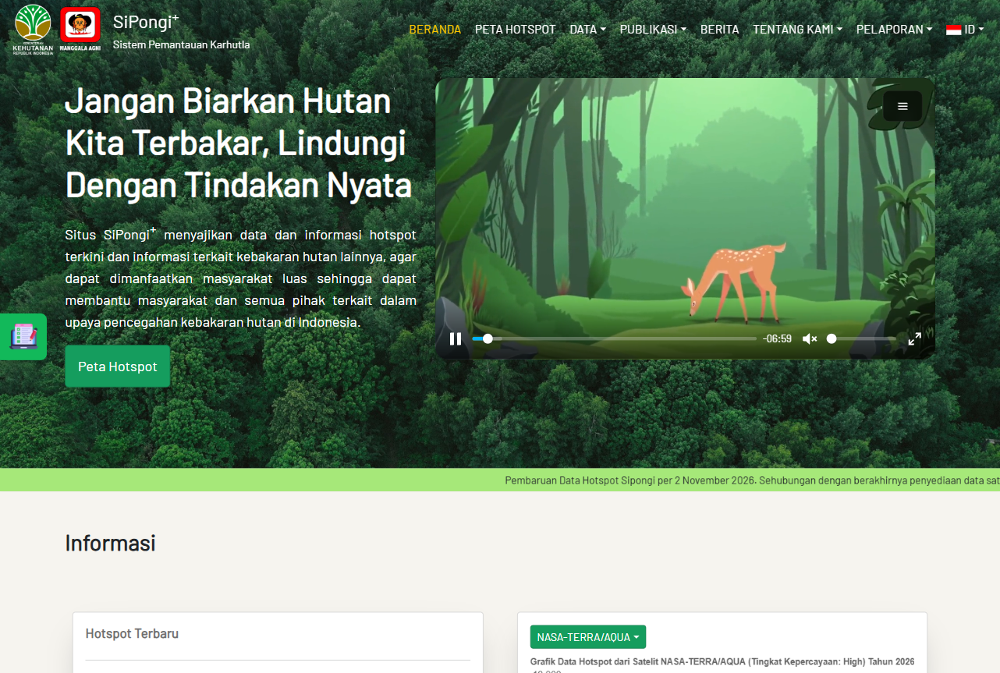
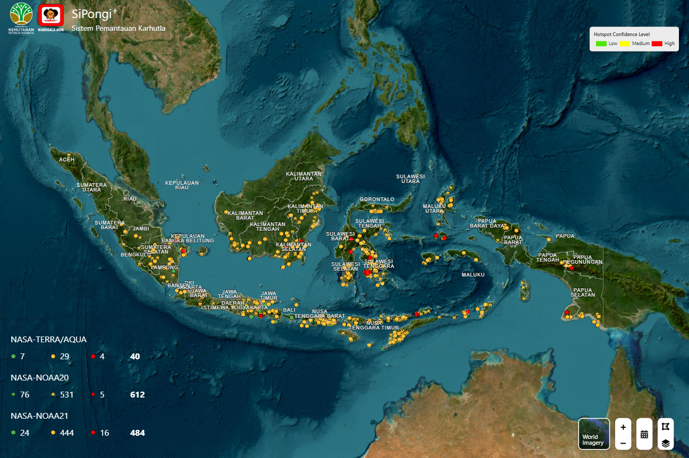
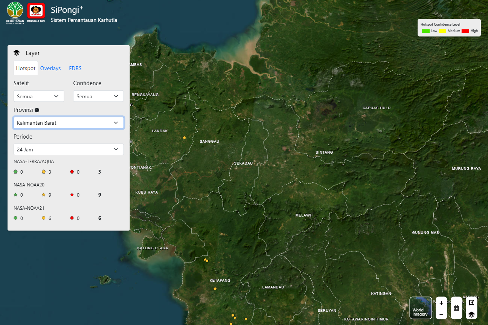
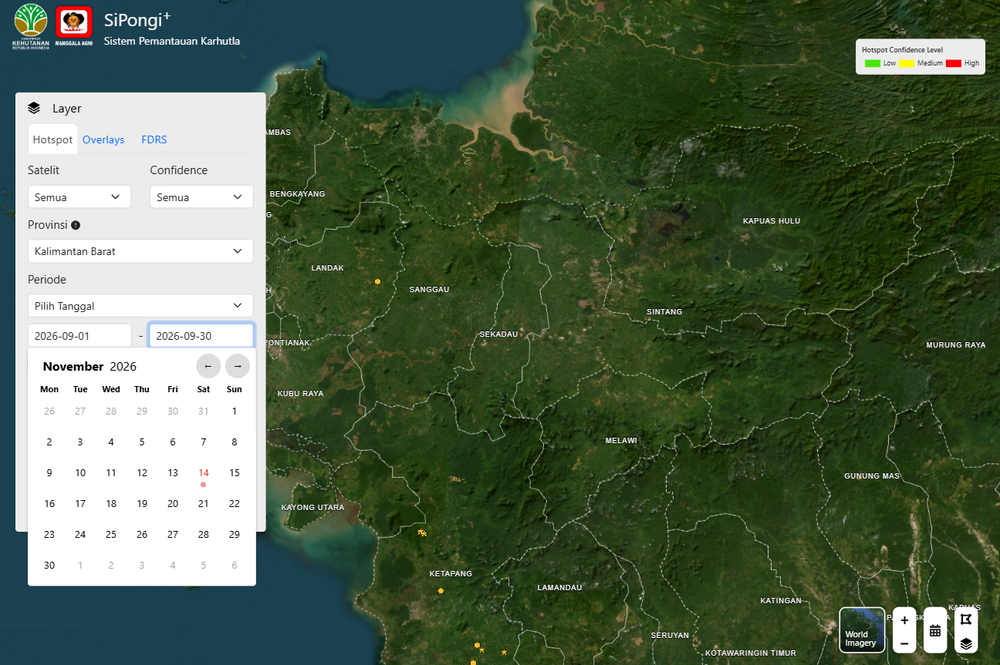
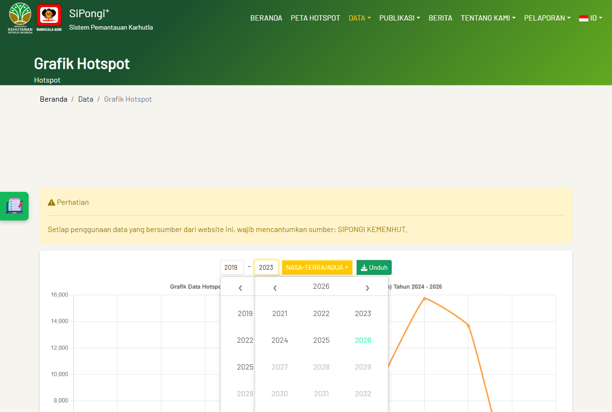
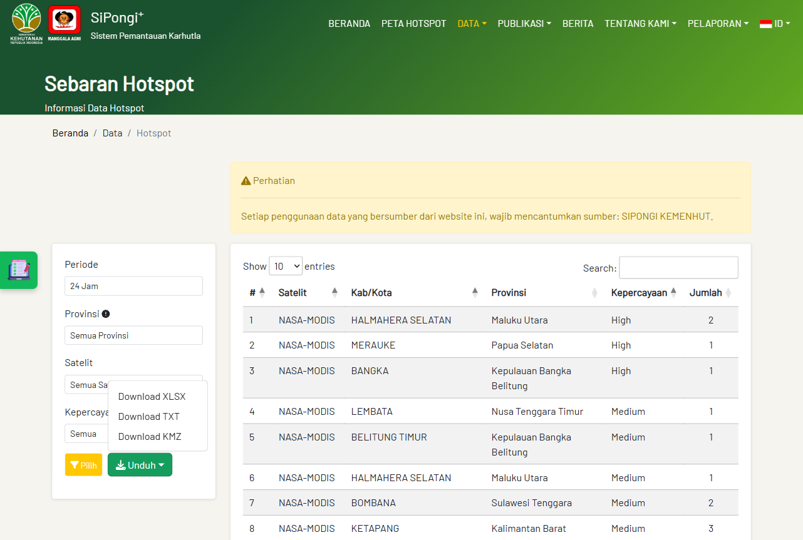
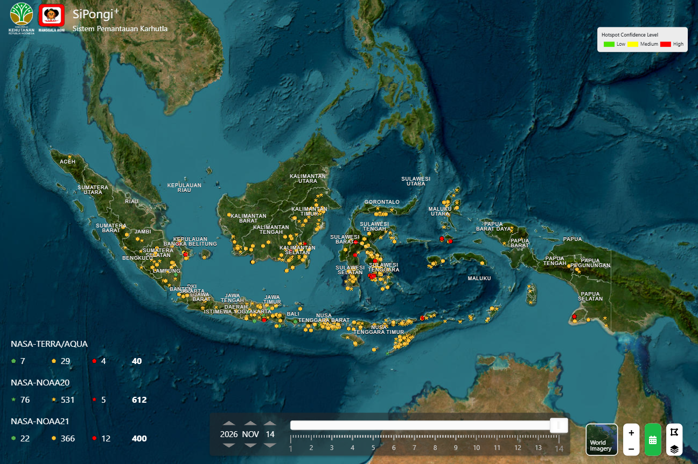
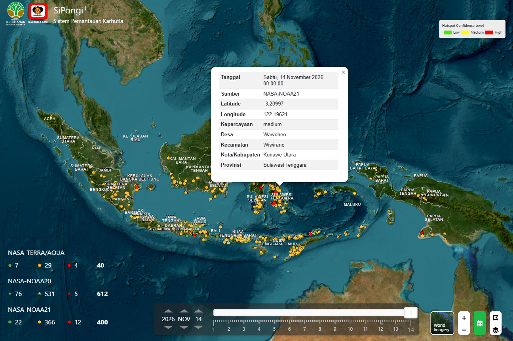

# SiPongi+ (Indonesia KLHK/Kemenhut)
URL: https://sipongi.gakkum.kehutanan.go.id/ · Audited: 2026-11-14 · Tier: 1

Note: the plan's original URL `sipongi.menlhk.go.id` no longer resolves (`net::ERR_NAME_NOT_RESOLVED`, checked in-browser this session). The service moved with the ministry rename (KLHK → Kementerian Kehutanan); current site confirmed live at the URL above, found via web search.

## Summary
SiPongi+ is Indonesia's national karhutla (forest and land fire) monitoring system: a Bahasa Indonesia map of satellite Hotspots over the whole country (36 provinces, 340 kabupaten), a province/district statistics table with export, and a monthly Hotspot chart. What it does best for IGNIS is sensor transparency: three satellite feeds (NASA-TERRA/AQUA i.e. MODIS, NOAA-20, NOAA-21) are always shown separately with low/medium/high confidence counts, never merged — plus a homepage notice explaining that NOAA-21 (VIIRS) replaced the retired SNPP (VIIRS), a live example of communicating a sensor transition inside the Overlap Period. The site is fully public (no account wall) and fully bilingual (ID/EN, verified by toggling).

## Task walkthrough
Clicks counted from a fresh page load of each page, doing only what the task needs.

| Task | Steps / clicks | Result | Notes |
|---|---|---|---|
| Hotspots in West Kalimantan last September | 11: PETA HOTSPOT nav (1) → Panel Layer (1) → Provinsi dropdown (1) → Kalimantan Barat (1) → Periode dropdown (1) → Pilih Tanggal (1) → Dari field (1) → calendar day 1 (~1) → Ke day 30 (~1) → Pilih (1) | Partial: province filter worked in-UI (map refetched with `provinsi=11`, district labels appeared); the custom date range could not be completed — the lightpick calendar's month-title overlay permanently covered the "Pilih" (Apply) button in my session, and typed dates did not apply | September verified at API level instead (read-only GET): West Kalimantan 2026-09-01→09-30 = 3 NASA-MODIS + 9 NOAA-20 + 6 NOAA-21, all medium confidence (18 total). Map-click province drill-down also did not register in-session (SVG polygon swallowed clicks) — dropdown is the reliable path |
| Which months burn most, year over year | 3: DATA (1) → GRAFIK HOTSPOT (1) → (default 2024–2026 loads itself) | Yes, partly: monthly line chart with a clear Aug–Oct dry-season peak (default window 2024–2026, y-axis to 16,000, single peak ≈15–16k). Year-range fields exist (default 2024/2026, grid picker 2019–2028) but changing them did NOT re-render the chart in my session (no new API call fired, whether typed or grid-picked) | Monthly shape confirmed from the same endpoint the page uses: `GET /api/grafik/hotspot?satelit=NASA-MODIS&tahun=2019` → `[43,309,577,142,148,110,525,3381,15175,4131,1872,223]` (national, Jan–Dec): September is the peak month |
| 2023 vs 2019 | +4 on the Grafik page (year field, 2019, year field, 2023) | Answerable from data, not completed in-UI for the same reactivity failure. API answer (national, NASA-MODIS): 2019 total 26,776 with Sep = 15,175; 2023 total 10,625 with Sep = 3,258 / Oct = 3,597 → 2019 ≈ 2.5× worse than 2023, and 2019 peaked in September while 2023 peaked in October | No year-vs-year overlay, baseline or anomaly view exists anywhere on the site — this is the gap IGNIS's Burning Calendar and Typical Year fill |

## Checklist
Users scored 0–2: Responder (R), Scientist (S), Land manager (L). Verdict = inherit / adapt / avoid.

| # | Item | Observation | R | S | L | Verdict |
|---|---|---|---|---|---|---|
| 1 | First screen | Homepage = hero video + notice banner + "Informasi" cards: latest-Hotspot list (time, satellite, village, province), 2026 totals (202K+ Ha burned, 3,212 fires handled, 36 provinces / 340 kabupaten), and an embedded monthly chart. Map needs 1 more click. Useful context, slow to first Hotspot location | 1 | 1 | 1 | adapt — IGNIS should land on the map/calendar; the stat tiles are worth keeping |
| 2 | Time controls | Presets 12/24/48 Jam, "Pilih Tanggal" custom range (Dari/Ke + lightpick), a day-of-month slider on the map, month+year pickers for overlays. The lightpick is fragile: month-title overlay blocked Apply in my session | 2 | 1 | 1 | adapt — presets good; custom range needs a robust picker |
| 3 | Space controls | Province dropdown (38 entries incl. IKN) + province labels on the national map + kabupaten labels after filtering. No search box, no draw-an-Area-of-Interest, no bookmarkable place | 1 | 1 | 2 | adapt — IGNIS adds draw + search for Areas of Interest |
| 4 | Hotspot display | Points colored by confidence on a canvas layer, same style at every zoom (no clustering or density); click popup gives village-level detail. Coverage Area is all Indonesia — far beyond IGNIS's Borneo | 2 | 1 | 1 | adapt — keep point detail, add clustering/heatmap for IGNIS |
| 5 | Sensor handling | Best-in-audit: satellite dropdown (Semua / NASA-TERRA/AQUA / NOAA-20 / NOAA-21), per-satellite low/med/high counts with totals on the map, satellite as a table column and chart filter. API keeps per-sensor keys incl. retired NASA-SNPP (zeroed) and LPN-* variants — counts never merged. Homepage notice: NOAA-21 (VIIRS) replaces retired SNPP, "jumlah satelit dan cakupan tidak berubah" | 2 | 2 | 1 | inherit — per-feed transparency and the sensor-transition notice; the anti-pattern for IGNIS is having no harmonized count at all |
| 6 | Color and legend | "Hotspot Confidence Level" legend top-right: Low green / Medium yellow / High red over dark World Imagery; the satellite-counts strip is color-keyed to it. Always visible. Red/green pair is colorblind-risky | 2 | 1 | 1 | adapt — keep the always-on legend, pick a colorblind-safe triple |
| 7 | Linked views | Filters and the day slider refetch map Hotspots live; the Grafik page is separate — picking a date on a chart never moves a map | 1 | 1 | 1 | adapt — IGNIS's Burning Calendar and heatmap must be linked |
| 8 | Comparison | Only a year-range on the chart line. No year-vs-year overlay, no region-vs-region, no baseline/Typical Year, no anomaly view | 0 | 1 | 1 | adapt — biggest gap; exactly IGNIS's core feature |
| 9 | Explaining the data | SNPP→NOAA-21 notice with date on the homepage; hotspot popup shows provenance (satellite, confidence, lat/lon, timestamp). No methodology page: "Tentang Kami", "Publikasi", "Pelaporan" nav items are dead links (`href="#"`) | 1 | 1 | 1 | adapt — provenance pattern good; IGNIS needs a real method page for the Harmonized Hotspot Count |
| 10 | Mobile | `viewport width=device-width` declared; footer links an Android app (SiPongi on Google Play, "Unduh SiPongi+ Mobile"). Phone-width layout not tested this session (no window resize available) | 1 | 1 | 1 | adapt — companion-app idea noted, unverified |
| 11 | Export/share | Table page "Unduh" menu: **Download XLSX / TXT / KMZ** (KMZ = Google Earth); grafik page has an "Unduh" button that produced no network call in-session (unverified). No shareable URL state — every filter is client-side only | 1 | 2 | 2 | inherit — the XLSX/TXT/KMZ menu; add shareable URLs |
| 12 | Language and locale | Full ID/EN toggle in the nav (verified both directions; whole site translates incl. DATA submenu). Indonesian long dates ("Sabtu, 14 November 2026"), Indonesian admin vocabulary (Desa/Kecamatan/Kabupaten/Provinsi) | 2 | 1 | 2 | inherit — Bahasa-first with EN toggle is the model for IGNIS's Borneo audience |
| 13 | Performance | Svelte SPA + Leaflet + ArcGIS CDN tiles; homepage DOMContentLoaded ≈2.05 s, load ≈2.81 s, 87 resources; Hotspots drawn on a single canvas layer; public API answered every query in well under a second | 2 | 2 | 2 | inherit — canvas marker layer + CDN tiles |

## Screenshots
-  Homepage: green satellite-transition notice (NOAA-21 replaces SNPP, 2 Nov 2026), "Informasi" cards — "Hotspot Terbaru" list and the embedded chart titled "Grafik Data Hotspot dari Satelit NASA-TERRA/AQUA (Tingkat Kepercayaan: High) Tahun 2026"
-  Peta Hotspot national view: all Indonesia with province labels, confidence-colored Hotspot points (green/yellow/red), legend top-right, per-satellite counts bottom-left (TERRA/AQUA 40, NOAA-20 612, NOAA-21 484 at audit time)
-  Layer Panel with Kalimantan Barat selected in the Provinsi dropdown: Satelit / Confidence / Provinsi / Periode filters, Hotspot-Overlays-FDRS tabs; map refetched with provinsi=11 and switched to kabupaten labels
-  Task 1 state: custom period "Pilih Tanggal" with Dari 2026-09-01 / Ke 2026-09-30 filled — and the lightpick month-title overlay sitting over the blocked "Pilih" (Apply) button
-  Grafik Hotspot page: monthly line chart (default 2024–2026, peak ≈15–16k in the dry season), year-range fields (2019/2023 typed), satellite filter, "Unduh" button; the year-grid popup is open
-  Sebaran Hotspot table: # / Satelit / Kab-Kota / Provinsi / Kepercayaan / Jumlah with sortable columns, search, pagination — and the "Unduh" menu open showing Download XLSX / TXT / KMZ
-  Map with the date slider revealed ("Tampilkan/Sembunyikan Slider Tanggal" toggle): a day-of-month slider set to 14 (today)
-  Hotspot click popup: Tanggal (Sat 14 Nov 2026), Sumber NASA-NOAA21, Latitude/Longitude, Kepercayaan medium, and full place chain Desa Wawoheo / Kec. Wiwirano / Kab. Konawe Utara / Sulawesi Tenggara

## Patterns worth taking
- **Per-satellite count strip**: on the map, a small panel lists each satellite feed with low/medium/high counts and a total (e.g. TERRA/AQUA 40 · NOAA-20 612 · NOAA-21 484). For IGNIS: show MODIS, VIIRS and the Harmonized Hotspot Count side by side so scientists can see what harmonization did. Serves the Scientist.
- **Sensor-transition notice**: a dated banner explaining that NOAA-21 (VIIRS) replaced the retired SNPP (VIIRS) with "coverage unchanged". For IGNIS: the same honest banner for the Overlap Period (2012 onward) — say where MODIS/VIIRS records change character. Serves Scientist + Land manager.
- **Village-level hotspot popup**: every Hotspot popup carries time, satellite, lat/lon, confidence and the full Desa→Kecamatan→Kabupaten→Provinsi chain. For IGNIS: local place names are what a responder in Borneo actually dispatches to. Serves the First responder.
- **Confidence traffic-light with always-on legend**: green/yellow/red points keyed to a legend that never leaves the screen. For IGNIS: keep the legend pinned; swap the palette for a colorblind-safe one. Serves First responder.
- **Preset time chips + custom range**: 12/24/48 Jam chips for instant refresh plus a custom range for history. For IGNIS: presets serve the responder, the range serves the scientist. Serves all three.
- **Province dropdown → map drill**: picking a province refilters the map and swaps labels one admin level down. For IGNIS's region panel: presets are the fastest Area-of-Interest picker. Serves Land manager.
- **Table + tri-format export (XLSX/TXT/KMZ)**: the Sebaran table pairs full-filter data with a one-click export menu including KMZ for Google Earth. For IGNIS: export belongs next to the data, not buried. Serves Scientist + Land manager.
- **Bahasa-first with full EN toggle**: an Indonesian-first UI whose every string (nav, filters, dates, admin levels) flips to English. For IGNIS: ship Bahasa Indonesia alongside English from day one for the Kalimantan side of the Coverage Area. Serves all three.
- **Context-overlay tabs in one panel**: one layer panel with tabs for Hotspot filters, situational overlays (cloud H-1, wind, air quality, rain, fire-suppression and groundcheck records, concession and community-land boundaries) and FDRS fire-danger indices (FFMC/DMC/DC/BUI/ISI/FWI, observation or forecast). For IGNIS: a single overlay panel keeps the map uncluttered. Serves all three.
- **Cautionary patterns (avoid)**: the lightpick date-range widget whose calendar overlay blocks its own Apply button; year-range fields that accept input but never refetch; dead nav links ("Tentang Kami", "Publikasi"); a hotspot canvas that swallows clicks aimed at UI beneath it. For IGNIS: every filter control must visibly commit, and no layer may eat clicks meant for panels.
