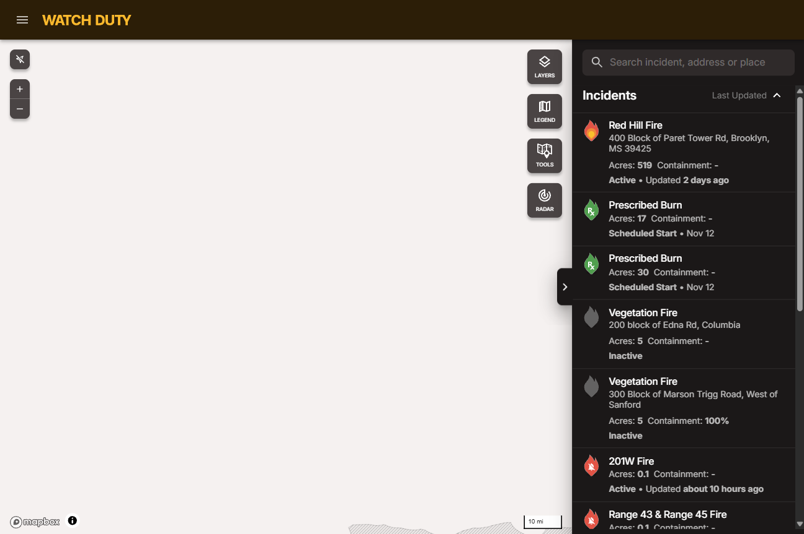
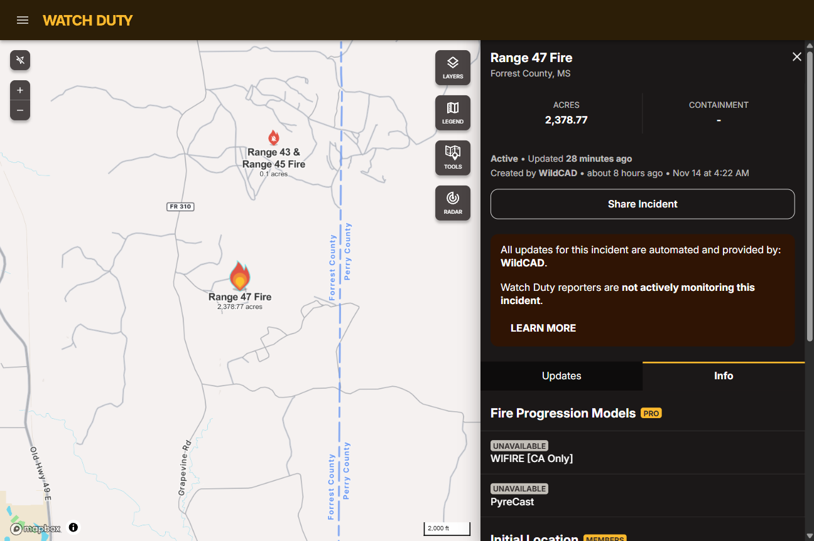
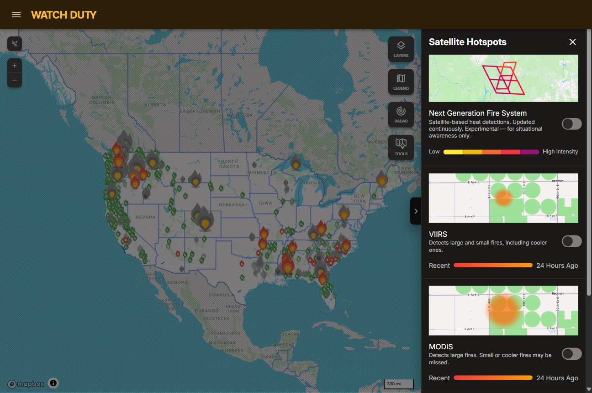
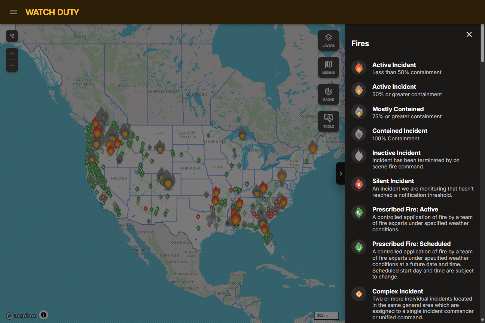
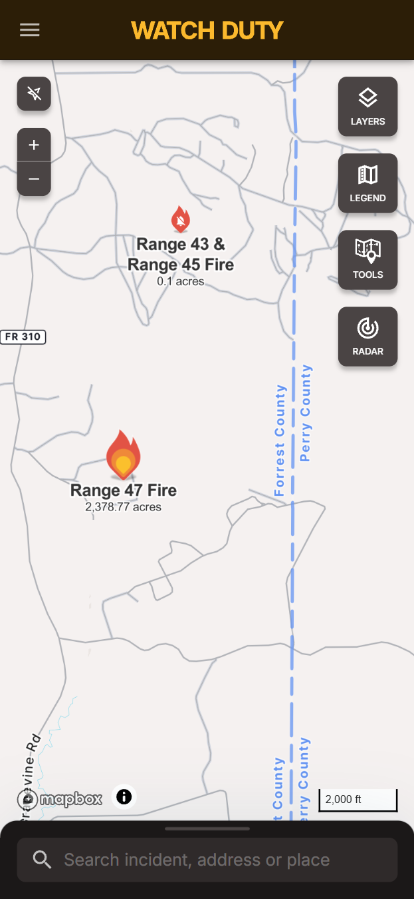
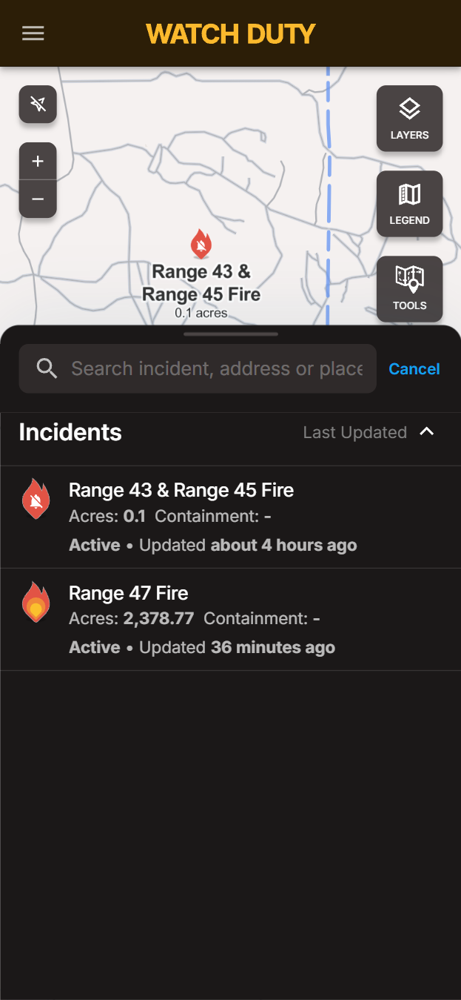

# Watch Duty

URL: https://www.watchduty.org/ (live app: https://app.watchduty.org/) · Audited: 2026-11-14 · Tier: 2

## Summary

Watch Duty is a US nonprofit wildfire (and flood) app whose whole design answers one responder question — "is it burning near me, right now?" — with a map-first shell, an incident list ranked by freshness, and heavy mobile-first patterns (modal search, bottom-sheet drawers). Its Coverage Area is the US only, so none of the three IGNIS walkthrough regions are covered, and it has no historical or seasonal view at all: time depth stops at a fixed 24-hour window on its satellite Hotspot layers. What it does offer IGNIS is the best sensor-communication pattern seen so far: MODIS, VIIRS, Landsat and an experimental NGFS layer each carry a plain-language capability description and caveat, individually toggled but never merged — the exact opposite of IGNIS's Harmonized Hotspot Count, and a clear model for how to label both.

## Task walkthrough

| Task | Steps / clicks | Result | Notes |
|---|---|---|---|
| Hotspots in West Kalimantan last September | 1 click (search box) + typing "Kalimantan" | not supported | Search returns zero incidents and zero places — Borneo is outside Watch Duty's US-only Coverage Area, and no date filter exists anyway (satellite Hotspot layers are fixed to "Recent: 24 Hours Ago"; no picker). The search state does go into the URL (`?search=Kalimantan`). Equivalent task verified instead with "Los Angeles" (2 clicks: search box → select result): map re-centers with `@34.048051,-118.254187,13z/pin` in the URL and the incident list re-scopes to a radius around the map center. |
| Which months burn most, year over year | 1 click explored (the "Last Updated" sort control — the only list control) | not supported | No monthly, seasonal or yearly aggregation anywhere. The incident list is a live "near the map center" feed (label read: "300 mi") sorted only by last update; the single sort control toggles newest/oldest-first ordering. Each incident has a per-incident update chronology (e.g. "Acreage updated from 0.1 to 2,378.77 acres"), which is history for one fire, not a Typical Year view. |
| 2023 vs 2019 | 0 (no year control exists) | not supported | No year picker, no year filter, no comparison views of any kind. The oldest data encountered in the list was a fire "Updated 2 months ago" and a prescribed burn "Scheduled Start • Oct 31"; nothing reaches back years. |

## Checklist

| # | Item | Observation | Responder 0-2 | Scientist 0-2 | Land mgr 0-2 | Verdict |
|---|---|---|---|---|---|---|
| 1 | First screen | Map-first with a radius-scoped "Incidents" sidebar already loaded (each row: name, location, acres, containment %, Active/Inactive, "Updated N minutes ago"); floating LAYERS/LEGEND/TOOLS/RADAR buttons. Time to first useful answer ≈ zero clicks once loaded. | 2 | 1 | 1 | inherit |
| 2 | Time controls | None for history: no date picker, no presets. Hotspot layers fixed at "Recent: 24 Hours Ago"; NGFS "Updated continuously". RADAR button switches to a Doppler weather mode (`?mapMode=radar`). Future time appears only as "Scheduled Start • Oct 31" on prescribed burns. | 2 | 0 | 1 | adapt |
| 3 | Space controls | Search over incident/address/place with geocoded suggestions; "Near me" button; pan/zoom; the list implicitly scopes to a radius around the map center ("300 mi"). No draw-a-box, no admin-boundary presets — the Area of Interest is the viewport, never made explicit. | 2 | 1 | 1 | adapt |
| 4 | Hotspot display | Incidents as points with perimeters ("Fire Perimeters — Active and Historical" layer); Satellite Hotspots as a separate point layer per sensor. Behavior at zoom levels not visually verified (map renders to canvas; I confirmed the layer options and toggles, not the rendered points — the map view during my session stayed centered on low-incident areas). | 2 | 1 | 1 | adapt |
| 5 | Sensor handling | Best-in-class: a "Satellite Hotspots" group listing NGFS, VIIRS, MODIS, Landsat, each with a one-line capability description ("VIIRS: Detects large and small fires, including cooler ones"; "MODIS: Detects large fires. Small or cooler fires may be missed") and its own toggle. Sensors are shown side by side, never merged or harmonized — the inverse of IGNIS's Harmonized Hotspot Count, and the model for labeling both raw layers and the harmonized count. | 1 | 2 | 1 | inherit |
| 6 | Color and legend | Legend is its own bottom drawer with sections Fires / Floods / Locations / Hazards / Evacuation Zones (California "Ready, Set, Go!") / Map. Dark theme default; Color Scheme setting (System/Light/Dark) in the menu. Colorblind safety not tested. | 2 | 1 | 1 | adapt |
| 7 | Linked views | No charts exist, so no chart↔map linking. List↔map are linked both ways: clicking an incident opens its detail and focuses the map; panning/zooming re-scopes the incident list. | 2 | 1 | 1 | adapt |
| 8 | Comparison | Absent: no year-vs-year, region-vs-region or anomaly-vs-baseline anywhere. | 0 | 0 | 0 | avoid |
| 9 | Explaining the data | Excellent and inline: every update carries provenance ("Automated" + source link, e.g. WildCAD); a banner states "Watch Duty reporters are not actively monitoring this incident"; NGFS is flagged "Experimental — for situational awareness only". The marketing site's How-it-Works page (documentation, not app) adds the human-verification methodology and code of conduct. | 2 | 2 | 1 | inherit |
| 10 | Mobile | Mobile-first by origin: at 390 px the sidebar disappears, map + floating button stack remain, search and the incident list become modal sheets, and LAYERS/LEGEND open as bottom drawers with backdrop (the same drawer UI is used on desktop). Verified via device emulation. | 2 | 1 | 1 | inherit |
| 11 | Export/share | "Share Incident" button on every incident; full app state lives in the URL (`/@lat,lng,z/pin?search=…&tab=info&menu=layers`). No CSV or data export of any kind. | 2 | 0 | 1 | adapt |
| 12 | Language and locale | Five languages in-app: English, Español, Filipino, Tiếng Việt, 简体中文 (no Malay/Indonesian). Timestamps pair relative with absolute ("26 minutes ago • Nov 14 at 11:42 AM"); US date/12-hour formats. | 1 | 1 | 1 | adapt |
| 13 | Performance | Qualitative only (no profiling run): the app shell is a heavy JS canvas map — first snapshot after navigation came back empty and needed a wait-for-selector before content appeared (several seconds); once loaded, the incident list and drawers responded instantly. | 2 | 1 | 1 | adapt |

## Screenshots

-  Desktop first screen: map-first with the freshness-ranked Incidents sidebar (acres, containment, Active/Inactive, "Updated … ago") and the floating LAYERS/LEGEND/TOOLS/RADAR stack.
-  Incident detail (Range 47 Fire): ACRES/CONTAINMENT stat chips, Updates/Info tabs, and the provenance banner ("All updates … automated and provided by: WildCAD", "Watch Duty reporters are not actively monitoring this incident").
-  The Satellite Hotspots layer group: NGFS, VIIRS, MODIS and Landsat each with a plain-language capability description, per-sensor toggle and fixed "Recent: 24 Hours Ago" freshness label.
-  Legend bottom drawer with Fires / Floods / Locations / Hazards / Evacuation Zones / Map sections.
-  Phone width (390 px, emulated): sidebar gone, map plus floating controls only.
-  Phone width: search opens as a modal sheet with Cancel button and the radius-scoped incident list.

## Patterns worth taking

- **Sensor capability cards**: each satellite layer names what it can and cannot detect in one plain sentence ("VIIRS: Detects large and small fires, including cooler ones" / "MODIS: Detects large fires. Small or cooler fires may be missed."), so non-scientists choose layers without knowing the instruments. IGNIS should put the same one-liners on its raw MODIS/VIIRS toggles and on the Harmonized Hotspot Count, in the heatmap layer panel and the about/method view. Serves all three users.
- **Per-layer freshness label**: every hotspot layer shows a fixed freshness stamp ("Recent: 24 Hours Ago", "Updated continuously") next to its toggle — the data's age is part of the layer choice, not a footnote. IGNIS heatmap layers should state their time window inline. Serves responders and scientists.
- **Provenance on every update + a not-monitored banner**: each incident update is tagged "Automated" with its source, and incidents without human monitoring say so outright. For IGNIS this is the pattern for Hotspot confidence, Overlap Period caveats and any model-derived numbers: say what produced the number and whether anyone has verified it. Serves all three users.
- **Recency-ranked incident list**: the sidebar defaults to "Last Updated" order with staleness in relative time, so the freshest burning is always at the top with zero clicks. IGNIS's responder default list (latest Hotspots in an Area of Interest) should inherit this, with the same "updated N minutes ago" phrasing. Serves responders.
- **Full state in the URL**: map center/zoom, pin, search, open panel and tab all serialize (`/@34.048051,-118.254187,13z/pin?search=Los+Angeles`, `?tab=info`, `?menu=layers`), making every view deep-linkable and shareable for free. IGNIS should encode Area of Interest + Burning Calendar month selection the same way. Serves all three users.
- **Mobile-first map shell**: at phone width everything except the map and a floating button stack collapses; search/list appear as modal sheets and panels as bottom drawers with backdrop — one drawer component reused on desktop. This is the strongest mobile layout seen among the references for IGNIS's heatmap. Serves responders most.
- **Viewport as implicit Area of Interest**: the incident list silently scopes itself to a radius around the map center and says so with a small "300 mi" label. IGNIS should adapt this by making the implicit selection explicit (named Area of Interest panel) rather than invisible. Serves all three users.
- **Inline experimental flag**: the NGFS layer carries "Experimental — for situational awareness only" right in its label rather than in a docs page. Any experimental layer or early harmonization output in IGNIS gets the same inline caveat. Serves responders and scientists.
