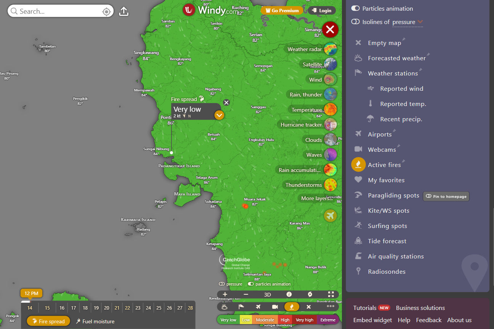
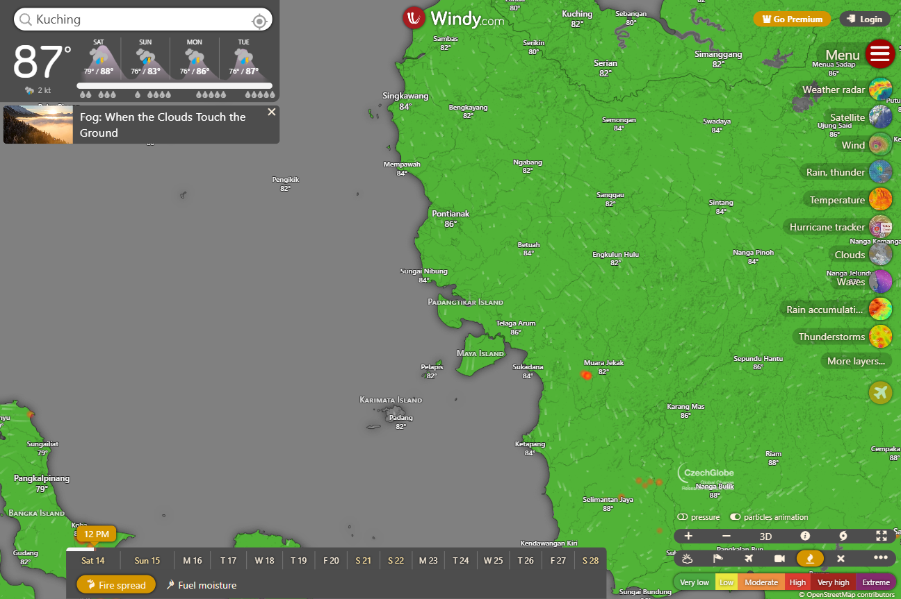
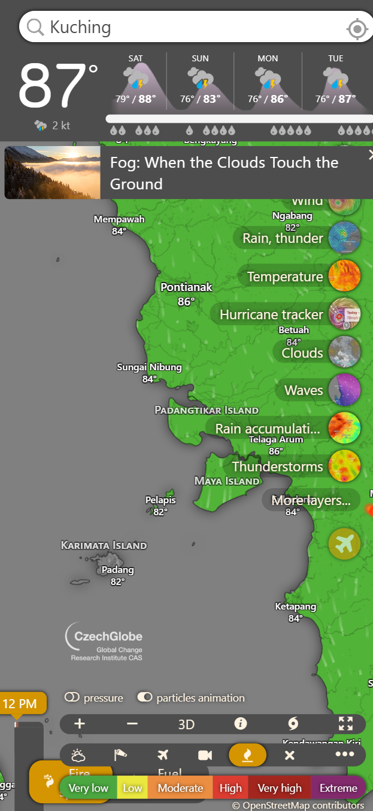

# Windy

URL: https://www.windy.com/ · Audited: 2026-11-14 · Tier: 2

## Summary

Windy (web app v51.4.4, observed in the page's asset URLs) is a map-first weather forecast viewer: a full-screen animated map, a 12-item layer rail on the left, a film-style timeline at the bottom, and everything — overlay, timestamp, center, zoom, displayed POI layer, even dropped pins — encoded in the shareable URL. What it does best for IGNIS is the playback experience: one click on play, a large timecode badge (`Sun 15 - 3 AM`), a scrub bar, and a 15-day day-strip above the timeline; and a legend system that pairs a green→red color ramp with plain verbal tiers ("Very low → Extreme"). Its fire story is thin, though: fire detections exist only as a "Display on map → Active fires" point layer (URL `p:firespots`), buried ~90 % down the settings menu, with no sensor attribution, no counts, and no history — the day strip starts at *today* and past data is a Premium upsell.

## Task walkthrough

| Task | Steps / clicks | Result | Notes |
|---|---|---|---|
| Hotspots in West Kalimantan last September | 4 clicks + typing + a deep scroll: "More layers…" (1) → scroll the Display-on-map list to ~90 % of its height (scrollTop 2519 of 2798 px) → "Active fires" (2) → search box (3) → type "Pontianak" → first result (4). Map flies to −0.704, 109.345 at zoom 8. | Partial — fire dots appear on today's map, but "last September" is impossible. | Fire spots render as tiny canvas dots (a handful visible near Nanga Pinoh / Sentaban Jaya in the wet season); no DOM elements, no popup detail verified (targets too small to click reliably), no sensor (MODIS/VIIRS) labeling, no counts. The 15-day strip (Sat 14 → S 28 Nov) starts at today, has no back arrow, and every day cell is wrapped in a `day-premium-wrapper` — history is a paid feature. |
| Which months burn most, year over year | — | not supported | No aggregation, no seasonality view, no month or year navigation anywhere. The time horizon of the whole app is a 15-day forecast strip. |
| 2023 vs 2019 | — | not supported | No historical playback (free tier), no comparison mode, no anomaly-vs-baseline view. Windy simply never answers year-over-year questions — the exact gap IGNIS's Burning Calendar fills. |

## Checklist

| # | Item | Observation | Responder 0-2 | Scientist 0-2 | Land mgr 0-2 | Verdict |
|---|---|---|---|---|---|---|
| 1 | First screen | Full-screen map loads immediately with the animated Wind overlay; left rail of 12 layer shortcuts; search top-left; timeline bottom. Map answer is instant; a point-pick opens a left sidebar with current conditions + 4-day forecast icons. Free tier shows an article ad card ("Fog: When the Clouds Touch the Ground") in the sidebar. | 2 | 2 | 2 | inherit |
| 2 | Time controls | Play/pause + timecode badge + scrub bar + 15-day strip (Sat 14 → S 28 Nov, today highlighted). Playback verified: play click moved the timecode 11 AM → Sun 15-3 AM → 4 AM → 7 AM within ~5 s, several model-hours per second, smooth. But no past dates, no presets like 24h/season/year, and history is Premium-gated. | 2 | 1 | 1 | adapt |
| 3 | Space controls | Geo search with well-labeled results ("Pontianak — City of Pontianak, Indonesia", 12 grouped hits incl. districts and a landmark); picking one flies the map and updates the URL. No draw-an-area, no admin-boundary presets, no province stats — an Area of Interest concept doesn't exist. | 2 | 1 | 1 | adapt |
| 4 | Hotspot display | "Active fires" = a Display-on-map POI toggle rendering tiny dot markers (canvas-rendered; none found in the DOM). No clustering, no density grid, no zoom-dependent behavior, no verified detail popup. At country zoom the dots are near-invisible. | 1 | 0 | 1 | adapt |
| 5 | Sensor handling | No fire-sensor attribution at all. The analogous pattern is excellent: model chips "ECMWF 9km / GFS 22km / ICON 13km / 1 more…" name each data source and its resolution beside the legend; layer tiles carry one-line tooltips ("Wildfire risk — spread danger (Canadian FWI) and dead fuel moisture"). No confidence levels. | 1 | 1 | 0 | adapt |
| 6 | Color and legend | Two legend styles, both bottom-right: sequential with units ("kt 0 5 10 20 30 40 60") for wind; categorical verbal tiers "Very low / Low / Moderate / High / Very high / Extreme" over a green→yellow→orange→red ramp (rgb(75,168,64) → rgb(234,232,63) → rgb(236,142,65) → rgb(220,60,48)) for Fire danger (FWI). Words carry the meaning, so the scale survives color blindness. The legend element is itself clickable (`metric-legend`); the FWI layer packs two metrics (Fire / Fuel) behind it. | 2 | 2 | 2 | inherit |
| 7 | Linked views | Timeline↔map is tightly linked: scrubbing/playback repaints the overlay instantly. Map click drops a pin that appears in the URL (`m:dEhajdq`); a searched point opens the forecast sidebar. There is no chart view to link, so nothing like calendar↔map. | 2 | 1 | 1 | adapt |
| 8 | Comparison | None: no year vs year, no region vs region, no anomaly vs baseline, no side-by-side. | 0 | 0 | 0 | avoid |
| 9 | Explaining the data | One-line tooltips on layer tiles; source + resolution chips; legend unit labels. No methodology page reachable from the map view in this walkthrough. | 1 | 1 | 1 | adapt |
| 10 | Mobile | Not fully verifiable here: a 390 px width keeps the `platform-desktop` body class — Windy switches its true phone layout by UA/touch, and UA override is blocked in this shared browser (`target_scope_unsupported`). In the squeezed desktop view: the layer rail collapses into a stacked top-right panel, search goes full-width, the legend stays readable (320 px), but the timeline is partly clipped and the ad card overlaps the forecast cards. Native apps exist (App Store / Google Play links in the menu) — not audited. | 1 | 1 | 1 | adapt |
| 11 | Export/share | Full state in the URL — verified by loading `?fwi,-0.704,109.345,8,p:firespots` and `?1.337,111.387,5,p:firespots` directly and getting the exact layer/place/pins back; a share button sits in the bottom-right control row. No CSV/data export observed. | 2 | 1 | 1 | inherit |
| 12 | Language and locale | English UI; units defaulted to imperial in this session ("kt", °F readouts in the sidebar); metric switch lives in Settings (not exercised). No Malay/Indonesian verified. | 1 | 1 | 1 | adapt |
| 13 | Performance | In-app navigation measured DOMContentLoaded at 571 ms; the post-load resource buffer was dominated by tiny analytics beacons; tiles and overlay frames stream in progressively; playback ran without stutter during the test. No cold-load or slow-network audit performed. | 2 | 1 | 1 | inherit |

## Screenshots

-  — The "More layers…" panel: layer tiles grouped by category, "Search layers" box at top, and the "Display on map" list scrolled to "Active fires" — the fire feature, ~90 % down the panel. ("Fire danger" tile also lives here; tooltip: "Wildfire risk — spread danger (Canadian FWI)…")
-  — Fire danger (FWI) overlay centered on Pontianak, West Kalimantan: green-dominant map with yellow/orange patches inland, tiny fire-spot dots, bottom timeline with day strip (14–28 Nov), categorical legend bottom-right, source chips, and the free-tier article card in the sidebar.
-  — The same app at 390 px width: desktop layout squeezed (platform-desktop class persists) — layer rail becomes a stacked top-right panel, search full-width, legend still readable, timeline clipped; illustrates what a width-only responsive pass does and does not solve.

## Patterns worth taking

- **Forecast-film playback**: play/pause beside a large timecode badge, a scrub bar of precomputed frames, and several model-hours per second — playback moved the clock ~20 model-hours in ~5 s with no stutter. IGNIS should give the heatmap the same one-click "watch the season burn" playback over Harmonized Hotspot Count frames. Serves all three users, especially the Responder.
- **Day strip above the timeline**: a horizontal 15-day strip with today highlighted, sitting directly above the hour slider, so day-jump and hour-scrub are two separate, obvious gestures. IGNIS can mirror this as a month strip (a Typical Year of Burning Phases) above a day-level slider. Serves the Land manager most.
- **Verbal-tier legend over a color ramp**: "Very low → Extreme" printed on the legend instead of bare numbers, on a green→yellow→orange→red ramp. This is almost exactly the Burning Phase vocabulary (Peak burning / Active burning / Moderate / Low) and is colorblind-safe because words carry the meaning. Inherit for any IGNIS Hotspot-density tier.
- **Clickable dual-metric legend**: the legend itself is a control (class `metric-legend`) and the FWI layer packs two related metrics (Fire / Fuel) behind it. IGNIS could let the calendar legend switch between Harmonized Hotspot Count and raw sensor counts. Serves the Scientist.
- **Source-and-resolution chips**: "ECMWF 9km / GFS 22km / ICON 13km" beside the legend names every model and its resolution — the exact pattern for a "MODIS 1 km / VIIRS 375 m / Harmonized" toggle. Serves the Scientist; calms the Overlap Period question.
- **Everything-in-the-URL state**: overlay, timestamp, center, zoom, POI layer (`p:firespots`) and dropped pins (`m:…`) all survive copy-paste — verified by loading two such URLs fresh. IGNIS views (Burning Calendar month/year/phase + Area of Interest) should be equally shareable.
- **POI display-on-map switcher**: a single-select list (Weather stations / Airports / Webcams / … / Active fires) that swaps what the map shows. The mechanism is right for IGNIS's Hotspot layer toggle, but it must sit one click from the top, not 90 % down a 58-item settings panel.
- **One-sentence layer tooltips**: each layer tile explains its metric in one line ("Wildfire risk — spread danger (Canadian FWI) and dead fuel moisture"). Cheap, and exactly the honesty IGNIS needs on the Hotspot and Harmonized Hotspot Count tiles.

Anti-patterns to avoid: burying the flagship data layer deep in a settings panel; ad cards inside the working area; paywalling the historical record (IGNIS's whole value is the multi-year archive).
